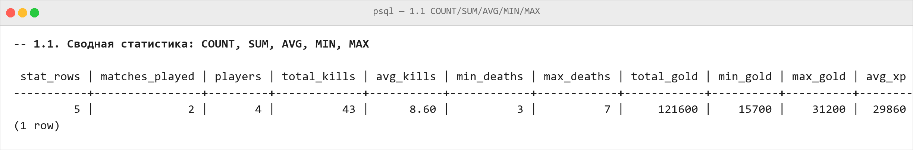
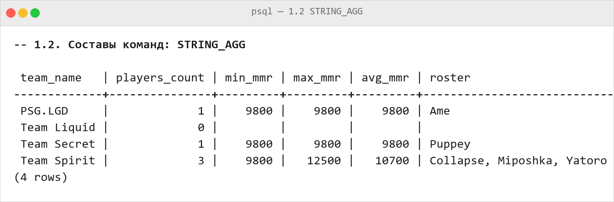
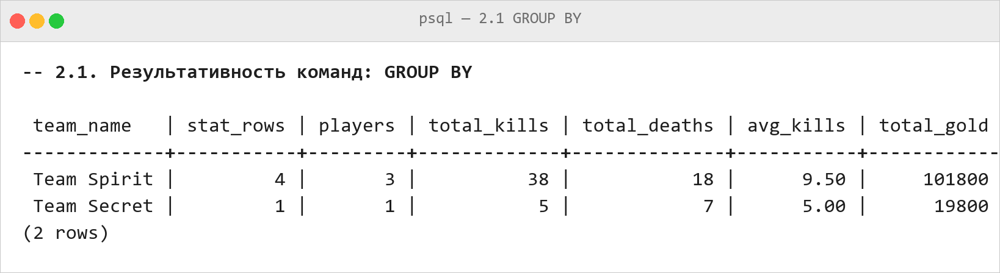
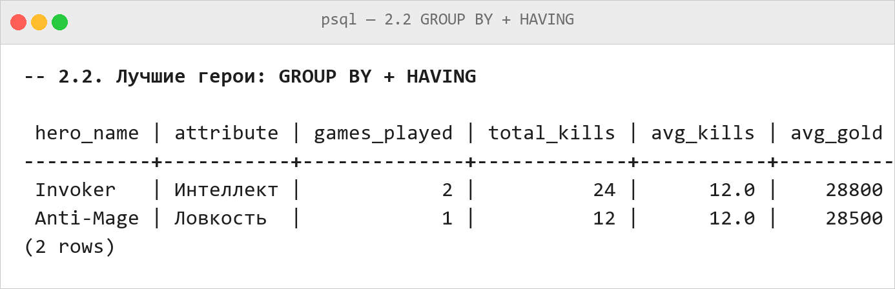
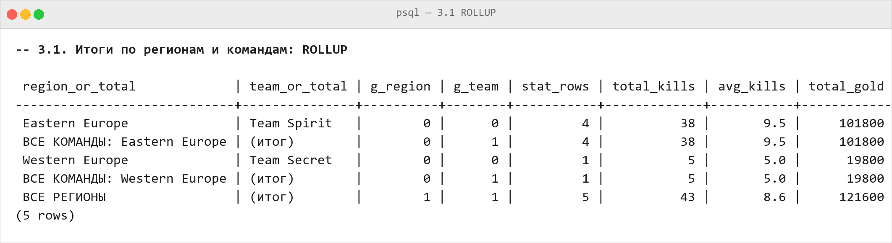
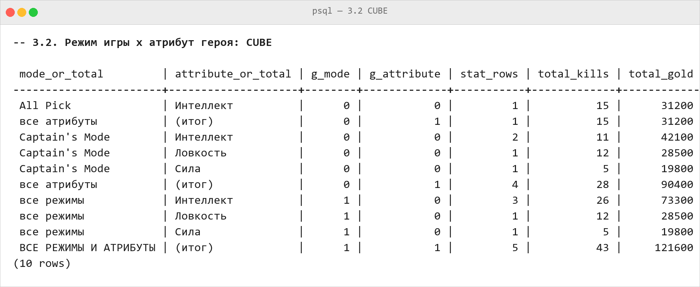
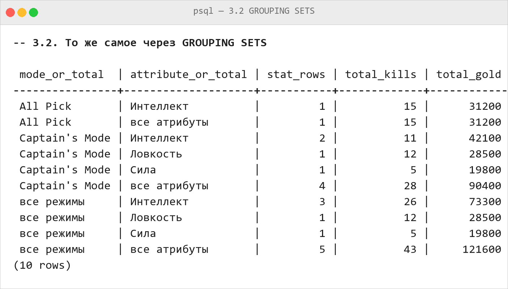
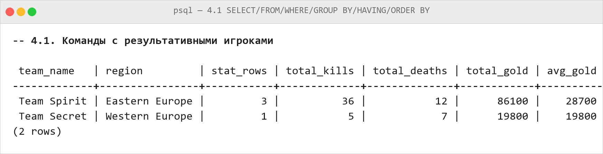
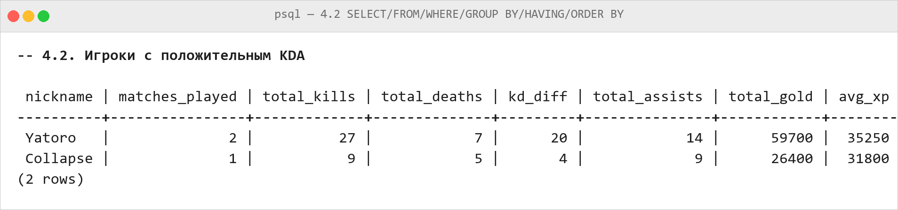

# Домашняя работа 5 — Агрегатные функции и группировка

**Предметная область:** Dota 2  
**Схема данных:** `nf` — нормализованная схема из HW3 (14 таблиц)  
**СУБД:** PostgreSQL 18

Запросы выполняются на данных, перенесённых из HW2 скриптом
`HW3/migrate_to_nf.sql`: 4 команды, 5 игроков, 5 героев, 4 матча,
5 записей статистики игроков и 5 записей инвентаря.
Все результаты ниже — реальный вывод PostgreSQL на этих данных.

## Подготовка

Перед запросами нужно загрузить схему и данные предыдущих работ:

```sql
SET search_path TO nf, public;
```

Порядок запуска скриптов:

```sql
\i HW2/create_tables.sql
\i HW2/alter_tables.sql
\i HW2/insert_data.sql
\i HW2/update_data.sql
\i HW3/normalized_schema.sql
\i HW3/migrate_to_nf.sql
\i HW5/queries.sql
```

Все девять запросов одной папки продублированы в файле
[`HW5/queries.sql`](queries.sql), текстовый вывод psql — в
[`HW5/output/psql_output.txt`](output/psql_output.txt).

## 1. Агрегатные функции: COUNT(), SUM(), AVG(), MIN(), MAX(), STRING_AGG()

Агрегатная функция сворачивает набор строк в одно значение:
`COUNT()` считает строки, `SUM()` складывает числа, `AVG()` усредняет,
`MIN()` и `MAX()` находят крайние значения, `STRING_AGG()` склеивает
текстовые значения в одну строку через разделитель. Без `GROUP BY`
функции применяются ко всей таблице сразу.

### 1.1. Сводная статистика по матчам — COUNT, SUM, AVG, MIN, MAX

**Что хотим получить**

Одной строкой: сколько записей статистики накопилось, в скольких разных матчах и сколькими разными игроками они сделаны, суммарные и средние убийства, а также минимальные и максимальные значения смертей и заработанного золота и средний опыт за игру.

```sql
SELECT count(*)                    AS stat_rows,
       count(DISTINCT s.match_id)  AS matches_played,
       count(DISTINCT s.player_id) AS players,
       sum(s.kills)                AS total_kills,
       round(avg(s.kills), 2)      AS avg_kills,
       min(s.deaths)               AS min_deaths,
       max(s.deaths)               AS max_deaths,
       sum(s.gold_earned)          AS total_gold,
       min(s.gold_earned)          AS min_gold,
       max(s.gold_earned)          AS max_gold,
       round(avg(s.total_xp))      AS avg_xp
FROM nf.PlayerMatchStats s;
```

**Результат выполнения запроса**



| stat_rows | matches_played | players | total_kills | avg_kills | min_deaths | max_deaths | total_gold | min_gold | max_gold | avg_xp |
|---|---|---|---|---|---|---|---|---|---|---|
| 5 | 2 | 4 | 43 | 8.60 | 3 | 7 | 121600 | 15700 | 31200 | 29860 |

Всего в таблице `nf.PlayerMatchStats` 5 записей (43 убийства), относящиеся к 2 матчам и 4 игрокам: среднее равно 43 / 5 = 8.60 убийства за игру, меньше всего золота набрал Miposhka на Crystal Maiden (15700), больше всего — Yatoro на Invoker (31200). Значения `min_gold`, `max_gold` и `avg_xp` посчитаны функциями `MIN()`, `MAX()` и `AVG()` по столбцу золота и опыта.

### 1.2. Составы команд одной строкой — STRING_AGG

**Что хотим получить**

По каждой команде: сколько игроков записано, минимальный, максимальный и средний MMR, и весь состав команды, склеенный в одну строку через `STRING_AGG` с разделителем `', '` и с сортировкой ников.

```sql
SELECT t.name                                            AS team_name,
       count(p.player_id)                                AS players_count,
       min(p.mmr)                                        AS min_mmr,
       max(p.mmr)                                        AS max_mmr,
       round(avg(p.mmr))                                 AS avg_mmr,
       string_agg(p.nickname, ', ' ORDER BY p.nickname)  AS roster
FROM nf.Teams t
LEFT JOIN nf.Players p ON p.team_id = t.team_id
GROUP BY t.team_id, t.name
ORDER BY t.name;
```

**Результат выполнения запроса**



| team_name | players_count | min_mmr | max_mmr | avg_mmr | roster |
|---|---|---|---|---|---|
| PSG.LGD | 1 | 9800 | 9800 | 9800 | Ame |
| Team Liquid | 0 | NULL | NULL | NULL | NULL |
| Team Secret | 1 | 9800 | 9800 | 9800 | Puppey |
| Team Spirit | 3 | 9800 | 12500 | 10700 | Collapse, Miposhka, Yatoro |

`STRING_AGG(p.nickname, ', ' ORDER BY p.nickname)` возвращает не набор строк, а одно значение — строку `Collapse, Miposhka, Yatoro`. Команда `Team Liquid` осталась в результате благодаря `LEFT JOIN`, но `count()` вернул 0, поэтому MMR и состав равны `NULL` — psql печатает `NULL` пустой ячейкой. У Team Spirit минимальный MMR 9800, максимальный 12500 (Yatoro), средний 10700.

## 2. GROUP BY и HAVING

`GROUP BY` разбивает строки на группы по значениям указанных столбцов,
и агрегатные функции вычисляются отдельно для каждой группы. `HAVING`
фильтрует уже готовые группы — в отличие от `WHERE`, который отбрасывает
отдельные строки до группировки.

### 2.1. Результативность команд — GROUP BY

**Что хотим получить**

Сколько строк статистики записано за каждую команду, сколько разных игроков за неё играло, суммарные убийства и смерти, средние убийства и суммарное золото. Группы отсортированы по сумме убийств.

```sql
SELECT t.name                        AS team_name,
       count(*)                      AS stat_rows,
       count(DISTINCT p.player_id)   AS players,
       sum(s.kills)                  AS total_kills,
       sum(s.deaths)                 AS total_deaths,
       round(avg(s.kills), 2)        AS avg_kills,
       sum(s.gold_earned)            AS total_gold
FROM nf.PlayerMatchStats s
JOIN nf.Players p ON p.player_id = s.player_id
JOIN nf.Teams   t ON t.team_id   = p.team_id
GROUP BY t.team_id, t.name
ORDER BY total_kills DESC, t.name;
```

**Результат выполнения запроса**



| team_name | stat_rows | players | total_kills | total_deaths | avg_kills | total_gold |
|---|---|---|---|---|---|---|
| Team Spirit | 4 | 3 | 38 | 18 | 9.50 | 101800 |
| Team Secret | 1 | 1 | 5 | 7 | 5.00 | 19800 |

За Team Spirit — 4 строки статистики (Yatoro сыграл два раза, Collapse и Miposhka по одному) и 38 убийств, за Team Secret — одна строка Puppey и 5 убийств. PSG.LGD в результат не попала: у Ame в базе нет ни одной строки статистики, а соединение внутреннее (`JOIN`).

### 2.2. Лучшие герои — GROUP BY + HAVING

**Что хотим получить**

Только тех героев, у которых среднее число убийств за игру не меньше 8. Такое условие можно задать только через `HAVING`: в `WHERE` агрегатные функции не доступны.

```sql
SELECT h.name                    AS hero_name,
       a.attribute_name          AS attribute,
       count(*)                  AS games_played,
       sum(s.kills)              AS total_kills,
       round(avg(s.kills), 1)    AS avg_kills,
       round(avg(s.gold_earned)) AS avg_gold
FROM nf.PlayerMatchStats s
JOIN nf.Heroes     h ON h.hero_id        = s.hero_id
JOIN nf.Attributes a ON a.attribute_code = h.primary_attribute
GROUP BY h.hero_id, h.name, a.attribute_name
HAVING round(avg(s.kills), 1) >= 8
ORDER BY avg_kills DESC, total_kills DESC, h.name;
```

**Результат выполнения запроса**



| hero_name | attribute | games_played | total_kills | avg_kills | avg_gold |
|---|---|---|---|---|---|
| Invoker | Интеллект | 2 | 24 | 12.0 | 28800 |
| Anti-Mage | Ловкость | 1 | 12 | 12.0 | 28500 |

`HAVING round(avg(s.kills), 1) >= 8` оставил двух героев: Invoker (2 игры, 24 убийства, в среднем 12.0) и Anti-Mage (1 игра, 12 убийств, тоже 12.0). Crystal Maiden (2 убийства) и Pudge (5 убийств) отсеялись, хотя их строки статистики участвовали в группировке и подсчёте средних.

## 3. GROUPING SETS, ROLLUP и CUBE

Это расширения `GROUP BY`, которые строят несколько наборов группировок
одновременно: `ROLLUP` — «сверху вниз» (итог по колонке, потом по паре, …),
`CUBE` — все комбинации измерений плюс итоги по каждому, а `GROUPING SETS` —
общий случай, из которого `ROLLUP` и `CUBE` являются сокращениями.
Функция `GROUPING()` возвращает `1`, если значение в строке получено
как итог, а не как реальное значение, — по ней строки-итоги удобно
подписывать осмысленными словами.

### 3.1. Итоги по регионам и командам — ROLLUP

**Что хотим получить**

Статистику игроков в разрезе регионов и команд с двумя уровнями итогов: по каждой команде, по каждому региону и общий итог по всем регионам сразу.

```sql
SELECT CASE
           WHEN grouping(r.region_name) = 1
            AND grouping(t.name) = 1 THEN 'ВСЕ РЕГИОНЫ'
           WHEN grouping(t.name) = 1
                THEN 'ВСЕ КОМАНДЫ: ' || r.region_name
           ELSE r.region_name
       END                          AS region_or_total,
       CASE WHEN grouping(t.name) = 1
            THEN '(итог)' ELSE t.name END AS team_or_total,
       grouping(r.region_name)     AS g_region,
       grouping(t.name)            AS g_team,
       count(*)                    AS stat_rows,
       sum(s.kills)                AS total_kills,
       round(avg(s.kills), 1)      AS avg_kills,
       sum(s.gold_earned)          AS total_gold
FROM nf.PlayerMatchStats s
JOIN nf.Players p ON p.player_id = s.player_id
JOIN nf.Teams   t ON t.team_id   = p.team_id
JOIN nf.Regions r ON r.region_id = t.region_id
GROUP BY ROLLUP (r.region_name, t.name)
ORDER BY grouping(r.region_name), r.region_name NULLS LAST,
         grouping(t.name),        t.name NULLS LAST;
```

**Результат выполнения запроса**



| region_or_total | team_or_total | g_region | g_team | stat_rows | total_kills | avg_kills | total_gold |
|---|---|---|---|---|---|---|---|
| Eastern Europe | Team Spirit | 0 | 0 | 4 | 38 | 9.5 | 101800 |
| ВСЕ КОМАНДЫ: Eastern Europe | (итог) | 0 | 1 | 4 | 38 | 9.5 | 101800 |
| Western Europe | Team Secret | 0 | 0 | 1 | 5 | 5.0 | 19800 |
| ВСЕ КОМАНДЫ: Western Europe | (итог) | 0 | 1 | 1 | 5 | 5.0 | 19800 |
| ВСЕ РЕГИОНЫ | (итог) | 1 | 1 | 5 | 43 | 8.6 | 121600 |

`GROUP BY ROLLUP (r.region_name, t.name)` даёт пять строк: две по командам, две итоговые по регионам (`g_team = 1`) и общий итог (`g_region = 1`, `g_team = 1`), где суммируются все 5 записей — 43 убийства и 121600 золота. Общий итог совпадает с суммой двух региональных (101800 + 19800 = 121600), потому что третий регион — China — в статистике не представлен: за PSG.LGD игрок Ame не играл.

### 3.2. Режим игры × атрибут героя — CUBE

**Что хотим получить**

Пересечение двух измерений — режим игры и атрибут героя, — с итогами по каждому измерению и общим итогом.

```sql
SELECT CASE
           WHEN grouping(gm.mode_name) = 1
            AND grouping(a.attribute_name) = 1
                THEN 'ВСЕ РЕЖИМЫ И АТРИБУТЫ'
           WHEN grouping(a.attribute_name) = 1 THEN 'все атрибуты'
           WHEN grouping(gm.mode_name) = 1    THEN 'все режимы'
           ELSE gm.mode_name
       END                                 AS mode_or_total,
       CASE WHEN grouping(a.attribute_name) = 1
            THEN '(итог)' ELSE a.attribute_name END AS attribute_or_total,
       grouping(gm.mode_name)              AS g_mode,
       grouping(a.attribute_name)          AS g_attribute,
       count(*)                            AS stat_rows,
       sum(s.kills)                        AS total_kills,
       sum(s.gold_earned)                  AS total_gold
FROM nf.PlayerMatchStats s
JOIN nf.Matches   m  ON m.match_id      = s.match_id
JOIN nf.GameModes gm ON gm.game_mode_id = m.game_mode_id
JOIN nf.Heroes    h  ON h.hero_id       = s.hero_id
JOIN nf.Attributes a  ON a.attribute_code = h.primary_attribute
GROUP BY CUBE (gm.mode_name, a.attribute_name)
ORDER BY grouping(gm.mode_name),    gm.mode_name NULLS LAST,
         grouping(a.attribute_name), a.attribute_name NULLS LAST;
```

**Результат выполнения запроса**



| mode_or_total | attribute_or_total | g_mode | g_attribute | stat_rows | total_kills | total_gold |
|---|---|---|---|---|---|---|
| All Pick | Интеллект | 0 | 0 | 1 | 15 | 31200 |
| все атрибуты | (итог) | 0 | 1 | 1 | 15 | 31200 |
| Captain's Mode | Интеллект | 0 | 0 | 2 | 11 | 42100 |
| Captain's Mode | Ловкость | 0 | 0 | 1 | 12 | 28500 |
| Captain's Mode | Сила | 0 | 0 | 1 | 5 | 19800 |
| все атрибуты | (итог) | 0 | 1 | 4 | 28 | 90400 |
| все режимы | Интеллект | 1 | 0 | 3 | 26 | 73300 |
| все режимы | Ловкость | 1 | 0 | 1 | 12 | 28500 |
| все режимы | Сила | 1 | 0 | 1 | 5 | 19800 |
| ВСЕ РЕЖИМЫ И АТРИБУТЫ | (итог) | 1 | 1 | 5 | 43 | 121600 |

Всего 10 строк: 4 комбинации режим × атрибут (комбинация `All Pick` × `Ловкость` не появилась, таких записей нет), 2 итога по режимам, 3 итога по атрибутам и 1 общий итог. `CUBE (gm.mode_name, a.attribute_name)` — это сокращение для `GROUPING SETS ((gm.mode_name, a.attribute_name), (gm.mode_name), (a.attribute_name), ())`, поэтому следующий вариант даёт идентичный результат:

**Что хотим получить**

Тот же отчёт, но набор группировок выписан явно через `GROUPING SETS`, без сокращений `CUBE` и `ROLLUP`. (Вариант заменяет CUBE на его развёрнутую запись — набор группировок остаётся тем же.)

```sql
SELECT COALESCE(gm.mode_name, 'все режимы')       AS mode_or_total,
       COALESCE(a.attribute_name, 'все атрибуты') AS attribute_or_total,
       count(*)      AS stat_rows,
       sum(s.kills)  AS total_kills,
       sum(s.gold_earned) AS total_gold
FROM nf.PlayerMatchStats s
JOIN nf.Matches   m  ON m.match_id      = s.match_id
JOIN nf.GameModes gm ON gm.game_mode_id = m.game_mode_id
JOIN nf.Heroes    h  ON h.hero_id       = s.hero_id
JOIN nf.Attributes a  ON a.attribute_code = h.primary_attribute
GROUP BY GROUPING SETS (
    (gm.mode_name, a.attribute_name),
    (gm.mode_name),
    (a.attribute_name),
    ()
)
ORDER BY 1, 2;
```

**Результат выполнения запроса**



| mode_or_total | attribute_or_total | stat_rows | total_kills | total_gold |
|---|---|---|---|---|
| All Pick | Интеллект | 1 | 15 | 31200 |
| All Pick | все атрибуты | 1 | 15 | 31200 |
| Captain's Mode | Интеллект | 2 | 11 | 42100 |
| Captain's Mode | Ловкость | 1 | 12 | 28500 |
| Captain's Mode | Сила | 1 | 5 | 19800 |
| Captain's Mode | все атрибуты | 4 | 28 | 90400 |
| все режимы | Интеллект | 3 | 26 | 73300 |
| все режимы | Ловкость | 1 | 12 | 28500 |
| все режимы | Сила | 1 | 5 | 19800 |
| все режимы | все атрибуты | 5 | 43 | 121600 |

Результат совпадает с предыдущим запросом построчно — это одинаковые наборы группировок, просто записанные разными средствами.

## 4. SELECT, FROM, WHERE, GROUP BY, HAVING, ORDER BY

Полный запрос со всеми клаузами: `SELECT` перечисляет результат,
`FROM` задаёт таблицы, `WHERE` фильтрует строки, `GROUP BY` собирает
группы, `HAVING` фильтрует группы, `ORDER BY` задаёт порядок вывода.
Порядок выполнения в СУБД именно такой, независимо от порядка
написания: `FROM` → `WHERE` → `GROUP BY` → `HAVING` → `SELECT` → `ORDER BY`.

### 4.1. Команды с результативными игроками

**Что хотим получить**

Команды, чьи игроки в отдельных играх набирали 5 и больше убийств, с суммарными убийствами, смертями и золотом. `WHERE` отсекает слабые записи статистики, `HAVING` — группы, не достигшие порога, `ORDER BY` сортирует команды по золоту.

```sql
SELECT t.name                    AS team_name,
       r.region_name             AS region,
       count(*)                  AS stat_rows,
       sum(s.kills)              AS total_kills,
       sum(s.deaths)             AS total_deaths,
       sum(s.gold_earned)        AS total_gold,
       round(avg(s.gold_earned)) AS avg_gold
FROM nf.Teams t
JOIN nf.Regions r ON r.region_id = t.region_id
JOIN nf.Players p ON p.team_id   = t.team_id
JOIN nf.PlayerMatchStats s ON s.player_id = p.player_id
WHERE s.kills >= 5
GROUP BY t.team_id, t.name, r.region_name
HAVING sum(s.kills) >= 5
ORDER BY total_gold DESC, t.name;
```

**Результат выполнения запроса**



| team_name | region | stat_rows | total_kills | total_deaths | total_gold | avg_gold |
|---|---|---|---|---|---|---|
| Team Spirit | Eastern Europe | 3 | 36 | 12 | 86100 | 28700 |
| Team Secret | Western Europe | 1 | 5 | 7 | 19800 | 19800 |

`WHERE s.kills >= 5` убрал запись Miposhka (2 убийства), поэтому у Team Spirit осталось 3 строки вместо 4, а сумма убийств 36 вместо 38. `HAVING sum(s.kills) >= 5` проверяет уже готовые группы и пропускает обе команды.

### 4.2. Игроки с положительным KDA

**Что хотим получить**

Рейтинг игроков, у которых в каждой игре число убийств не меньше числа смертей, с разницей K/D (`kd_diff`), суммарными ассистами, золотом и средним опытом.

```sql
SELECT p.nickname                       AS nickname,
       count(*)                         AS matches_played,
       sum(s.kills)                     AS total_kills,
       sum(s.deaths)                    AS total_deaths,
       sum(s.kills) - sum(s.deaths)     AS kd_diff,
       sum(s.assists)                   AS total_assists,
       sum(s.gold_earned)               AS total_gold,
       round(avg(s.total_xp))           AS avg_xp
FROM nf.PlayerMatchStats s
JOIN nf.Players p ON p.player_id = s.player_id
WHERE s.kills >= s.deaths
GROUP BY p.player_id, p.nickname
HAVING sum(s.gold_earned) >= 25000
ORDER BY kd_diff DESC, total_gold DESC, p.nickname;
```

**Результат выполнения запроса**



| nickname | matches_played | total_kills | total_deaths | kd_diff | total_assists | total_gold | avg_xp |
|---|---|---|---|---|---|---|---|
| Yatoro | 2 | 27 | 7 | 20 | 14 | 59700 | 35250 |
| Collapse | 1 | 9 | 5 | 4 | 9 | 26400 | 31800 |

`WHERE s.kills >= s.deaths` отбрасывает Miposhka (2 против 6) и Puppey (5 против 7). `HAVING sum(s.gold_earned) >= 25000` оставляет Yatoro (2 матча, 27 убийств, 7 смертей, разница +20) и Collapse (1 матч, 9 и 5, разница +4). Сортировка идёт по `kd_diff` — сначала лучшая разница, затем по сумме золота.

## Итог

| Вид из задания | Запросы | Что использовано |
|---|---|---|
| Агрегатные функции | 1.1, 1.2 | `COUNT`, `SUM`, `AVG`, `MIN`, `MAX`, `STRING_AGG`, работа без `GROUP BY` |
| `GROUP BY`, `HAVING` | 2.1, 2.2 | группировка по команде и по герою, фильтр групп через `HAVING` |
| `GROUPING SETS`, `ROLLUP`, `CUBE` | 3.1, 3.2 | `ROLLUP` для итогов сверху вниз, `CUBE` для всех комбинаций, тот же набор группировок через `GROUPING SETS`, разметка итогов через `GROUPING()` |
| `SELECT`, `FROM`, `WHERE`, `GROUP BY`, `HAVING`, `ORDER BY` | 4.1, 4.2 | все клаузы полного запроса |

### Что стоит запомнить

- агрегатная функция без `GROUP BY` сворачивает **всю** таблицу в одну строку;
- `WHERE` отсекает строки, `HAVING` — группы, и в `HAVING` можно
  использовать агрегатные функции;
- `STRING_AGG` превращает столбец строк в одно строковое значение;
- `ROLLUP(a, b)` = `GROUPING SETS ((a, b), (a), ())`,
  `CUBE(a, b)` = `GROUPING SETS ((a, b), (a), (b), ())`;
- в строках-итогах вместо значения измерения стоит `NULL`, а
  `GROUPING(столбец)` возвращает для них `1`;
- `ORDER BY` для результата группировки лучше начинать с
  `grouping(...)`, иначе итоговые строки перемешиваются с обычными.
