# Домашняя работа 6 — CTE, операции над множествами и оконные функции

**Предметная область:** Dota 2  
**Данные:** схема `nf` из HW3 + дополнительные строки из `cte_demo_data.sql`  
**Проверено:** PostgreSQL 16.15.

## Условие и состав работы

Последний слайд (65) презентации «09. CTE, Оконные функции» требует:

| Тип | Число запросов |
|---|---:|
| CTE (включая один рекурсивный пример) | 3 |
| UNION / INTERSECT / EXCEPT | 1 / 1 / 1 |
| PARTITION BY | 2 |
| PARTITION BY + ORDER BY | 2 |
| ROWS / RANGE | 2 / 2 |
| ROW_NUMBER / RANK / DENSE_RANK | 1 / 1 / 1 |
| LAG / LEAD / FIRST_VALUE / LAST_VALUE | 1 / 1 / 1 / 1 |
| **Итого** | **21** |

Под «все виды» взяты функции, перечисленные на слайдах 56–58 и 62.
Дополнительные CTE и рамки внутри других разделов не заменяют отдельные запросы.
На последнем слайде указан срок 13.11.2025, хотя титул относится к 2026/2027;
условие сохранено без предположений об актуальном сроке сдачи.

## Запуск в pgAdmin

1. Выбрать базу со схемой `nf`, на которой выполнялась HW5/первая часть HW6.
2. Открыть и выполнить [cte_demo_data.sql](cte_demo_data.sql) целиком.
   Он добавляет одну команду, четырёх игроков, четыре матча, восемь строк участников
   матчей и восемь строк статистики. Исходные строки не обновляет и не удаляет.
   Скрипт выполняется в транзакции и допускает повторный запуск без дублирования строк.
3. Открыть [cte_queries.sql](cte_queries.sql). Выделять запросы по номерам и выполнять,
   сравнивая с результатами ниже. Все 21 результата непустые после добавления данных.
4. Для повторной проверки запускать только SELECT из `cte_queries.sql`.
   Изображения ниже показывают таблицы результатов локальной проверки.
   Снимки из pgAdmin можно добавить после ручного прогона.

Файлы не содержат `\i` или других команд psql. Все таблицы указаны с `nf.`.
Вывод локального запуска: [output/cte_psql_output.txt](output/cte_psql_output.txt).
Это отдельная часть HW6: [sub_queries.md](sub_queries.md) и [queries.sql](queries.sql)
с предыдущей работой сохранены. После добавления новых игроков их результаты
могут измениться, поскольку изменилась база, а не SQL предыдущей части.

Если `nf` отсутствует, сначала в отдельной учебной базе последовательно выполнить
HW2/create_tables.sql, alter_tables.sql, insert_data.sql, update_data.sql,
затем HW3/normalized_schema.sql и migrate_to_nf.sql из databases-course.
Перед HW2 установить `SET search_path TO public;`. Эти старые скрипты пересоздают
объекты; для уже заполненной базы повторно запускать их не нужно.

### Дополнительные данные

В команду `HW6_Academy` добавлены игроки `HW6_Atlas` (MMR 11000),
`HW6_Boreal` (10000), `HW6_Cinder` (10000), `HW6_Delta` (9000).
Два одинаковых MMR показывают различие RANK и DENSE_RANK.

| Дата | Длительность матча (сек.) | Убийства HW6_Atlas | Победа HW6_Academy |
|---|---:|---:|---|
| 2026-11-01 | 1801 | 10 | да |
| 2026-11-01 | 1802 | 14 | нет |
| 2026-11-02 | 1803 | 6 | нет |
| 2026-11-04 | 1804 | 20 | да |

Два матча одной даты показывают группы равных значений ORDER BY (peers) для RANGE.
Пропуск 3 ноября отличает календарную рамку RANGE от числа строк ROWS.
HW6_Boreal имеет две записи статистики (8 и 12 убийств), HW6_Cinder — одну (8),
HW6_Delta — одну (3). Это демонстрационные данные, а не реальные матчи Dota 2.
Имена HW6_* и сочетания дат/длительностей из таблицы выделены для этой работы;
не следует заранее использовать их для других данных. Если строки с такими
именами уже вручную изменены, скрипт не перезаписывает их; результаты надо сверять.

Числовые ID не заданы вручную: связи находятся по именам и выделенным матчам.
Значения match_id в результатах могут отличаться в пользовательской БД.
Все примеры читают актуальные связи схемы nf. Ранее обнаруженная проблема
миграции предметов HW3 здесь не исправлялась; новые данные инвентарь не меняют.

## 1. CTE — 3 запроса

### 1.1. CTE — команды со средним MMR от 10000

**Задача:** Найти команды, у которых средний MMR игроков не меньше 10000.

```sql
WITH team_mmr AS (
    SELECT p.team_id, count(*) AS players_count, avg(p.mmr) AS avg_mmr
    FROM nf.Players p
    GROUP BY p.team_id
)
SELECT t.name AS team_name, tm.players_count, round(tm.avg_mmr, 2) AS avg_mmr
FROM team_mmr tm
JOIN nf.Teams t ON t.team_id = tm.team_id
WHERE tm.avg_mmr >= 10000
ORDER BY tm.avg_mmr DESC, t.name;
```

**Пояснение:** WITH задаёт именованный результат агрегации. Внешний запрос присоединяет название и фильтрует среднее без округления.

**Фактический результат:**

| team_name | players_count | avg_mmr |
| --- | --- | --- |
| Team Spirit | 3 | 10700.00 |
| HW6_Academy | 4 | 10000.00 |

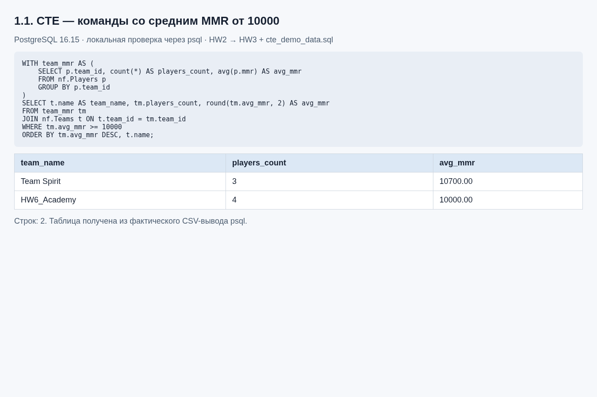

### 1.2. CTE — игроки выше средней суммы убийств

**Задача:** Найти игроков, сумма убийств которых больше средней суммы по игрокам с записанной статистикой.

```sql
WITH player_totals AS (
    SELECT s.player_id, sum(s.kills) AS total_kills
    FROM nf.PlayerMatchStats s
    GROUP BY s.player_id
), benchmark AS (
    SELECT avg(total_kills) AS avg_total FROM player_totals
)
SELECT p.nickname, pt.total_kills, round(b.avg_total, 2) AS avg_total
FROM player_totals pt
JOIN nf.Players p ON p.player_id = pt.player_id
CROSS JOIN benchmark b
WHERE pt.total_kills > b.avg_total
ORDER BY pt.total_kills DESC, p.nickname;
```

**Пояснение:** Первое CTE считает суммы по игрокам, второе использует первое и вычисляет среднее. Игроки без статистики в базу сравнения не включаются.

**Фактический результат:**

| nickname | total_kills | avg_total |
| --- | --- | --- |
| HW6_Atlas | 50 | 15.50 |
| Yatoro | 27 | 15.50 |
| HW6_Boreal | 20 | 15.50 |

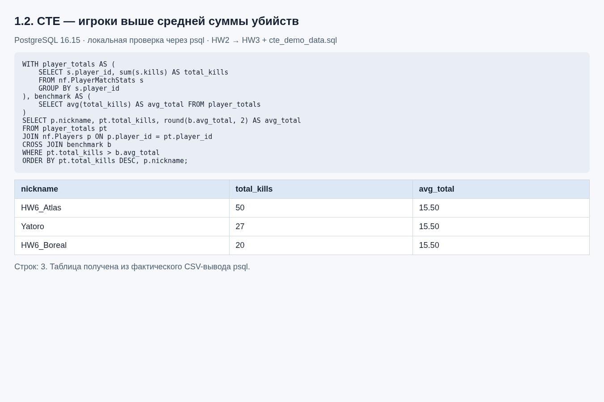

### 1.3. Рекурсивное CTE — связи команд через матчи

**Задача:** Найти команды, достижимые от HW6_Academy по цепочке общих матчей, и минимальное число переходов.

```sql
WITH RECURSIVE edges AS (
    SELECT DISTINCT a.team_id AS src, b.team_id AS dst
    FROM nf.MatchTeams a
    JOIN nf.MatchTeams b ON b.match_id = a.match_id AND b.team_id <> a.team_id
), paths AS (
    SELECT t.team_id, 0 AS hops, ARRAY[t.team_id] AS path
    FROM nf.Teams t
    WHERE t.name = 'HW6_Academy'
    UNION ALL
    SELECT e.dst, p.hops + 1, p.path || e.dst
    FROM paths p
    JOIN edges e ON e.src = p.team_id
    WHERE NOT (e.dst = ANY (p.path))
)
SELECT t.name AS team_name, min(p.hops) AS min_hops
FROM paths p
JOIN nf.Teams t ON t.team_id = p.team_id
WHERE p.hops > 0
GROUP BY t.team_id, t.name
ORDER BY min_hops, t.name;
```

**Пояснение:** edges строит неориентированный граф соперников. База рекурсии — Academy с глубиной 0. Рекурсивная часть идёт к соперникам, не посещая команду повторно в одном пути. Массив path предотвращает циклы; MIN выбирает кратчайшую длину среди простых путей. Это связь через матчи, а не число личных встреч и не иерархия команд.

**Фактический результат:**

| team_name | min_hops |
| --- | --- |
| Team Spirit | 1 |
| PSG.LGD | 2 |
| Team Secret | 2 |
| Team Liquid | 3 |

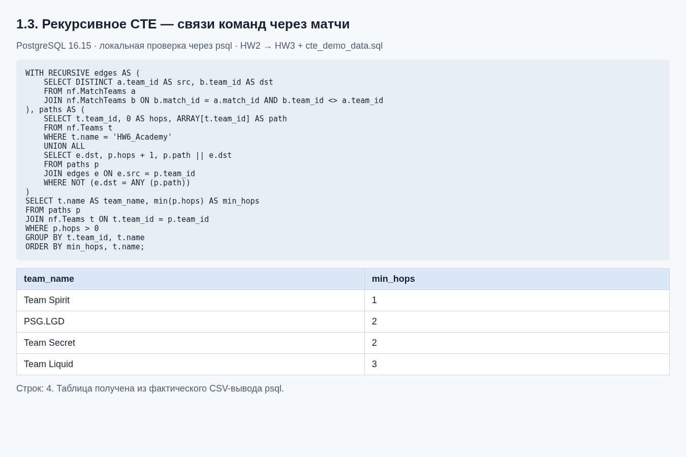

## 2. UNION, INTERSECT, EXCEPT — по одному запросу

### 2.1. UNION — регионы команд или игроков

**Задача:** Вывести уникальные названия регионов, используемых командами или игроками.

```sql
SELECT r.region_name
FROM nf.Teams t
JOIN nf.Regions r ON r.region_id = t.region_id
UNION
SELECT r.region_name
FROM nf.Players p
JOIN nf.Regions r ON r.region_id = p.region_id
ORDER BY region_name;
```

**Пояснение:** UNION объединяет совместимые столбцы и удаляет повторы между и внутри выборок. JOIN со справочником исключает отсутствующие регионы.

**Фактический результат:**

| region_name |
| --- |
| China |
| Eastern Europe |
| Western Europe |

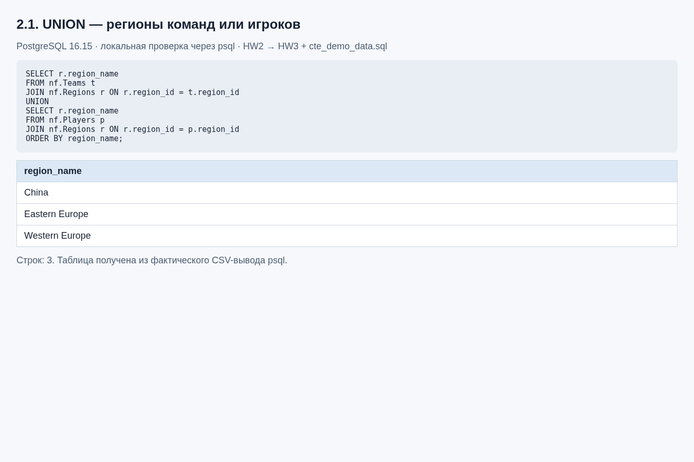

### 2.2. INTERSECT — игроки со статистикой и покупками

**Задача:** Найти игроков, которые присутствуют и в индивидуальной статистике, и в инвентаре.

```sql
SELECT p.nickname
FROM nf.Players p
JOIN nf.PlayerMatchStats s ON s.player_id = p.player_id
INTERSECT
SELECT p.nickname
FROM nf.Players p
JOIN nf.PlayerInventory pi ON pi.player_id = p.player_id
ORDER BY nickname;
```

**Пояснение:** INTERSECT возвращает общие строки двух наборов. Пересечение по игрокам не требует, чтобы статистика и покупка относились к одному конкретному матчу.

**Фактический результат:**

| nickname |
| --- |
| Collapse |
| Puppey |
| Yatoro |

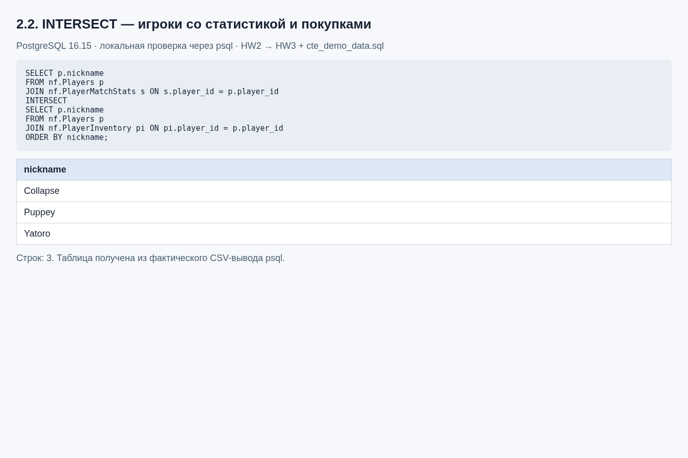

### 2.3. EXCEPT — игроки без статистики

**Задача:** Найти зарегистрированных игроков, для которых нет ни одной записи статистики.

```sql
SELECT p.nickname FROM nf.Players p
EXCEPT
SELECT p.nickname
FROM nf.Players p
JOIN nf.PlayerMatchStats s ON s.player_id = p.player_id
ORDER BY nickname;
```

**Пояснение:** Из набора всех игроков вычитается набор игроков с записанными выступлениями. Отсутствие статистики не означает отсутствие участия в реальных матчах.

**Фактический результат:**

| nickname |
| --- |
| Ame |

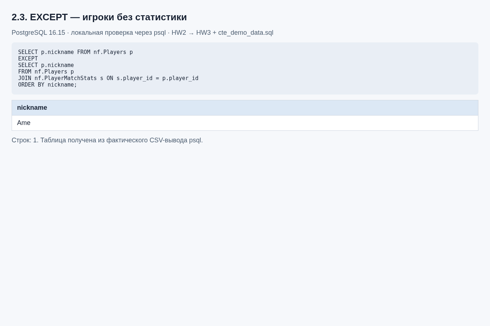

## 3. PARTITION BY — 2 запроса

### 3.1. PARTITION BY — средний MMR команды

**Задача:** Показать каждого игрока, размер его состава и средний MMR команды без сворачивания строк.

```sql
SELECT p.nickname, t.name AS team_name, p.mmr,
       count(*) OVER (PARTITION BY p.team_id) AS players_count,
       round(avg(p.mmr) OVER (PARTITION BY p.team_id), 2) AS team_avg_mmr
FROM nf.Players p
LEFT JOIN nf.Teams t ON t.team_id = p.team_id
ORDER BY t.name NULLS LAST, p.nickname;
```

**Пояснение:** Окна разделены по team_id и не содержат ORDER BY, поэтому COUNT и AVG видят всю партицию. На этих данных все игроки имеют команды. При NULL team_id игроки без команды образовали бы общую отдельную партицию.

**Фактический результат:**

| nickname | team_name | mmr | players_count | team_avg_mmr |
| --- | --- | --- | --- | --- |
| HW6_Atlas | HW6_Academy | 11000 | 4 | 10000.00 |
| HW6_Boreal | HW6_Academy | 10000 | 4 | 10000.00 |
| HW6_Cinder | HW6_Academy | 10000 | 4 | 10000.00 |
| HW6_Delta | HW6_Academy | 9000 | 4 | 10000.00 |
| Ame | PSG.LGD | 9800 | 1 | 9800.00 |
| Puppey | Team Secret | 9800 | 1 | 9800.00 |
| Collapse | Team Spirit | 9800 | 3 | 10700.00 |
| Miposhka | Team Spirit | 9800 | 3 | 10700.00 |
| Yatoro | Team Spirit | 12500 | 3 | 10700.00 |

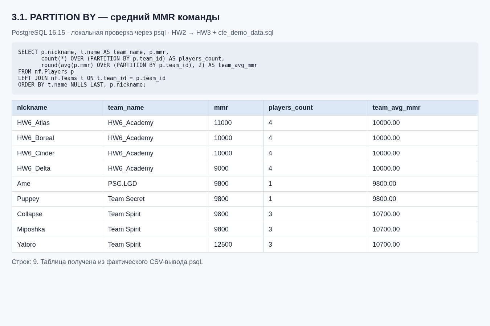

### 3.2. PARTITION BY — доля убийств выступления

**Задача:** Для каждой записи статистики показать сумму убийств игрока и долю текущего выступления в этой сумме.

```sql
SELECT p.nickname, s.match_id, s.kills,
       sum(s.kills) OVER (PARTITION BY s.player_id) AS player_total_kills,
       round(100.0 * s.kills /
             nullif(sum(s.kills) OVER (PARTITION BY s.player_id), 0), 2) AS kill_share_pct
FROM nf.PlayerMatchStats s
JOIN nf.Players p ON p.player_id = s.player_id
ORDER BY p.nickname, s.match_id;
```

**Пояснение:** SUM OVER сохраняет каждую строку. Умножение на 100.0 исключает целочисленное деление; NULLIF защищает от деления на ноль, если у игрока во всех выступлениях 0 убийств.

**Фактический результат:**

| nickname | match_id | kills | player_total_kills | kill_share_pct |
| --- | --- | --- | --- | --- |
| Collapse | 1 | 9 | 9 | 100.00 |
| HW6_Atlas | 5 | 14 | 50 | 28.00 |
| HW6_Atlas | 6 | 20 | 50 | 40.00 |
| HW6_Atlas | 7 | 6 | 50 | 12.00 |
| HW6_Atlas | 8 | 10 | 50 | 20.00 |
| HW6_Boreal | 7 | 12 | 20 | 60.00 |
| HW6_Boreal | 8 | 8 | 20 | 40.00 |
| HW6_Cinder | 8 | 8 | 8 | 100.00 |
| HW6_Delta | 8 | 3 | 3 | 100.00 |
| Miposhka | 1 | 2 | 2 | 100.00 |
| Puppey | 1 | 5 | 5 | 100.00 |
| Yatoro | 1 | 12 | 27 | 44.44 |
| Yatoro | 2 | 15 | 27 | 55.56 |

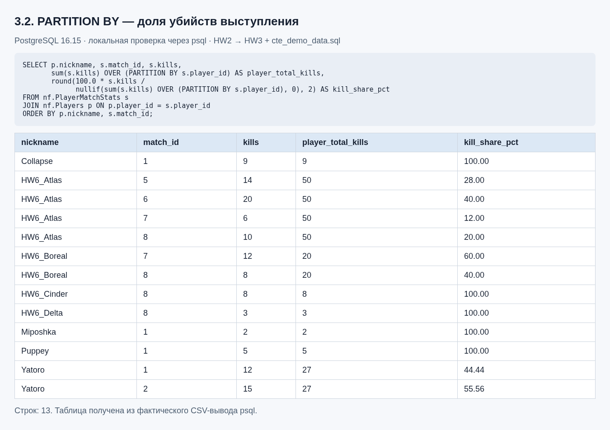

## 4. PARTITION BY + ORDER BY — 2 запроса

### 4.1. PARTITION BY + ORDER BY — накопленные убийства

**Задача:** Показать, как накапливаются убийства HW6_Atlas и HW6_Boreal по их матчам.

```sql
SELECT p.nickname, m.match_date, m.duration_sec, s.kills,
       sum(s.kills) OVER (
           PARTITION BY s.player_id
           ORDER BY m.match_date, m.duration_sec, m.match_id
           ROWS BETWEEN UNBOUNDED PRECEDING AND CURRENT ROW
       ) AS cumulative_kills
FROM nf.PlayerMatchStats s
JOIN nf.Players p ON p.player_id = s.player_id
JOIN nf.Matches m ON m.match_id = s.match_id
WHERE p.nickname IN ('HW6_Atlas', 'HW6_Boreal')
ORDER BY p.nickname, m.match_date, m.duration_sec, m.match_id;
```

**Пояснение:** PARTITION BY считает каждого игрока отдельно, ORDER BY задаёт хронологию. Длительность и match_id разрешают совпадения дат; рамка ROWS явно задаёт накопление по строкам.

**Фактический результат:**

| nickname | match_date | duration_sec | kills | cumulative_kills |
| --- | --- | --- | --- | --- |
| HW6_Atlas | 2026-11-01 | 1801 | 10 | 10 |
| HW6_Atlas | 2026-11-01 | 1802 | 14 | 24 |
| HW6_Atlas | 2026-11-02 | 1803 | 6 | 30 |
| HW6_Atlas | 2026-11-04 | 1804 | 20 | 50 |
| HW6_Boreal | 2026-11-01 | 1801 | 8 | 8 |
| HW6_Boreal | 2026-11-02 | 1803 | 12 | 20 |

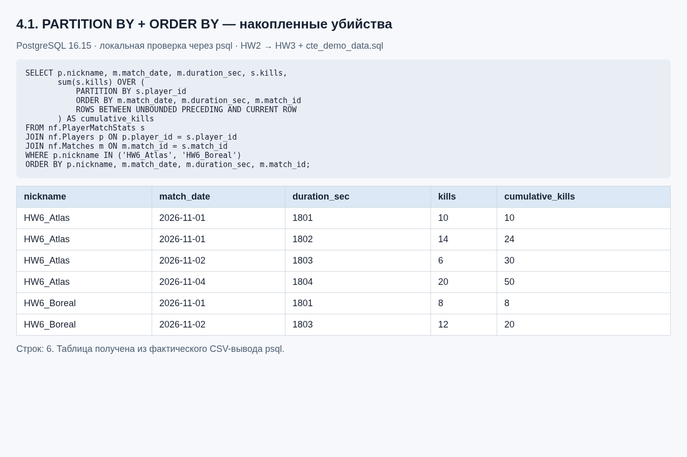

### 4.2. PARTITION BY + ORDER BY — накопленные победы

**Задача:** Для каждого матча HW6_Academy показать число побед команды с начала её записанной истории.

```sql
SELECT t.name AS team_name, m.match_date, m.duration_sec, mt.is_winner,
       sum(CASE WHEN mt.is_winner THEN 1 ELSE 0 END) OVER (
           PARTITION BY mt.team_id
           ORDER BY m.match_date, m.duration_sec, m.match_id
           ROWS BETWEEN UNBOUNDED PRECEDING AND CURRENT ROW
       ) AS cumulative_wins
FROM nf.MatchTeams mt
JOIN nf.Teams t ON t.team_id = mt.team_id
JOIN nf.Matches m ON m.match_id = mt.match_id
WHERE t.name = 'HW6_Academy'
ORDER BY m.match_date, m.duration_sec, m.match_id;
```

**Пояснение:** CASE переводит флаг победы в 0/1. Оконная сумма не сворачивает матчи; рамка ROWS не объединяет матчи одной даты.

**Фактический результат:**

| team_name | match_date | duration_sec | is_winner | cumulative_wins |
| --- | --- | --- | --- | --- |
| HW6_Academy | 2026-11-01 | 1801 | t | 1 |
| HW6_Academy | 2026-11-01 | 1802 | f | 1 |
| HW6_Academy | 2026-11-02 | 1803 | f | 1 |
| HW6_Academy | 2026-11-04 | 1804 | t | 2 |

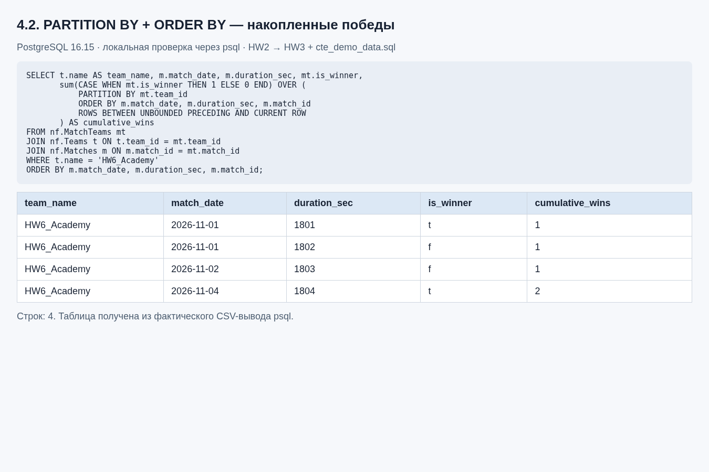

## 5. ROWS — 2 запроса

### 5.1. ROWS — среднее за текущее и предыдущее выступление

**Задача:** Для HW6_Atlas посчитать скользящее среднее убийств по текущему и одному предыдущему выступлению.

```sql
SELECT p.nickname, m.match_date, m.duration_sec, s.kills,
       round(avg(s.kills) OVER (
           PARTITION BY s.player_id
           ORDER BY m.match_date, m.duration_sec, m.match_id
           ROWS BETWEEN 1 PRECEDING AND CURRENT ROW
       ), 2) AS moving_avg_kills
FROM nf.PlayerMatchStats s
JOIN nf.Players p ON p.player_id = s.player_id
JOIN nf.Matches m ON m.match_id = s.match_id
WHERE p.nickname = 'HW6_Atlas'
ORDER BY m.match_date, m.duration_sec, m.match_id;
```

**Пояснение:** ROWS BETWEEN 1 PRECEDING AND CURRENT ROW включает максимум две строки. Для первой строки предыдущей нет, поэтому среднее равно её kills.

**Фактический результат:**

| nickname | match_date | duration_sec | kills | moving_avg_kills |
| --- | --- | --- | --- | --- |
| HW6_Atlas | 2026-11-01 | 1801 | 10 | 10.00 |
| HW6_Atlas | 2026-11-01 | 1802 | 14 | 12.00 |
| HW6_Atlas | 2026-11-02 | 1803 | 6 | 10.00 |
| HW6_Atlas | 2026-11-04 | 1804 | 20 | 13.00 |

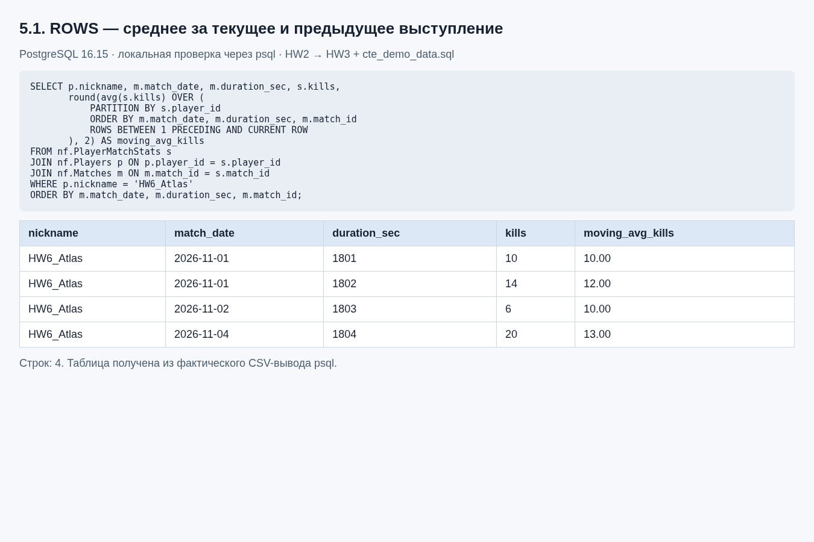

### 5.2. ROWS — сумма от текущего выступления до последнего

**Задача:** Для каждой строки HW6_Atlas посчитать сумму убийств в текущем и всех последующих записанных выступлениях.

```sql
SELECT p.nickname, m.match_date, m.duration_sec, s.kills,
       sum(s.kills) OVER (
           PARTITION BY s.player_id
           ORDER BY m.match_date, m.duration_sec, m.match_id
           ROWS BETWEEN CURRENT ROW AND UNBOUNDED FOLLOWING
       ) AS remaining_kills
FROM nf.PlayerMatchStats s
JOIN nf.Players p ON p.player_id = s.player_id
JOIN nf.Matches m ON m.match_id = s.match_id
WHERE p.nickname = 'HW6_Atlas'
ORDER BY m.match_date, m.duration_sec, m.match_id;
```

**Пояснение:** ROWS BETWEEN CURRENT ROW AND UNBOUNDED FOLLOWING даёт обратное накопление. На первой строке — вся сумма, на последней — только её kills.

**Фактический результат:**

| nickname | match_date | duration_sec | kills | remaining_kills |
| --- | --- | --- | --- | --- |
| HW6_Atlas | 2026-11-01 | 1801 | 10 | 50 |
| HW6_Atlas | 2026-11-01 | 1802 | 14 | 40 |
| HW6_Atlas | 2026-11-02 | 1803 | 6 | 26 |
| HW6_Atlas | 2026-11-04 | 1804 | 20 | 20 |

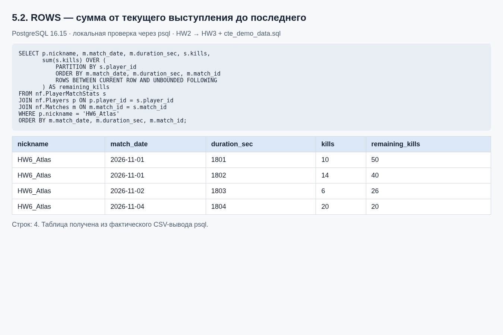

## 6. RANGE — 2 запроса

### 6.1. RANGE — накопление с объединением одинаковых дат

**Задача:** Посчитать накопленные убийства HW6_Atlas до конца даты текущего матча.

```sql
SELECT p.nickname, m.match_date, m.duration_sec, s.kills,
       sum(s.kills) OVER (
           PARTITION BY s.player_id
           ORDER BY m.match_date
           RANGE BETWEEN UNBOUNDED PRECEDING AND CURRENT ROW
       ) AS kills_through_date
FROM nf.PlayerMatchStats s
JOIN nf.Players p ON p.player_id = s.player_id
JOIN nf.Matches m ON m.match_id = s.match_id
WHERE p.nickname = 'HW6_Atlas'
ORDER BY m.match_date, m.duration_sec, m.match_id;
```

**Пояснение:** В окне ORDER BY содержит только match_date: RANGE включает все строки с той же датой, включая следующую по порядку вывода строку. Поэтому оба матча 1 ноября сразу получают сумму 24. Дополнительная сортировка с duration_sec нужна только для вывода.

**Фактический результат:**

| nickname | match_date | duration_sec | kills | kills_through_date |
| --- | --- | --- | --- | --- |
| HW6_Atlas | 2026-11-01 | 1801 | 10 | 24 |
| HW6_Atlas | 2026-11-01 | 1802 | 14 | 24 |
| HW6_Atlas | 2026-11-02 | 1803 | 6 | 30 |
| HW6_Atlas | 2026-11-04 | 1804 | 20 | 50 |

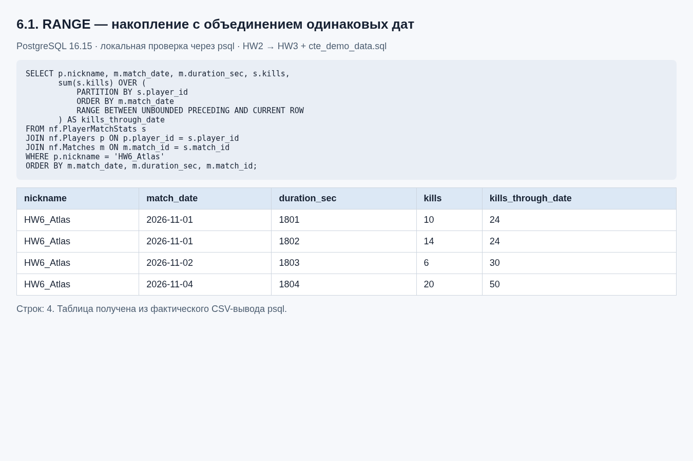

### 6.2. RANGE — сумма за текущую и предыдущую дату

**Задача:** Для HW6_Atlas посчитать убийства в диапазоне от предыдущей календарной даты до текущей включительно.

```sql
SELECT p.nickname, m.match_date, m.duration_sec, s.kills,
       sum(s.kills) OVER (
           PARTITION BY s.player_id
           ORDER BY m.match_date
           RANGE BETWEEN INTERVAL '1 day' PRECEDING AND CURRENT ROW
       ) AS kills_in_date_range
FROM nf.PlayerMatchStats s
JOIN nf.Players p ON p.player_id = s.player_id
JOIN nf.Matches m ON m.match_id = s.match_id
WHERE p.nickname = 'HW6_Atlas'
ORDER BY m.match_date, m.duration_sec, m.match_id;
```

**Пояснение:** RANGE с INTERVAL ограничивает значения дат, а не количество предыдущих строк. Для 2 ноября входят оба матча 1 ноября и матч 2 ноября; для 4 ноября матч 2 ноября уже не входит. В PostgreSQL рамка RANGE со смещением требует ровно одно выражение ORDER BY.

**Фактический результат:**

| nickname | match_date | duration_sec | kills | kills_in_date_range |
| --- | --- | --- | --- | --- |
| HW6_Atlas | 2026-11-01 | 1801 | 10 | 24 |
| HW6_Atlas | 2026-11-01 | 1802 | 14 | 24 |
| HW6_Atlas | 2026-11-02 | 1803 | 6 | 30 |
| HW6_Atlas | 2026-11-04 | 1804 | 20 | 20 |

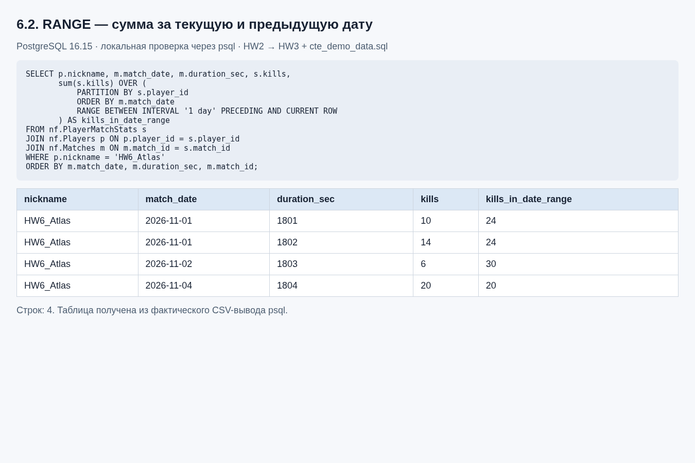

## 7. Ранжирование — все три вида из презентации

### 7.1. ROW_NUMBER — уникальный номер игрока по MMR

**Задача:** Пронумеровать игроков HW6_Academy по убыванию MMR.

```sql
SELECT p.nickname, p.mmr,
       row_number() OVER (
           PARTITION BY p.team_id ORDER BY p.mmr DESC, p.nickname, p.player_id
       ) AS row_num
FROM nf.Players p
JOIN nf.Teams t ON t.team_id = p.team_id
WHERE t.name = 'HW6_Academy'
ORDER BY row_num;
```

**Пояснение:** ROW_NUMBER выдаёт разные номера при равном MMR. nickname и player_id делают порядок однозначным.

**Фактический результат:**

| nickname | mmr | row_num |
| --- | --- | --- |
| HW6_Atlas | 11000 | 1 |
| HW6_Boreal | 10000 | 2 |
| HW6_Cinder | 10000 | 3 |
| HW6_Delta | 9000 | 4 |

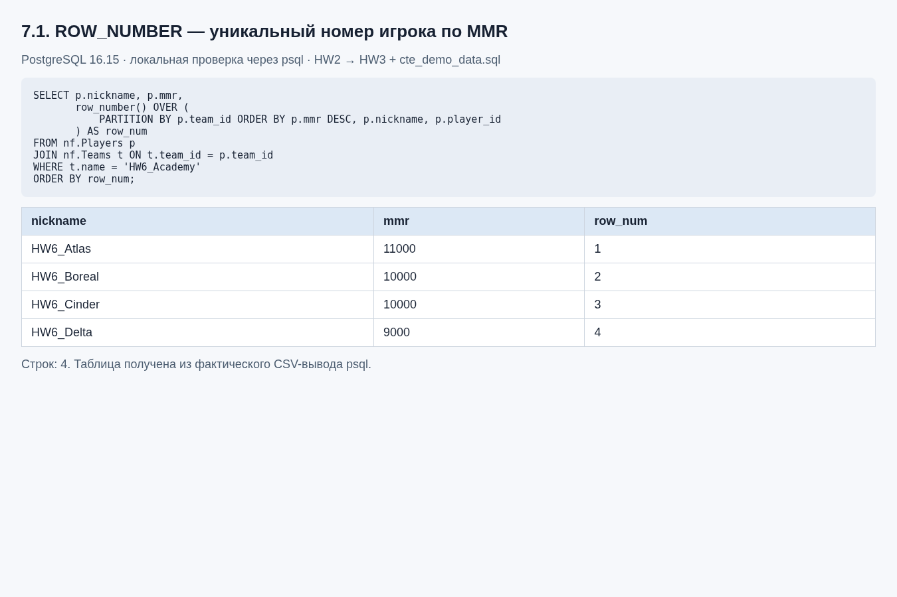

### 7.2. RANK — места с пропусками

**Задача:** Распределить игроков HW6_Academy по местам по MMR с одинаковым местом при равенстве.

```sql
SELECT p.nickname, p.mmr,
       rank() OVER (PARTITION BY p.team_id ORDER BY p.mmr DESC) AS mmr_rank
FROM nf.Players p
JOIN nf.Teams t ON t.team_id = p.team_id
WHERE t.name = 'HW6_Academy'
ORDER BY mmr_rank, p.nickname;
```

**Пояснение:** Внутри окна сортируем только по MMR, чтобы не разрушить равенство рангов. Получаются места 1, 2, 2, 4. nickname используется только для порядка вывода.

**Фактический результат:**

| nickname | mmr | mmr_rank |
| --- | --- | --- |
| HW6_Atlas | 11000 | 1 |
| HW6_Boreal | 10000 | 2 |
| HW6_Cinder | 10000 | 2 |
| HW6_Delta | 9000 | 4 |

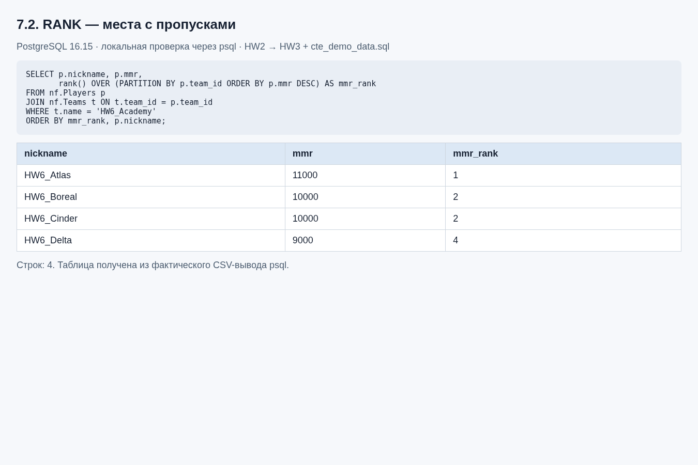

### 7.3. DENSE_RANK — места без пропусков

**Задача:** Распределить игроков HW6_Academy по плотным местам по MMR.

```sql
SELECT p.nickname, p.mmr,
       dense_rank() OVER (PARTITION BY p.team_id ORDER BY p.mmr DESC) AS dense_mmr_rank
FROM nf.Players p
JOIN nf.Teams t ON t.team_id = p.team_id
WHERE t.name = 'HW6_Academy'
ORDER BY dense_mmr_rank, p.nickname;
```

**Пояснение:** DENSE_RANK сохраняет равные места, но не пропускает следующее: 1, 2, 2, 3.

**Фактический результат:**

| nickname | mmr | dense_mmr_rank |
| --- | --- | --- |
| HW6_Atlas | 11000 | 1 |
| HW6_Boreal | 10000 | 2 |
| HW6_Cinder | 10000 | 2 |
| HW6_Delta | 9000 | 3 |

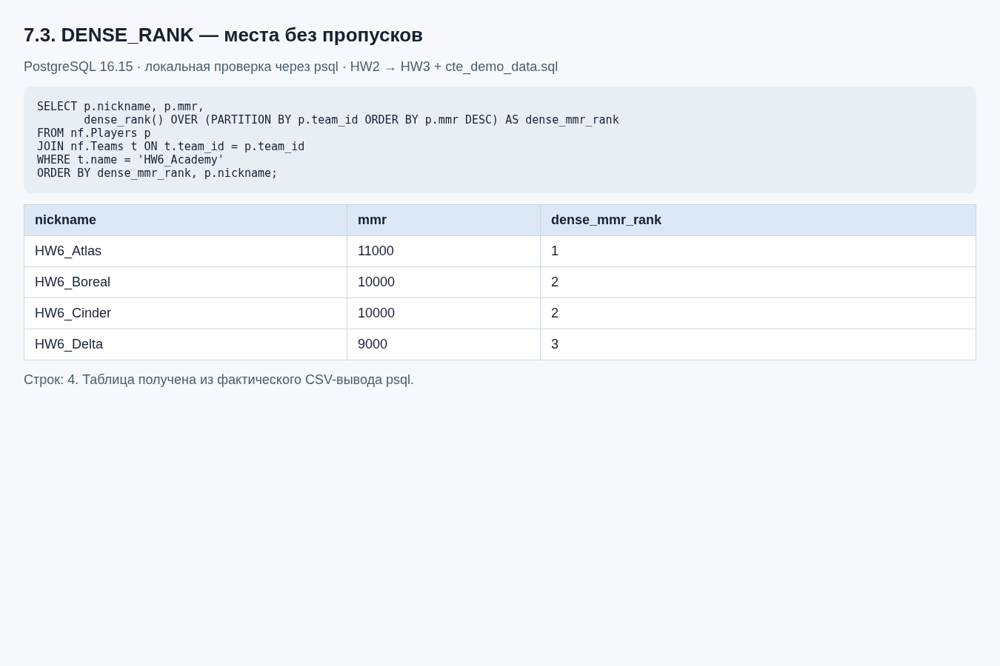

## 8. Смещение — все четыре вида из презентации

### 8.1. LAG — изменение убийств относительно предыдущего матча

**Задача:** Для HW6_Atlas показать убийства в предыдущем выступлении и разницу с текущим.

```sql
WITH history AS (
    SELECT p.nickname, m.match_date, m.duration_sec, m.match_id, s.kills,
           lag(s.kills) OVER (
               PARTITION BY s.player_id
               ORDER BY m.match_date, m.duration_sec, m.match_id
           ) AS prev_kills
    FROM nf.PlayerMatchStats s
    JOIN nf.Players p ON p.player_id = s.player_id
    JOIN nf.Matches m ON m.match_id = s.match_id
    WHERE p.nickname = 'HW6_Atlas'
)
SELECT nickname, match_date, duration_sec, kills, prev_kills,
       kills - prev_kills AS kills_change
FROM history
ORDER BY match_date, duration_sec, match_id;
```

**Пояснение:** LAG использует предыдущее выступление в заданном порядке. Для первой строки предыдущего нет, поэтому prev_kills и разница равны NULL. Значение default в LAG применяется при отсутствии строки, а не при NULL в существующей строке.

**Фактический результат:**

| nickname | match_date | duration_sec | kills | prev_kills | kills_change |
| --- | --- | --- | --- | --- | --- |
| HW6_Atlas | 2026-11-01 | 1801 | 10 | NULL | NULL |
| HW6_Atlas | 2026-11-01 | 1802 | 14 | 10 | 4 |
| HW6_Atlas | 2026-11-02 | 1803 | 6 | 14 | -8 |
| HW6_Atlas | 2026-11-04 | 1804 | 20 | 6 | 14 |

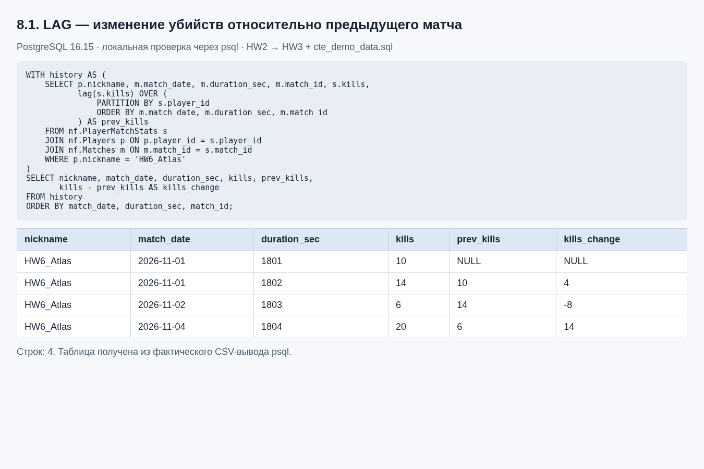

### 8.2. LEAD — убийства в следующем матче

**Задача:** Для HW6_Atlas показать число убийств в следующем записанном выступлении.

```sql
SELECT p.nickname, m.match_date, m.duration_sec, s.kills,
       lead(s.kills) OVER (
           PARTITION BY s.player_id
           ORDER BY m.match_date, m.duration_sec, m.match_id
       ) AS next_kills
FROM nf.PlayerMatchStats s
JOIN nf.Players p ON p.player_id = s.player_id
JOIN nf.Matches m ON m.match_id = s.match_id
WHERE p.nickname = 'HW6_Atlas'
ORDER BY m.match_date, m.duration_sec, m.match_id;
```

**Пояснение:** LEAD смотрит на следующую строку партиции, а не на следующий календарный день. У последнего выступления next_kills равен NULL.

**Фактический результат:**

| nickname | match_date | duration_sec | kills | next_kills |
| --- | --- | --- | --- | --- |
| HW6_Atlas | 2026-11-01 | 1801 | 10 | 14 |
| HW6_Atlas | 2026-11-01 | 1802 | 14 | 6 |
| HW6_Atlas | 2026-11-02 | 1803 | 6 | 20 |
| HW6_Atlas | 2026-11-04 | 1804 | 20 | NULL |

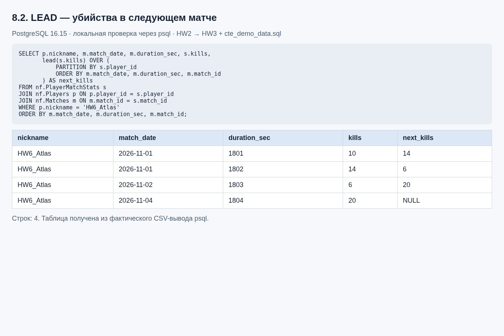

### 8.3. FIRST_VALUE — результат первого выступления

**Задача:** Для каждого выступления HW6_Atlas показать его первое число убийств в записанной истории.

```sql
SELECT p.nickname, m.match_date, m.duration_sec, s.kills,
       first_value(s.kills) OVER (
           PARTITION BY s.player_id
           ORDER BY m.match_date, m.duration_sec, m.match_id
           ROWS BETWEEN UNBOUNDED PRECEDING AND UNBOUNDED FOLLOWING
       ) AS first_kills
FROM nf.PlayerMatchStats s
JOIN nf.Players p ON p.player_id = s.player_id
JOIN nf.Matches m ON m.match_id = s.match_id
WHERE p.nickname = 'HW6_Atlas'
ORDER BY m.match_date, m.duration_sec, m.match_id;
```

**Пояснение:** FIRST_VALUE берёт первую строку рамки, а не минимальное значение kills. Полная рамка явно охватывает всю партицию.

**Фактический результат:**

| nickname | match_date | duration_sec | kills | first_kills |
| --- | --- | --- | --- | --- |
| HW6_Atlas | 2026-11-01 | 1801 | 10 | 10 |
| HW6_Atlas | 2026-11-01 | 1802 | 14 | 10 |
| HW6_Atlas | 2026-11-02 | 1803 | 6 | 10 |
| HW6_Atlas | 2026-11-04 | 1804 | 20 | 10 |


### 8.4. LAST_VALUE — результат последнего выступления

**Задача:** Для каждого выступления HW6_Atlas показать его последнее число убийств в записанной истории.

```sql
SELECT p.nickname, m.match_date, m.duration_sec, s.kills,
       last_value(s.kills) OVER (
           PARTITION BY s.player_id
           ORDER BY m.match_date, m.duration_sec, m.match_id
           ROWS BETWEEN UNBOUNDED PRECEDING AND UNBOUNDED FOLLOWING
       ) AS last_kills
FROM nf.PlayerMatchStats s
JOIN nf.Players p ON p.player_id = s.player_id
JOIN nf.Matches m ON m.match_id = s.match_id
WHERE p.nickname = 'HW6_Atlas'
ORDER BY m.match_date, m.duration_sec, m.match_id;
```

**Пояснение:** Для LAST_VALUE важен UNBOUNDED FOLLOWING: иначе при рамке по умолчанию функция вернула бы последнюю строку только до текущей группы равных значений ORDER BY, а не последний матч всей истории.

**Фактический результат:**

| nickname | match_date | duration_sec | kills | last_kills |
| --- | --- | --- | --- | --- |
| HW6_Atlas | 2026-11-01 | 1801 | 10 | 20 |
| HW6_Atlas | 2026-11-01 | 1802 | 14 | 20 |
| HW6_Atlas | 2026-11-02 | 1803 | 6 | 20 |
| HW6_Atlas | 2026-11-04 | 1804 | 20 | 20 |

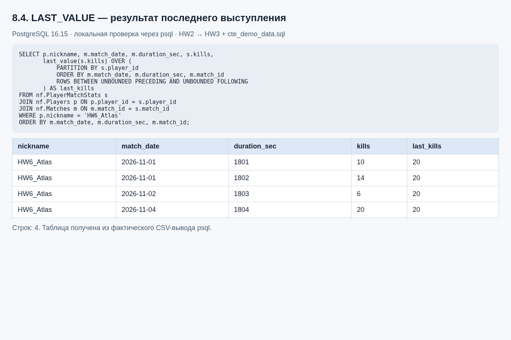

## Выводы по презентации и проверка

CTE существует в пределах одного SQL-оператора, а не как постоянная таблица.
PostgreSQL может встроить CTE в план; WITH сам по себе не гарантирует материализацию
или ускорение. Рекурсивная часть использует UNION ALL и явную защиту от циклов.
UNION/INTERSECT/EXCEPT требуют одинакового числа столбцов с совместимыми типами;
родство таблиц не запрещает применение этих операций. Без ALL повторы удаляются.

Оконные функции сохраняют строки результата после FROM/WHERE/GROUP BY/HAVING.
PARTITION BY задаёт независимые группы, ORDER BY внутри OVER — порядок вычисления,
а внешний ORDER BY — порядок показа. Для фильтрации результата окна нужен внешний
SELECT/CTE а не обращение к окну в WHERE того же уровня.

Без ORDER BY стандартная рамка охватывает всю партицию. С ORDER BY рамка по
умолчанию — RANGE BETWEEN UNBOUNDED PRECEDING AND CURRENT ROW, включая peers:
утверждение слайда 42 «нет ROWS/RANGE — значит вся партиция» верно только без ORDER BY.
ROWS считает строки, RANGE — значения ключа порядка. RANK/DENSE_RANK определяются
peers; добавление nickname в их оконный ORDER BY уничтожило бы равенство MMR.
LAG/LEAD ищут строки в партиции и не ограничиваются рамкой агрегата;
их default используется при отсутствии строки, а не для замены NULL в найденной.
FIRST_VALUE/LAST_VALUE используют рамку; для последнего значения всей партиции
нужен UNBOUNDED FOLLOWING. FIRST_VALUE не означает MIN, LAST_VALUE — не MAX.

Все запросы (21) выполнены с ON_ERROR_STOP=1 на отдельной копии исходной БД,
после cte_demo_data.sql. Повторная загрузка демонстрационных данных проверена.
Числовые результаты, поведение ROWS/RANGE, ранги, границы LAG/LEAD и защита
рекурсии от циклов проверены дополнительно. Исходная БД dota2_hw не изменялась.
SQL в Markdown совпадает с cte_queries.sql. Изображения в screenshots/ получены снимком браузерного представления
фактического CSV-вывода psql с текстом запроса и указанием источника.
Снимки из pgAdmin можно добавить после пользовательского прогона.
