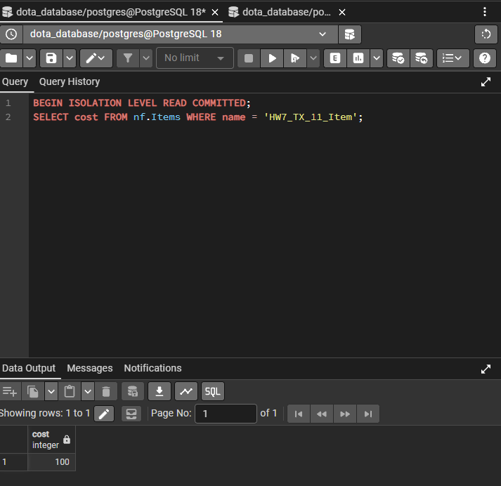
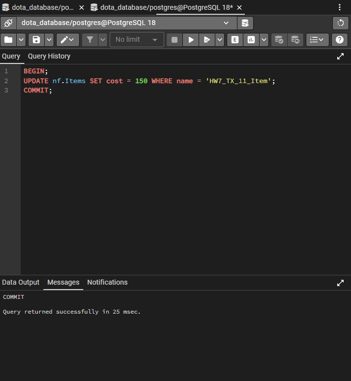

# HW7: полный порядок на другом ПК — от пустой базы до Pull Request

**Текущий комплект:** ручной прогон уже представлен 117 фотографиями в отчёте.
Шаги 2–6 ниже нужны для самостоятельного повторения. Для подготовки сдачи
использовать шаги 7–8.

В PostgreSQL нужна не одна таблица: работа использует нормализованную схему
`nf` с 14 таблицами и связями из предыдущих домашних работ.

## 1. Скачать рабочую копию домашки

Можно скачать ZIP по ссылке из чата и распаковать: внутри папка `HW7`.
Если на ПК установлен Git, удобнее сразу работать в клоне репозитория.
В новом терминале PowerShell, в папке, где нужно хранить проект:

```powershell
git clone https://github.com/SdKS454/databases-course.git databases-course-hw7
cd databases-course-hw7
git fetch origin
git switch -c hw7-transactions origin/master
git restore --source=origin/download/hw7-transactions --worktree -- HW7
```

Это создаёт будущую ветку для сдачи от `master` и копирует только `HW7`.
Всё выполнение и фотографии дальше сохранять в этой папке `HW7`.
Если папка клона или ветка с таким именем уже есть — не удалять их,
а сначала проверить `git status` и выяснить, где находится существующая работа.

## 2. Создать отдельную базу в pgAdmin

1. Подключиться к своему серверу PostgreSQL.
2. В дереве слева выбрать существующую служебную базу `postgres`.
3. Открыть для неё Query Tool. Auto-commit должен быть включён.
4. Выполнить **только эту команду, без BEGIN**:

```sql
CREATE DATABASE dota2_hw7;
```

Если база уже существует, не удалять её. Можно использовать другое новое имя,
например `dota2_hw7_practice`, и выбирать именно его в дальнейших шагах.
Если нет права CREATE DATABASE, создать базу под ролью администратора сервера
или использовать выделенную учебную базу без схемы `nf`.

5. Обновить список Databases (Refresh), выбрать **новую базу `dota2_hw7`**,
   открыть её Query Tool. Не продолжать в Query Tool базы `postgres`.
6. Проверить:

```sql
SELECT current_database();
```

Результат должен быть `dota2_hw7` (или выбранное другое новое имя).

## 3. Создать таблицы и данные

В Query Tool новой базы открыть `HW7/00_bootstrap_new_pc.sql` и выполнить целиком.
Он создаёт схему `nf`, все 14 таблиц, два представления и 92 исходные строки
на состоянии репозитория после HW6. Он не требует public-таблиц из HW2 и
не использует DROP. Если `nf` уже существует, выполнение остановится;
в таком случае выполнить `ROLLBACK;` и не пытаться удалить существующую схему.

Проверка в конце файла должна показать `nf_tables = 14` и:

| Таблица | Исходных строк |
|---|---:|
| teams | 5 |
| players | 9 |
| matches | 8 |
| items | 5 |

Затем открыть и выполнить целиком `HW7/01_prepare.sql`.
Он добавляет отдельные строки `HW7_TX_`, с которыми работают опыты:
6 команд, 7 игроков, 8 предметов, 3 региона, 2 режима игры.
Эти числа относятся только к демонстрационным строкам, не ко всей таблице.

Теперь база полностью готова для HW7. Старые HW2/HW3 запускать не нужно.
Для повторения опытов достаточно `01_prepare.sql`; bootstrap повторять нельзя.

## 4. Подготовить два независимых соединения

1. Дважды открыть Query Tool **одной новой базы**. Обозначить окна/вкладки T1 и T2.
2. В обоих выполнить:

```sql
SELECT current_database(), pg_backend_pid();
```

Имя базы должно совпадать, PID должны различаться.
3. Оставить Auto-commit включённым, Auto-rollback выключенным.
   BEGIN/COMMIT/ROLLBACK уже написаны в сценариях.
4. Если в каком-либо окне висит неудачная транзакция, выделить и выполнить
   в нём отдельно `ROLLBACK;`.

## 5. Выполнить опыты по порядку

Открыть `HW7/transaction.md`: это основной отчёт с SQL и результатами.
Короткая карта всех сценариев и порядка переключений — в `HW7/README.md`.

- Сценарии **01–06**: одна вкладка T1, COMMIT, ROLLBACK и ошибки.
- **07–22**: два Query Tool. Открыть T1.sql в T1, T2.sql в T2.
- **23–24**: SAVEPOINT, достаточно T1.

Начать с `HW7/sql/01_commit_a/T1.sql`.
Выделять ровно один блок под комментарием `ШАГ N` и выполнять.
Затем переходить к следующему номеру. В двухсессионных опытах номера общие
для файлов T1/T2, поэтому нельзя сначала выполнить весь T1, потом весь T2.

Например, для `11_rc_repeat_a`:

1. T1, шаг 1: начать READ COMMITTED и прочитать цену 100.
2. T2, шаг 2: изменить цену на 150 и выполнить COMMIT.
3. T1, шаг 3: повторное чтение даст 150.
4. T1, шаг 4: завершить транзакцию.

Ошибки `22012`, `25P02`, `40001` в отмеченных шагах ожидаемы.
Ошибка должна быть видна в Messages. Следующий ROLLBACK выполнить отдельным
выделением: не запускать его в одном блоке с командой, которая должна упасть.

Перед повтором неудачно выполненного сценария:
1. Закончить/откатить транзакции в T1 и T2.
2. Выполнить `01_prepare.sql` в третьем Query Tool или в свободном T1.
3. Начать нужный сценарий заново с первого шага.

Подготовка сбрасывает только свои строки опытов. Предыдущие фотографии и
результаты в файлах от этого не пропадают.

## 6. Сделать и добавить фотографии

Да, фотографии требуются последним слайдом презентации.
Папка назначения: `HW7/screenshots/`.
Имена и рекомендации для каждого опыта — в `HW7/screenshots/README.md`.

На фотографии должны быть видны SQL и результат Data Output или ошибка Messages.
Для обычного опыта сохранить два снимка: первое состояние/чтение и итоговое.
Для сериализации дополнительно показать ошибку 40001 и успешный повтор;
для ошибочной транзакции — ошибку и значения после ROLLBACK.

Например, для неповторяющегося чтения:
- `11_rc_repeat_a_1.png` — T1 прочитала 100;
- `11_rc_repeat_a_2.png` — T1 после COMMIT T2 прочитала 150.

В соответствующем разделе `transaction.md` заменить текст-заглушку фотографий на:

```markdown


```

В каждом разделе сверить свои значения с отчётом. Полные реальные локальные
протоколы находятся в `output/`. Не подменять ими фотографии pgAdmin.

После ручного выполнения отметить в конце `transaction.md` пункты про свой
прогон и фотографии: `[ ]` заменить на `[x]`. Удалить временные фразы вроде
«сейчас фотографии не приложены», когда соответствующие фотографии добавлены.
Не отмечать пункт про отправку до фактической отправки.

После закрытия всех T1/T2 при желании выполнить `99_cleanup.sql`.
Она удаляет только строки HW7_TX_; исходная база остаётся для следующих работ.

## 7. Подготовить репозиторий к сдаче

Работать в `databases-course-hw7`, в ветке `hw7-transactions` из шага 1.
Если использовался ZIP, перенести свою готовую папку HW7 в этот клон,
заменив там заготовку и сохранив фотографии.

В корневой README.md добавить краткий пункт про HW7 по аналогии с HW6:
транзакции, уровни изоляции, SAVEPOINT и ссылка `HW7/transaction.md`.
Например, в конец корневого README.md добавить:

```markdown
### HW7 — Транзакции

- BEGIN / COMMIT / ROLLBACK, ошибки и SAVEPOINT.
- Уровни изоляции PostgreSQL: 24 сценария с результатами выполнения.
- Отчёт и фотографии: [HW7/transaction.md](HW7/transaction.md).
```

Не менять старые домашки. ZIP из временной ветки и папку `downloads`
в сдачу переносить не нужно.

Проверить в PowerShell:

```powershell
git branch --show-current
git status
git diff -- README.md
```

Текущая ветка должна быть `hw7-transactions`.
Проверить, что все вставленные изображения открываются из отчёта и нет
неподставленных фотографий-заглушек. Текстовые протоколы — локальная проверка;
если свой результат отличается, разобраться с причиной до отправки.

Добавить только работу и корневой README:

```powershell
git add HW7 README.md
git diff --cached --check
git diff --cached --stat
```

В списке должны быть только HW7 и README.md, без изменений HW1–HW6.
Параметры подключения, пароли и личные настройки pgAdmin не добавлять.

## 8. Создать коммит, отправить ветку и открыть PR

Проверить имя и почту автора:

```powershell
git config user.name
git config user.email
```

Если значения отсутствуют, задать свои данные только для этого клона:

```powershell
git config user.name "Твоё имя"
git config user.email "Твоя почта GitHub"
```

Создать коммит и отправить:

```powershell
git commit -m "HW7: транзакции и уровни изоляции"
git push -u origin hw7-transactions
```

Открыть репозиторий https://github.com/SdKS454/databases-course → Pull requests
→ New pull request. Выбрать:

```text
base: master
compare: hw7-transactions
```

Название: `HW7: Транзакции`. В описании коротко указать 24 сценария,
прогон в pgAdmin и фотографии. Просмотреть вкладку Files changed:
только HW7 и дополнение корневого README. Нажать Create pull request.
Если нужен Reviewer, выбрать преподавателя. Самостоятельно Merge не нажимать.

Если по правилам преподавателя нужно отправлять прямо в master вместо PR,
сначала уточнить это; перечисленные команды master не изменяют.
