# Домашняя работа 7 — Транзакции

**Предметная область:** Dota 2.\
**Схема:** `nf`, продолжение HW3 и HW6.\
**Выполнение:** PostgreSQL 18, pgAdmin.\
**Задание:** презентация «10. Транзакции», слайды 31–35.

В этой работе я проверяю, как PostgreSQL сохраняет и отменяет изменения,
что видят две параллельные транзакции и как работают точки сохранения.
Для опытов я использую отдельные строки с префиксом `HW7_TX_`.
Данные предыдущих домашних работ не меняю.

[Краткий маршрут показа](README.md#showcase) · [Повторение опытов](START_HERE.md) ·
[Все фотографии](screenshots/README.md)

## Что я проверяю

| Раздел | Сценариев |
|---|---:|
| COMMIT: INSERT и UPDATE связанных записей | 2 |
| ROLLBACK тех же изменений | 2 |
| Ошибка внутри транзакции | 2 |
| Восемь тем изоляции, по два примера | 16 |
| SAVEPOINT | 2 |
| **Всего** | **24** |

На слайдах указано восемь заданий по изоляции без отдельной нумерации.
В качестве контрольной пары я сравниваю фантомные строки на READ COMMITTED
и REPEATABLE READ. Это позволяет показать отличие уровней на одинаковых действиях.

<a id="contents"></a>

## Содержание

В каждом опыте сначала показываю результат и основные фотографии.
Полный SQL с порядком шагов, остальные снимки и таблица контрольных значений
раскрываются ниже. Нажатие на фотографию открывает её в полном размере.

| № | Опыт | Что наблюдаю |
|---|---|---|
| [01](#hw7-01) | COMMIT: игрок и команда | Обе операции сохранены |
| [02](#hw7-02) | COMMIT: команда и регион | Команда и изменение региона сохранены |
| [03](#hw7-03) | ROLLBACK: игрок и команда | Обе операции отменены |
| [04](#hw7-04) | ROLLBACK: команда и регион | Новая команда не сохранена |
| [05](#hw7-05) | ERROR: игрок и команда | 22012 → 25P02 → полный откат |
| [06](#hw7-06) | ERROR: команда и регион | Ошибка отменяет INSERT и UPDATE |
| [07](#hw7-07) | READ UNCOMMITTED: грязное чтение, цена предмета | Грязная цена не видна |
| [08](#hw7-08) | READ UNCOMMITTED: грязное чтение, MMR игрока | 8000 до COMMIT, 9000 после |
| [09](#hw7-09) | READ COMMITTED: грязное чтение, цена предмета | Грязная цена не видна |
| [10](#hw7-10) | READ COMMITTED: грязное чтение, MMR игрока | Новое значение видно после COMMIT |
| [11](#hw7-11) | READ COMMITTED: повторное чтение, цена предмета | 100 → 150 внутри T1 |
| [12](#hw7-12) | READ COMMITTED: повторное чтение, MMR игрока | 8000 → 8100 внутри T1 |
| [13](#hw7-13) | READ COMMITTED: новый игрок команды | Один игрок → два |
| [14](#hw7-14) | READ COMMITTED: новый предмет в выборке | Один предмет → два |
| [15](#hw7-15) | REPEATABLE READ: повторное чтение, цена предмета | Внутри T1 — 100; после — 150 |
| [16](#hw7-16) | REPEATABLE READ: повторное чтение, MMR игрока | Внутри T1 — 8000; после — 8100 |
| [17](#hw7-17) | REPEATABLE READ: новый игрок команды | Внутри T1 — один; после — два |
| [18](#hw7-18) | REPEATABLE READ: новый предмет в выборке | Внутри T1 — один; после — два |
| [19](#hw7-19) | SERIALIZABLE: две одинаковые заявки на матч (1800 секунд) | 40001, повтор видит один матч |
| [20](#hw7-20) | SERIALIZABLE: две одинаковые заявки на матч (2400 секунд) | 40001, дубликат не создаётся |
| [21](#hw7-21) | SERIALIZABLE: конкурентное обновление цены | 40001 → повтор → цена 130 |
| [22](#hw7-22) | SERIALIZABLE: конкурентное обновление MMR | 40001 → повтор → MMR 8300 |
| [23](#hw7-23) | SAVEPOINT: сохранить изменения до точки | Before остаётся, After отменён |
| [24](#hw7-24) | SAVEPOINT: возврат ко второй и первой точкам | 130 → 120 → 110 |

## Условия опытов

Я открываю два независимых Query Tool одной базы — T1 и T2. У них должны
различаться `pg_backend_pid()`. Auto-commit включён, Auto-rollback выключен:
границы транзакций задаю явными BEGIN, COMMIT и ROLLBACK.
Выполняю по одному пронумерованному шагу, переключаясь между T1/T2.

Начальные цены предметов — 100, MMR игроков — 8000. По именам нахожу нужные
строки, поэтому числовые ID не привязаны к конкретной установке PostgreSQL.
Для новой базы использую [00_bootstrap_new_pc.sql](00_bootstrap_new_pc.sql),
для начальных условий опытов — [01_prepare.sql](01_prepare.sql).

На фотографиях показан мой прогон в pgAdmin на PostgreSQL 18.
Таблицы ниже содержат контрольные значения; дополнительные текстовые протоколы
PostgreSQL 17.10 сохранены в [output](output/). Фотографии не заменены
этими протоколами. На некоторых снимках длинный SQL или значение обрезаны
шириной окна; полный текст запроса доступен в блоке SQL соответствующего опыта.

## 1. COMMIT, ROLLBACK и ошибка

<a id="hw7-01"></a>

### 01. COMMIT: игрок и команда

**Что я делаю и объясняю:** Я добавляю игрока и меняю дату основания его команды в одной транзакции. После COMMIT обе операции сохраняются.

**Итог:** Обе операции сохранены.

**Основные фотографии:**

**Внутри транзакции новый игрок уже виден.**

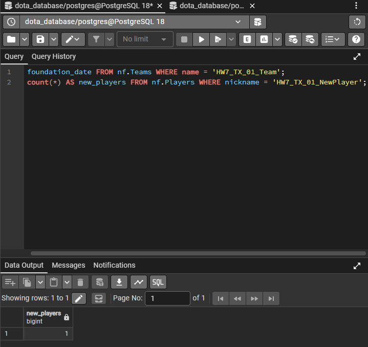

**Контроль сохранённых данных: дата 2026-11-19, новый игрок 1.**

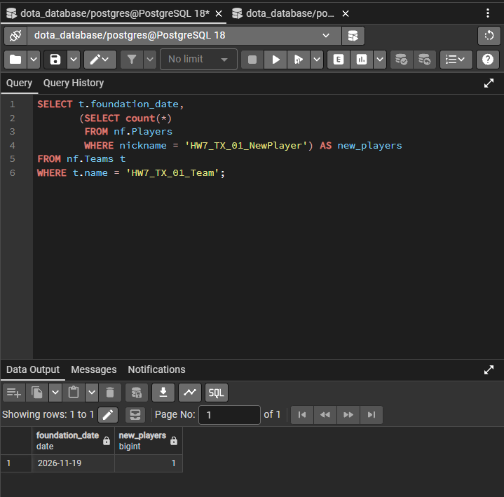

<details>
<summary>SQL и точный порядок выполнения</summary>

**Файлы:** [T1.sql](sql/01_commit_a/T1.sql).

**Порядок:** 1 (T1) → 2 (T1) → 3 (T1) → 4 (T1) → 5 (T1).

**Шаг 1 — T1.** До изменений.

```sql
SELECT foundation_date FROM nf.Teams WHERE name = 'HW7_TX_01_Team';
SELECT count(*) AS new_players FROM nf.Players WHERE nickname = 'HW7_TX_01_NewPlayer';
```

**Шаг 2 — T1.** INSERT в одну таблицу и UPDATE связанной записи в другой.

```sql
BEGIN;
INSERT INTO nf.Players (nickname, mmr, team_id)
SELECT 'HW7_TX_01_NewPlayer', 8500, team_id FROM nf.Teams WHERE name = 'HW7_TX_01_Team';
UPDATE nf.Teams SET foundation_date = DATE '2026-11-19' WHERE name = 'HW7_TX_01_Team';
```

**Шаг 3 — T1.** Внутри своей транзакции изменения уже видны.

```sql
SELECT foundation_date FROM nf.Teams WHERE name = 'HW7_TX_01_Team';
SELECT count(*) AS new_players FROM nf.Players WHERE nickname = 'HW7_TX_01_NewPlayer';
```

**Шаг 4 — T1.** Завершить транзакцию.

```sql
COMMIT;
```

**Шаг 5 — T1.** Проверка после завершения.

```sql
SELECT foundation_date FROM nf.Teams WHERE name = 'HW7_TX_01_Team';
SELECT count(*) AS new_players FROM nf.Players WHERE nickname = 'HW7_TX_01_NewPlayer';
```

</details>

<details>
<summary>Остальные фотографии — 3</summary>

**Исходная проверка: новых игроков 0.**

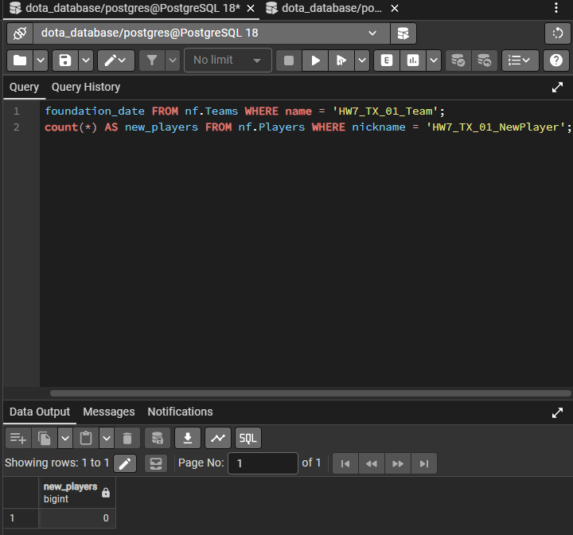

**Повторная проверка исходного состояния.**

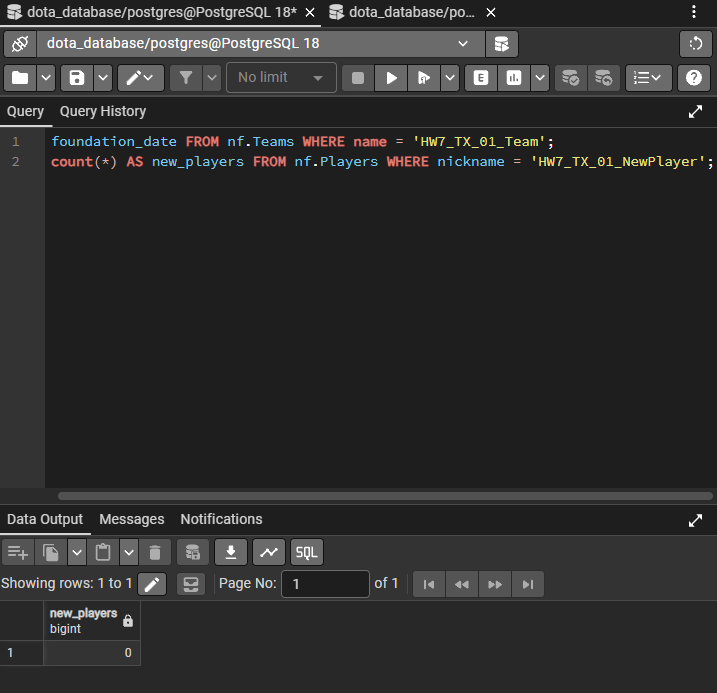

**INSERT игрока и UPDATE даты команды.**

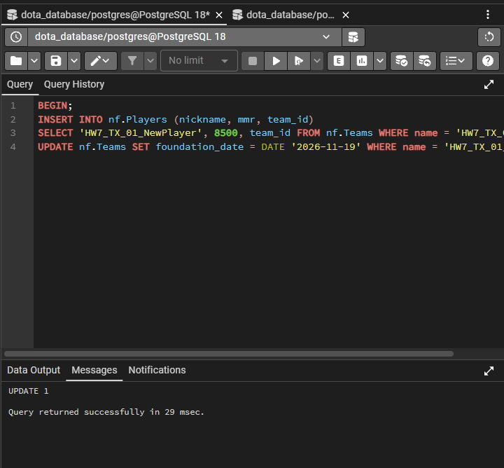

</details>

<details>
<summary>Пошаговые контрольные значения</summary>

Текстовый протокол PostgreSQL 17.10: [01_commit_a.txt](output/01_commit_a.txt).

| Шаг | Сессия | Результат |
|---|---|---|
| 1 | T1 | foundation_date → [["2000-01-01"]]; new_players → [[0]] |
| 2 | T1 | INSERT 0 1; UPDATE 1 |
| 3 | T1 | foundation_date → [["2026-11-19"]]; new_players → [[1]] |
| 4 | T1 | Команда выполнена. |
| 5 | T1 | foundation_date → [["2026-11-19"]]; new_players → [[1]] |

Запись `[[100]]` означает одну строку со значением 100.

</details>

[↑ К содержанию](#contents)

<a id="hw7-02"></a>

### 02. COMMIT: команда и регион

**Что я делаю и объясняю:** Я добавляю команду со ссылкой на регион и меняю название этого региона. COMMIT сохраняет и новую строку, и изменение связанной записи.

**Итог:** Команда и изменение региона сохранены.

**Основные фотографии:**

**Новая команда видна внутри транзакции.**

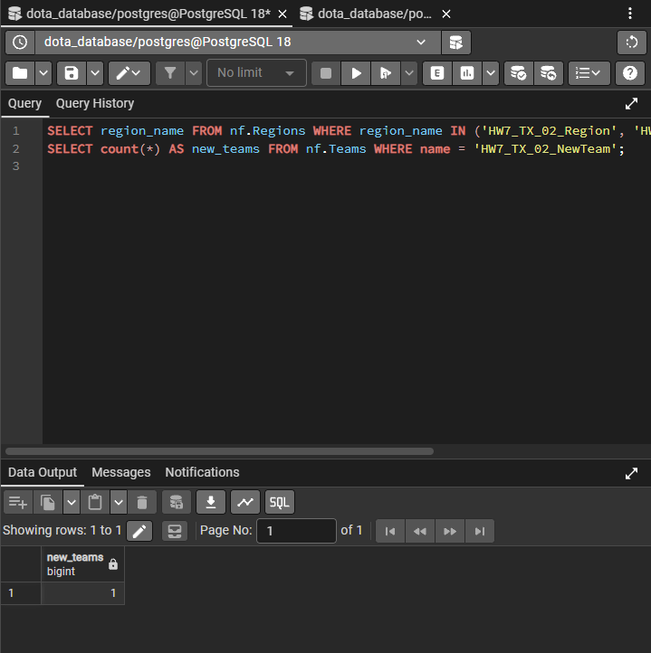

**Контрольная выборка команды и связанного региона после завершения транзакции.**

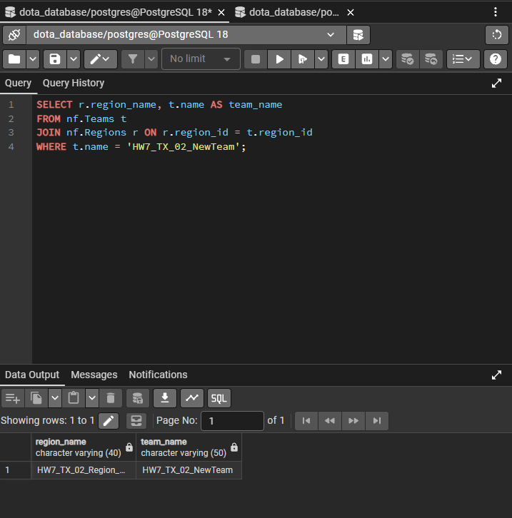

<details>
<summary>SQL и точный порядок выполнения</summary>

**Файлы:** [T1.sql](sql/02_commit_b/T1.sql).

**Порядок:** 1 (T1) → 2 (T1) → 3 (T1) → 4 (T1) → 5 (T1).

**Шаг 1 — T1.** До изменений.

```sql
SELECT region_name FROM nf.Regions WHERE region_name IN ('HW7_TX_02_Region', 'HW7_TX_02_Region_OK') ORDER BY region_name;
SELECT count(*) AS new_teams FROM nf.Teams WHERE name = 'HW7_TX_02_NewTeam';
```

**Шаг 2 — T1.** INSERT в одну таблицу и UPDATE связанной записи в другой.

```sql
BEGIN;
INSERT INTO nf.Teams (name, region_id)
SELECT 'HW7_TX_02_NewTeam', region_id FROM nf.Regions WHERE region_name = 'HW7_TX_02_Region';
UPDATE nf.Regions SET region_name = 'HW7_TX_02_Region_OK' WHERE region_name = 'HW7_TX_02_Region';
```

**Шаг 3 — T1.** Внутри своей транзакции изменения уже видны.

```sql
SELECT region_name FROM nf.Regions WHERE region_name IN ('HW7_TX_02_Region', 'HW7_TX_02_Region_OK') ORDER BY region_name;
SELECT count(*) AS new_teams FROM nf.Teams WHERE name = 'HW7_TX_02_NewTeam';
```

**Шаг 4 — T1.** Завершить транзакцию.

```sql
COMMIT;
```

**Шаг 5 — T1.** Проверка после завершения.

```sql
SELECT region_name FROM nf.Regions WHERE region_name IN ('HW7_TX_02_Region', 'HW7_TX_02_Region_OK') ORDER BY region_name;
SELECT count(*) AS new_teams FROM nf.Teams WHERE name = 'HW7_TX_02_NewTeam';
```

</details>

<details>
<summary>Остальные фотографии — 2</summary>

**Исходное состояние: новых команд 0.**

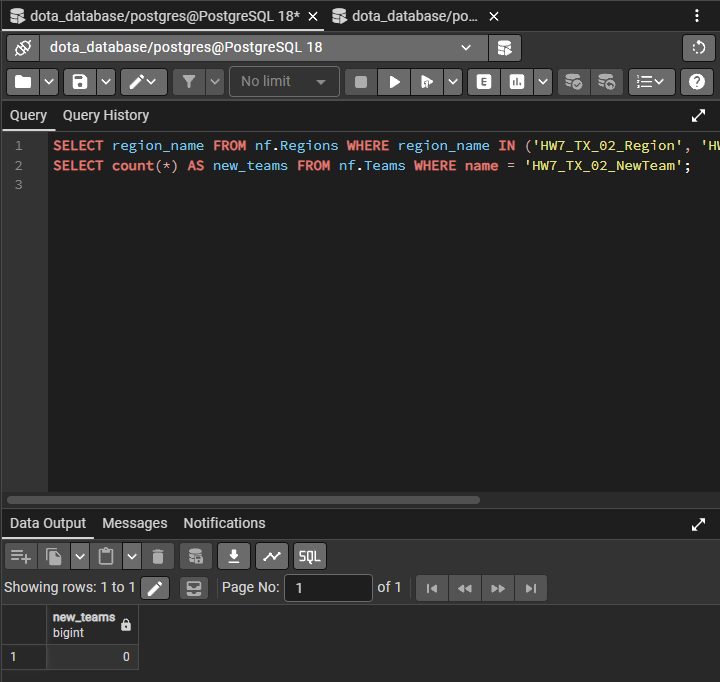

**INSERT команды и UPDATE региона.**

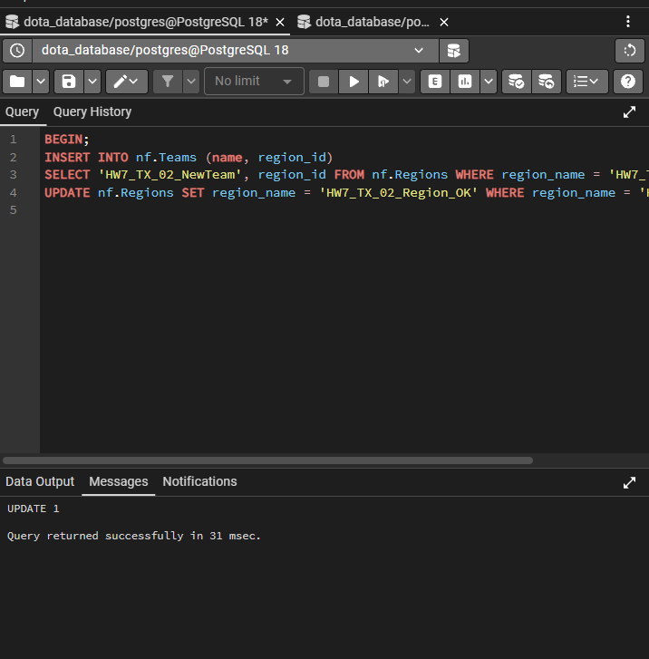

</details>

<details>
<summary>Пошаговые контрольные значения</summary>

Текстовый протокол PostgreSQL 17.10: [02_commit_b.txt](output/02_commit_b.txt).

| Шаг | Сессия | Результат |
|---|---|---|
| 1 | T1 | region_name → [["HW7_TX_02_Region"]]; new_teams → [[0]] |
| 2 | T1 | INSERT 0 1; UPDATE 1 |
| 3 | T1 | region_name → [["HW7_TX_02_Region_OK"]]; new_teams → [[1]] |
| 4 | T1 | Команда выполнена. |
| 5 | T1 | region_name → [["HW7_TX_02_Region_OK"]]; new_teams → [[1]] |

Запись `[[100]]` означает одну строку со значением 100.

</details>

[↑ К содержанию](#contents)

<a id="hw7-03"></a>

### 03. ROLLBACK: игрок и команда

**Что я делаю и объясняю:** Я повторяю добавление игрока и изменение команды, но завершаю транзакцию через ROLLBACK. Обе операции отменяются.

**Итог:** Обе операции отменены.

**Основные фотографии:**

**Внутри транзакции: новый игрок 1.**

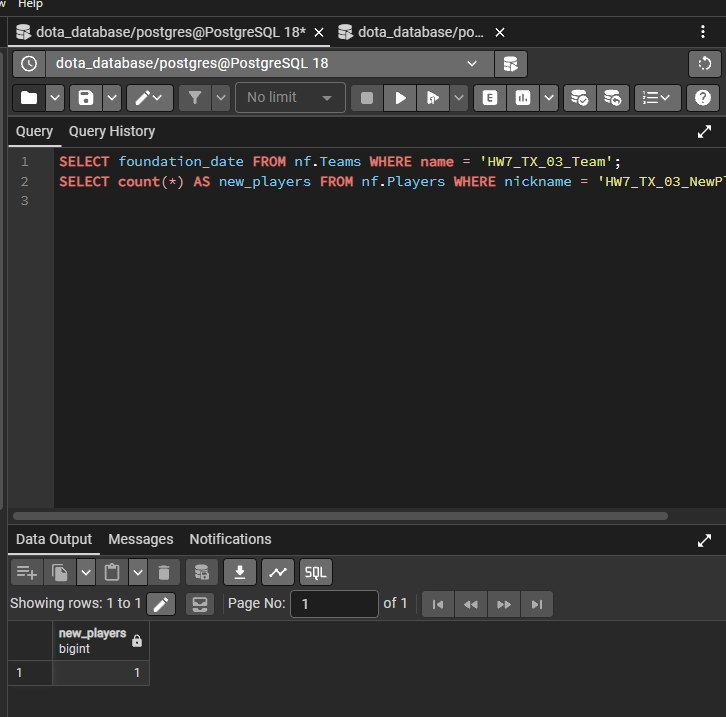

**После отмены: новых игроков 0.**

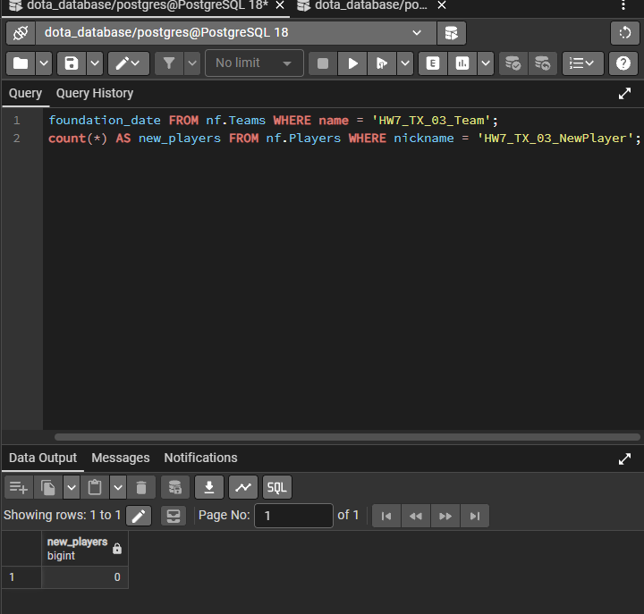

<details>
<summary>SQL и точный порядок выполнения</summary>

**Файлы:** [T1.sql](sql/03_rollback_a/T1.sql).

**Порядок:** 1 (T1) → 2 (T1) → 3 (T1) → 4 (T1) → 5 (T1).

**Шаг 1 — T1.** До изменений.

```sql
SELECT foundation_date FROM nf.Teams WHERE name = 'HW7_TX_03_Team';
SELECT count(*) AS new_players FROM nf.Players WHERE nickname = 'HW7_TX_03_NewPlayer';
```

**Шаг 2 — T1.** INSERT в одну таблицу и UPDATE связанной записи в другой.

```sql
BEGIN;
INSERT INTO nf.Players (nickname, mmr, team_id)
SELECT 'HW7_TX_03_NewPlayer', 8500, team_id FROM nf.Teams WHERE name = 'HW7_TX_03_Team';
UPDATE nf.Teams SET foundation_date = DATE '2026-11-19' WHERE name = 'HW7_TX_03_Team';
```

**Шаг 3 — T1.** Внутри своей транзакции изменения уже видны.

```sql
SELECT foundation_date FROM nf.Teams WHERE name = 'HW7_TX_03_Team';
SELECT count(*) AS new_players FROM nf.Players WHERE nickname = 'HW7_TX_03_NewPlayer';
```

**Шаг 4 — T1.** Завершить транзакцию.

```sql
ROLLBACK;
```

**Шаг 5 — T1.** Проверка после завершения.

```sql
SELECT foundation_date FROM nf.Teams WHERE name = 'HW7_TX_03_Team';
SELECT count(*) AS new_players FROM nf.Players WHERE nickname = 'HW7_TX_03_NewPlayer';
```

</details>

<details>
<summary>Остальные фотографии — 1</summary>

**До изменений: новых игроков 0.**

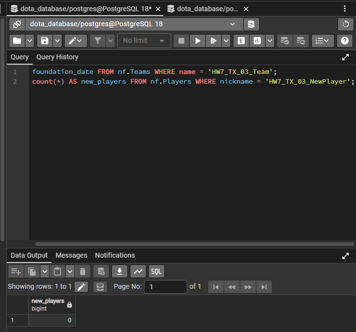

</details>

<details>
<summary>Пошаговые контрольные значения</summary>

Текстовый протокол PostgreSQL 17.10: [03_rollback_a.txt](output/03_rollback_a.txt).

| Шаг | Сессия | Результат |
|---|---|---|
| 1 | T1 | foundation_date → [["2000-01-01"]]; new_players → [[0]] |
| 2 | T1 | INSERT 0 1; UPDATE 1 |
| 3 | T1 | foundation_date → [["2026-11-19"]]; new_players → [[1]] |
| 4 | T1 | Команда выполнена. |
| 5 | T1 | foundation_date → [["2000-01-01"]]; new_players → [[0]] |

Запись `[[100]]` означает одну строку со значением 100.

</details>

[↑ К содержанию](#contents)

<a id="hw7-04"></a>

### 04. ROLLBACK: команда и регион

**Что я делаю и объясняю:** Я создаю команду и переименовываю её регион, затем выполняю ROLLBACK. Новая команда исчезает, прежнее название региона остаётся.

**Итог:** Новая команда не сохранена.

**Основные фотографии:**

**Внутри транзакции: новая команда 1.**

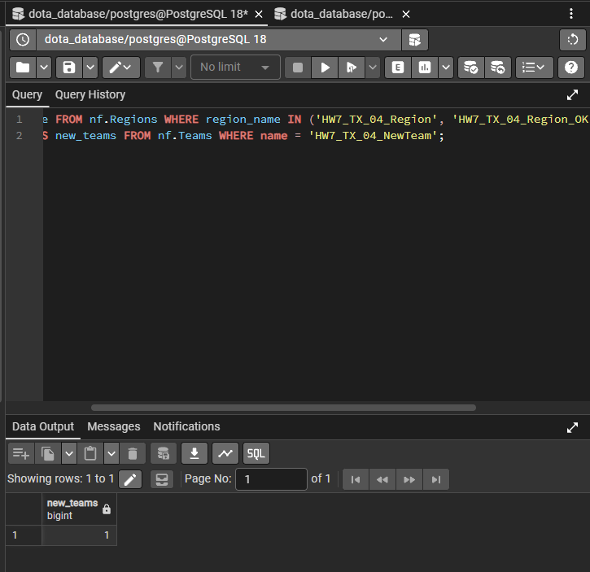

**Итоговая проверка: новых команд 0.**

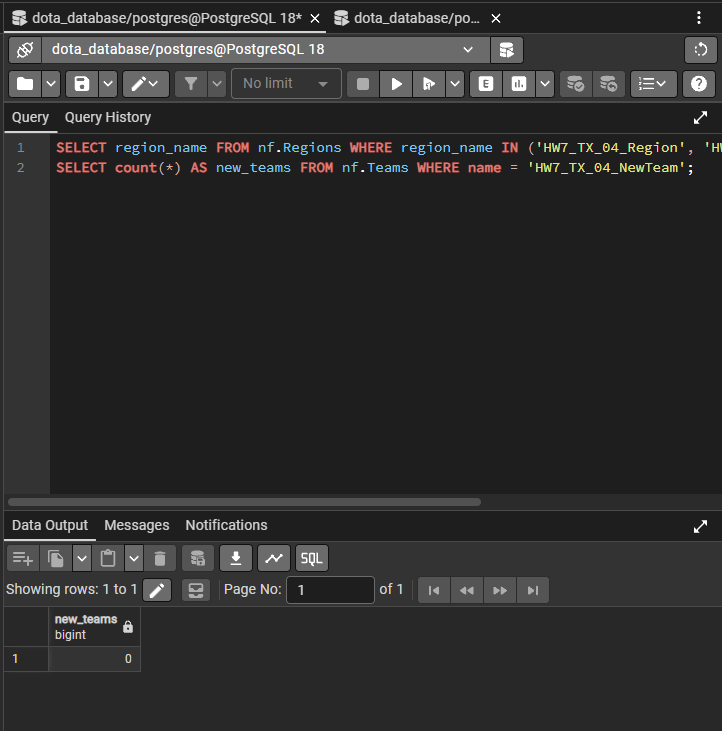

<details>
<summary>SQL и точный порядок выполнения</summary>

**Файлы:** [T1.sql](sql/04_rollback_b/T1.sql).

**Порядок:** 1 (T1) → 2 (T1) → 3 (T1) → 4 (T1) → 5 (T1).

**Шаг 1 — T1.** До изменений.

```sql
SELECT region_name FROM nf.Regions WHERE region_name IN ('HW7_TX_04_Region', 'HW7_TX_04_Region_OK') ORDER BY region_name;
SELECT count(*) AS new_teams FROM nf.Teams WHERE name = 'HW7_TX_04_NewTeam';
```

**Шаг 2 — T1.** INSERT в одну таблицу и UPDATE связанной записи в другой.

```sql
BEGIN;
INSERT INTO nf.Teams (name, region_id)
SELECT 'HW7_TX_04_NewTeam', region_id FROM nf.Regions WHERE region_name = 'HW7_TX_04_Region';
UPDATE nf.Regions SET region_name = 'HW7_TX_04_Region_OK' WHERE region_name = 'HW7_TX_04_Region';
```

**Шаг 3 — T1.** Внутри своей транзакции изменения уже видны.

```sql
SELECT region_name FROM nf.Regions WHERE region_name IN ('HW7_TX_04_Region', 'HW7_TX_04_Region_OK') ORDER BY region_name;
SELECT count(*) AS new_teams FROM nf.Teams WHERE name = 'HW7_TX_04_NewTeam';
```

**Шаг 4 — T1.** Завершить транзакцию.

```sql
ROLLBACK;
```

**Шаг 5 — T1.** Проверка после завершения.

```sql
SELECT region_name FROM nf.Regions WHERE region_name IN ('HW7_TX_04_Region', 'HW7_TX_04_Region_OK') ORDER BY region_name;
SELECT count(*) AS new_teams FROM nf.Teams WHERE name = 'HW7_TX_04_NewTeam';
```

</details>

<details>
<summary>Остальные фотографии — 2</summary>

**До изменений: новых команд 0.**

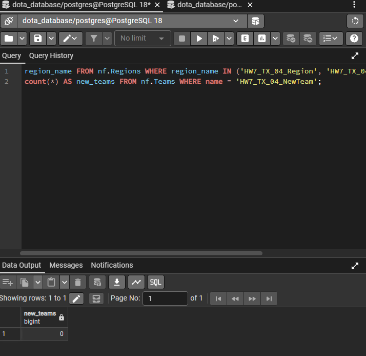

**Проверка после отката: новых команд 0.**

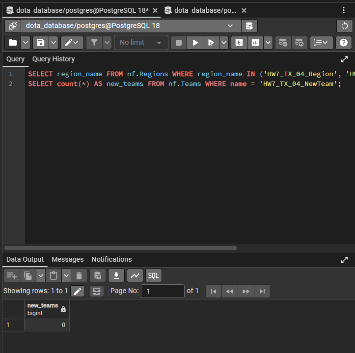

</details>

<details>
<summary>Пошаговые контрольные значения</summary>

Текстовый протокол PostgreSQL 17.10: [04_rollback_b.txt](output/04_rollback_b.txt).

| Шаг | Сессия | Результат |
|---|---|---|
| 1 | T1 | region_name → [["HW7_TX_04_Region"]]; new_teams → [[0]] |
| 2 | T1 | INSERT 0 1; UPDATE 1 |
| 3 | T1 | region_name → [["HW7_TX_04_Region_OK"]]; new_teams → [[1]] |
| 4 | T1 | Команда выполнена. |
| 5 | T1 | region_name → [["HW7_TX_04_Region"]]; new_teams → [[0]] |

Запись `[[100]]` означает одну строку со значением 100.

</details>

[↑ К содержанию](#contents)

<a id="hw7-05"></a>

### 05. ERROR: игрок и команда

**Что я делаю и объясняю:** После INSERT и UPDATE я вызываю деление на ноль. Следующий SELECT показывает состояние прерванной транзакции. После ROLLBACK новых игроков нет.

**Итог:** 22012 → 25P02 → полный откат.

**Основные фотографии:**

**Деление на ноль: SQLSTATE 22012.**

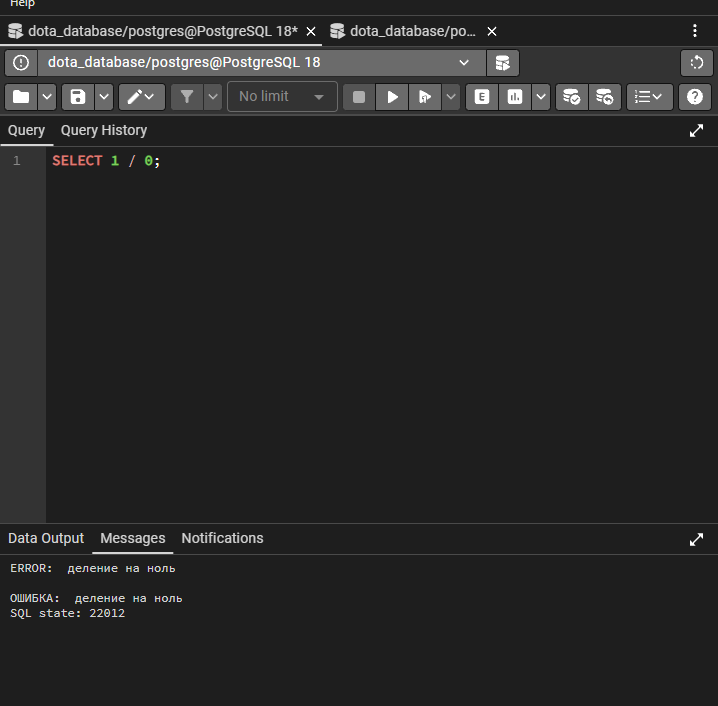

**Следующий запрос отклонён: SQLSTATE 25P02.**

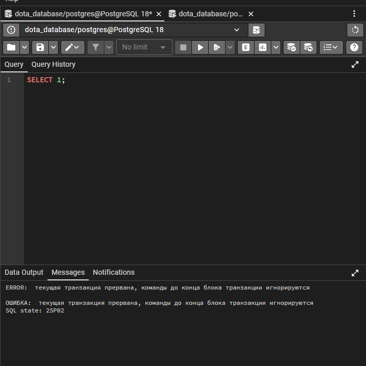

**После отмены: новых игроков 0.**

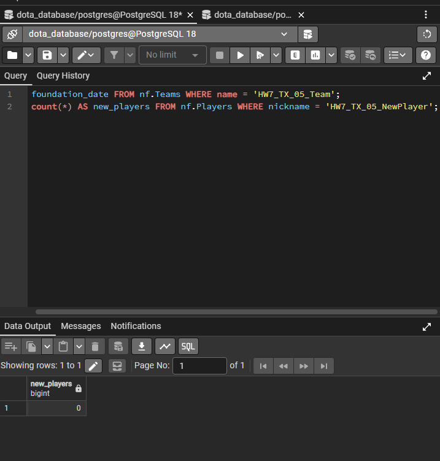

<details>
<summary>SQL и точный порядок выполнения</summary>

**Файлы:** [T1.sql](sql/05_error_a/T1.sql).

**Порядок:** 1 (T1) → 2 (T1) → 3 (T1) → 4 (T1) → 5 (T1) → 6 (T1) → 7 (T1).

**Шаг 1 — T1.** До изменений.

```sql
SELECT foundation_date FROM nf.Teams WHERE name = 'HW7_TX_05_Team';
SELECT count(*) AS new_players FROM nf.Players WHERE nickname = 'HW7_TX_05_NewPlayer';
```

**Шаг 2 — T1.** INSERT в одну таблицу и UPDATE связанной записи в другой.

```sql
BEGIN;
INSERT INTO nf.Players (nickname, mmr, team_id)
SELECT 'HW7_TX_05_NewPlayer', 8500, team_id FROM nf.Teams WHERE name = 'HW7_TX_05_Team';
UPDATE nf.Teams SET foundation_date = DATE '2026-11-19' WHERE name = 'HW7_TX_05_Team';
```

**Шаг 3 — T1.** Внутри своей транзакции изменения уже видны.

```sql
SELECT foundation_date FROM nf.Teams WHERE name = 'HW7_TX_05_Team';
SELECT count(*) AS new_players FROM nf.Players WHERE nickname = 'HW7_TX_05_NewPlayer';
```

**Шаг 4 — T1.** Ожидаемая ошибка. Выполнить только этот шаг.

```sql
SELECT 1 / 0;
```

**Шаг 5 — T1.** Транзакция в ошибочном состоянии: новые команды не выполняются.

```sql
SELECT 1;
```

**Шаг 6 — T1.** Выполнить отдельным запуском после ошибки: полностью отменить транзакцию.

```sql
ROLLBACK;
```

**Шаг 7 — T1.** Проверка после завершения.

```sql
SELECT foundation_date FROM nf.Teams WHERE name = 'HW7_TX_05_Team';
SELECT count(*) AS new_players FROM nf.Players WHERE nickname = 'HW7_TX_05_NewPlayer';
```

</details>

<details>
<summary>Остальные фотографии — 2</summary>

**Исходное состояние: новых игроков 0.**

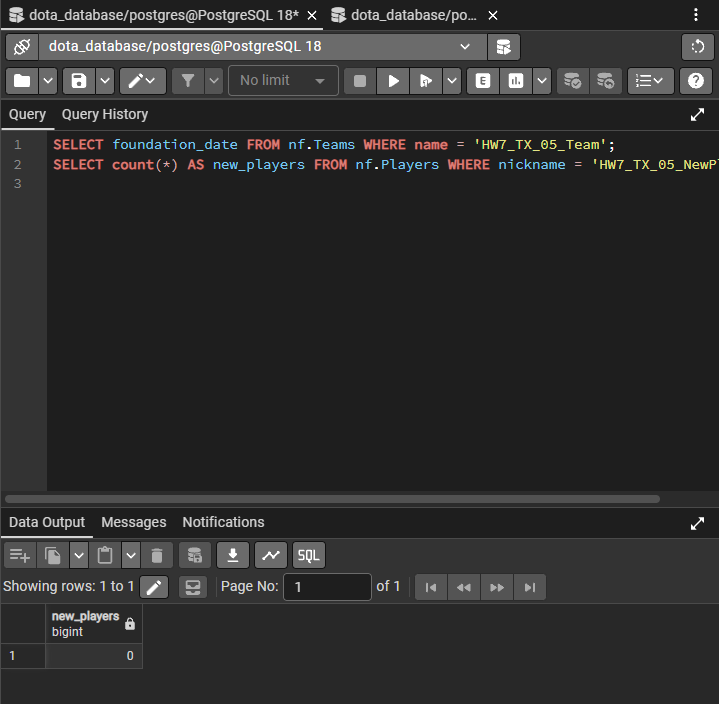

**Новый игрок виден внутри транзакции.**

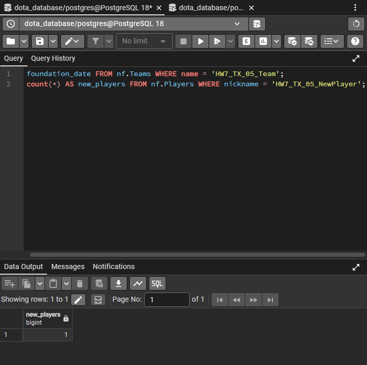

</details>

<details>
<summary>Пошаговые контрольные значения</summary>

Текстовый протокол PostgreSQL 17.10: [05_error_a.txt](output/05_error_a.txt).

| Шаг | Сессия | Результат |
|---|---|---|
| 1 | T1 | foundation_date → [["2000-01-01"]]; new_players → [[0]] |
| 2 | T1 | INSERT 0 1; UPDATE 1 |
| 3 | T1 | foundation_date → [["2026-11-19"]]; new_players → [[1]] |
| 4 | T1 | `22012`: division by zero |
| 5 | T1 | `25P02`: current transaction is aborted, commands ignored until end of transaction block |
| 6 | T1 | Команда выполнена. |
| 7 | T1 | foundation_date → [["2000-01-01"]]; new_players → [[0]] |

Запись `[[100]]` означает одну строку со значением 100.

</details>

[↑ К содержанию](#contents)

<a id="hw7-06"></a>

### 06. ERROR: команда и регион

**Что я делаю и объясняю:** Я проверяю тот же полный откат на команде и регионе: ошибка не позволяет сохранить ни одну из двух операций.

**Итог:** Ошибка отменяет INSERT и UPDATE.

**Основные фотографии:**

**Деление на ноль: SQLSTATE 22012.**

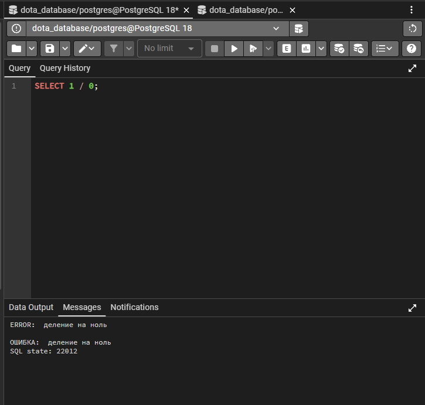

**Прерванная транзакция: SQLSTATE 25P02.**

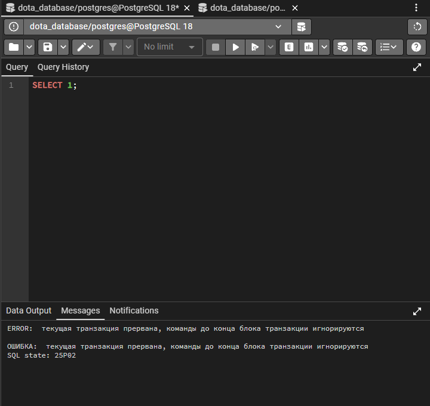

**После отката: новых команд 0.**

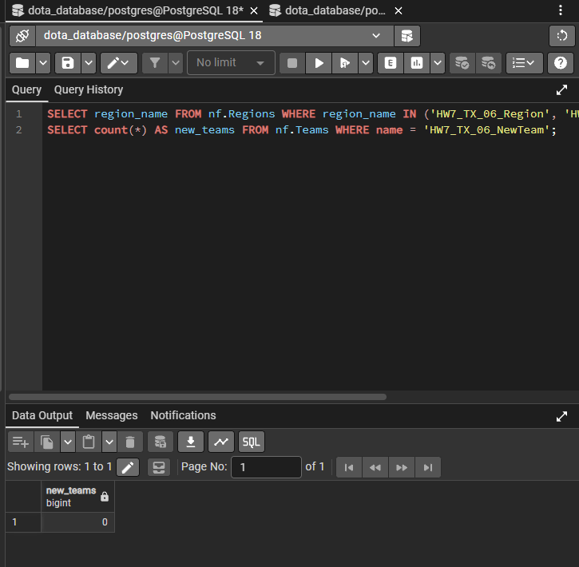

<details>
<summary>SQL и точный порядок выполнения</summary>

**Файлы:** [T1.sql](sql/06_error_b/T1.sql).

**Порядок:** 1 (T1) → 2 (T1) → 3 (T1) → 4 (T1) → 5 (T1) → 6 (T1) → 7 (T1).

**Шаг 1 — T1.** До изменений.

```sql
SELECT region_name FROM nf.Regions WHERE region_name IN ('HW7_TX_06_Region', 'HW7_TX_06_Region_OK') ORDER BY region_name;
SELECT count(*) AS new_teams FROM nf.Teams WHERE name = 'HW7_TX_06_NewTeam';
```

**Шаг 2 — T1.** INSERT в одну таблицу и UPDATE связанной записи в другой.

```sql
BEGIN;
INSERT INTO nf.Teams (name, region_id)
SELECT 'HW7_TX_06_NewTeam', region_id FROM nf.Regions WHERE region_name = 'HW7_TX_06_Region';
UPDATE nf.Regions SET region_name = 'HW7_TX_06_Region_OK' WHERE region_name = 'HW7_TX_06_Region';
```

**Шаг 3 — T1.** Внутри своей транзакции изменения уже видны.

```sql
SELECT region_name FROM nf.Regions WHERE region_name IN ('HW7_TX_06_Region', 'HW7_TX_06_Region_OK') ORDER BY region_name;
SELECT count(*) AS new_teams FROM nf.Teams WHERE name = 'HW7_TX_06_NewTeam';
```

**Шаг 4 — T1.** Ожидаемая ошибка. Выполнить только этот шаг.

```sql
SELECT 1 / 0;
```

**Шаг 5 — T1.** Транзакция в ошибочном состоянии: новые команды не выполняются.

```sql
SELECT 1;
```

**Шаг 6 — T1.** Выполнить отдельным запуском после ошибки: полностью отменить транзакцию.

```sql
ROLLBACK;
```

**Шаг 7 — T1.** Проверка после завершения.

```sql
SELECT region_name FROM nf.Regions WHERE region_name IN ('HW7_TX_06_Region', 'HW7_TX_06_Region_OK') ORDER BY region_name;
SELECT count(*) AS new_teams FROM nf.Teams WHERE name = 'HW7_TX_06_NewTeam';
```

</details>

<details>
<summary>Остальные фотографии — 3</summary>

**Исходное состояние: новых команд 0.**

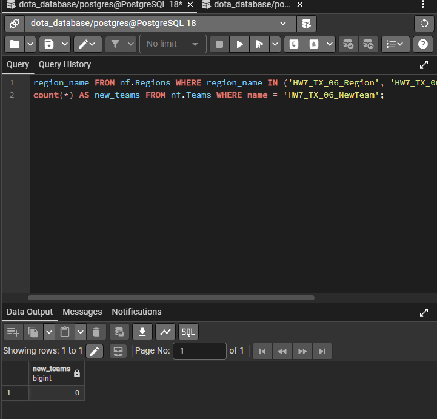

**Новая команда видна внутри транзакции.**

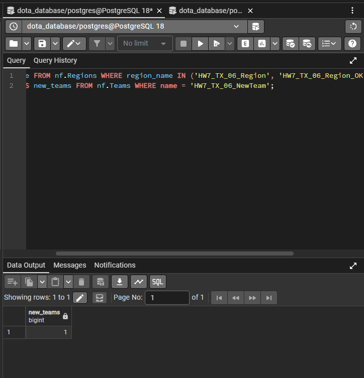

**Выполнен ROLLBACK.**

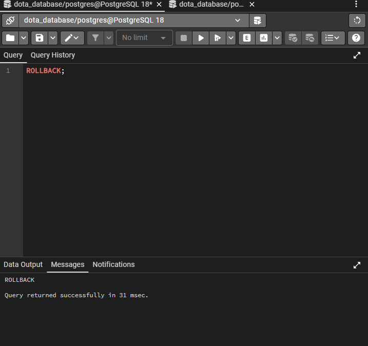

</details>

<details>
<summary>Пошаговые контрольные значения</summary>

Текстовый протокол PostgreSQL 17.10: [06_error_b.txt](output/06_error_b.txt).

| Шаг | Сессия | Результат |
|---|---|---|
| 1 | T1 | region_name → [["HW7_TX_06_Region"]]; new_teams → [[0]] |
| 2 | T1 | INSERT 0 1; UPDATE 1 |
| 3 | T1 | region_name → [["HW7_TX_06_Region_OK"]]; new_teams → [[1]] |
| 4 | T1 | `22012`: division by zero |
| 5 | T1 | `25P02`: current transaction is aborted, commands ignored until end of transaction block |
| 6 | T1 | Команда выполнена. |
| 7 | T1 | region_name → [["HW7_TX_06_Region"]]; new_teams → [[0]] |

Запись `[[100]]` означает одну строку со значением 100.

</details>

[↑ К содержанию](#contents)

## 2. Уровни изоляции

<a id="hw7-07"></a>

### 07. READ UNCOMMITTED: грязное чтение, цена предмета

**Что я делаю и объясняю:** В T1 я меняю цену на 900 без COMMIT. В T2 на READ UNCOMMITTED читаю 100. PostgreSQL не показывает неподтверждённые изменения другой транзакции.

**Итог:** Грязная цена не видна.

**Основные фотографии:**

**T1 меняет цену на 900 без COMMIT.**

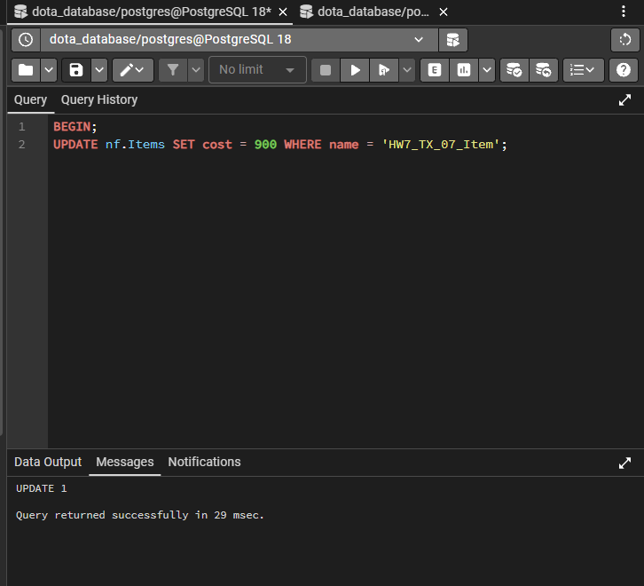

**T2 видит подтверждённую цену 100.**

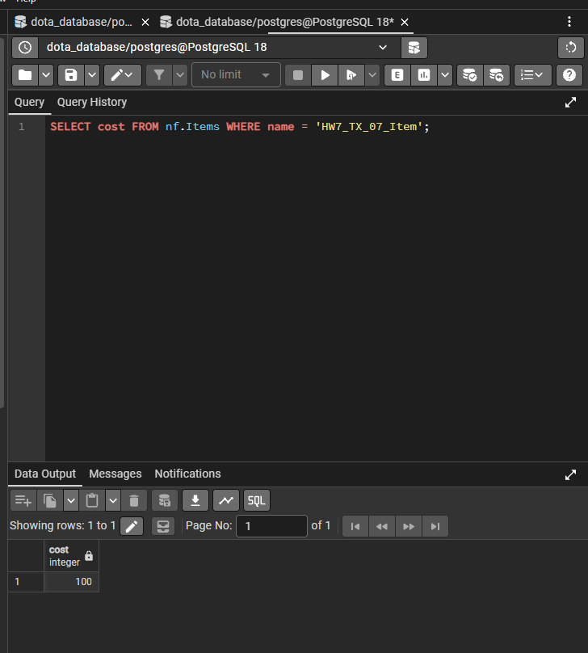

**Повторное чтение даёт 100.**

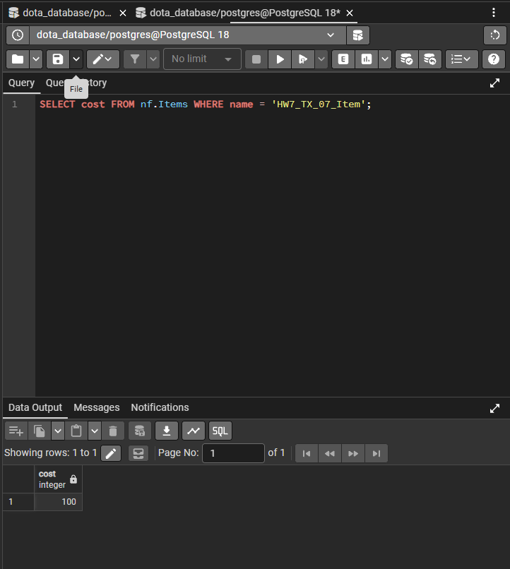

<details>
<summary>SQL и точный порядок выполнения</summary>

**Файлы:** [T1.sql](sql/07_ru_dirty_a/T1.sql), [T2.sql](sql/07_ru_dirty_a/T2.sql).

**Порядок:** 1 (T1) → 2 (T2) → 3 (T2) → 4 (T1) → 5 (T2) → 6 (T2).

**Шаг 1 — T1.** Оставить транзакцию открытой, не нажимать COMMIT.

```sql
BEGIN;
UPDATE nf.Items SET cost = 900 WHERE name = 'HW7_TX_07_Item';
```

**Шаг 2 — T2.** Начать независимую читающую транзакцию.

```sql
BEGIN ISOLATION LEVEL READ UNCOMMITTED;
SHOW transaction_isolation;
```

**Шаг 3 — T2.** Читается старое подтверждённое значение, без ожидания UPDATE.

```sql
SELECT cost FROM nf.Items WHERE name = 'HW7_TX_07_Item';
```

**Шаг 4 — T1.** Завершить T1 через ROLLBACK.

```sql
ROLLBACK;
```

**Шаг 5 — T2.** Повторное чтение.

```sql
SELECT cost FROM nf.Items WHERE name = 'HW7_TX_07_Item';
```

**Шаг 6 — T2.** Завершить T2.

```sql
COMMIT;
```

</details>

<details>
<summary>Остальные фотографии — 1</summary>

**T2 устанавливает READ UNCOMMITTED.**

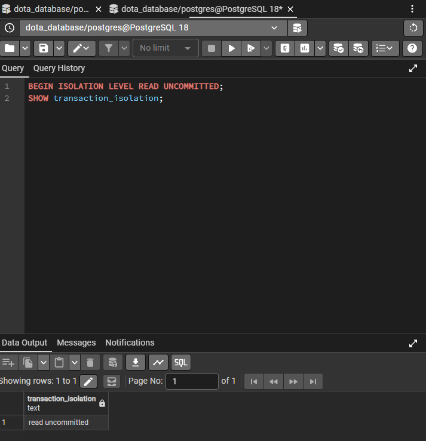

</details>

<details>
<summary>Пошаговые контрольные значения</summary>

Текстовый протокол PostgreSQL 17.10: [07_ru_dirty_a.txt](output/07_ru_dirty_a.txt).

| Шаг | Сессия | Результат |
|---|---|---|
| 1 | T1 | UPDATE 1 |
| 2 | T2 | transaction_isolation → [["read uncommitted"]] |
| 3 | T2 | cost → [[100]] |
| 4 | T1 | Команда выполнена. |
| 5 | T2 | cost → [[100]] |
| 6 | T2 | Команда выполнена. |

Запись `[[100]]` означает одну строку со значением 100.

</details>

[↑ К содержанию](#contents)

<a id="hw7-08"></a>

### 08. READ UNCOMMITTED: грязное чтение, MMR игрока

**Что я делаю и объясняю:** До COMMIT T1 я вижу в T2 старый MMR 8000, после COMMIT — 9000. READ UNCOMMITTED в PostgreSQL ведёт себя как READ COMMITTED.

**Итог:** 8000 до COMMIT, 9000 после.

**Основные фотографии:**

**T2 видит подтверждённый MMR 8000.**

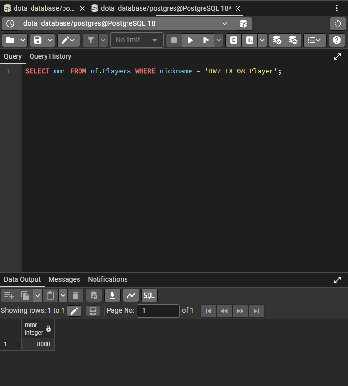

**После фиксации T2 видит 9000.**

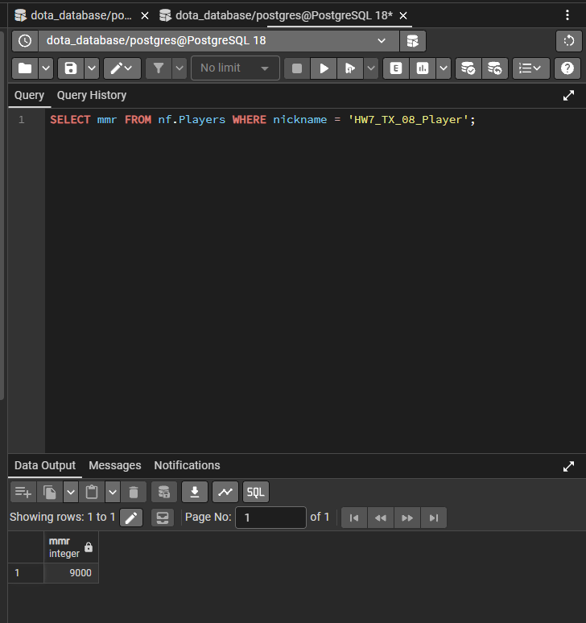

<details>
<summary>SQL и точный порядок выполнения</summary>

**Файлы:** [T1.sql](sql/08_ru_dirty_b/T1.sql), [T2.sql](sql/08_ru_dirty_b/T2.sql).

**Порядок:** 1 (T1) → 2 (T2) → 3 (T2) → 4 (T1) → 5 (T2) → 6 (T2).

**Шаг 1 — T1.** Оставить транзакцию открытой, не нажимать COMMIT.

```sql
BEGIN;
UPDATE nf.Players SET mmr = 9000 WHERE nickname = 'HW7_TX_08_Player';
```

**Шаг 2 — T2.** Начать независимую читающую транзакцию.

```sql
BEGIN ISOLATION LEVEL READ UNCOMMITTED;
SHOW transaction_isolation;
```

**Шаг 3 — T2.** Читается старое подтверждённое значение, без ожидания UPDATE.

```sql
SELECT mmr FROM nf.Players WHERE nickname = 'HW7_TX_08_Player';
```

**Шаг 4 — T1.** Завершить T1 через COMMIT.

```sql
COMMIT;
```

**Шаг 5 — T2.** Повторное чтение.

```sql
SELECT mmr FROM nf.Players WHERE nickname = 'HW7_TX_08_Player';
```

**Шаг 6 — T2.** Завершить T2.

```sql
COMMIT;
```

</details>

<details>
<summary>Остальные фотографии — 3</summary>

**T1 меняет MMR на 9000 без COMMIT.**

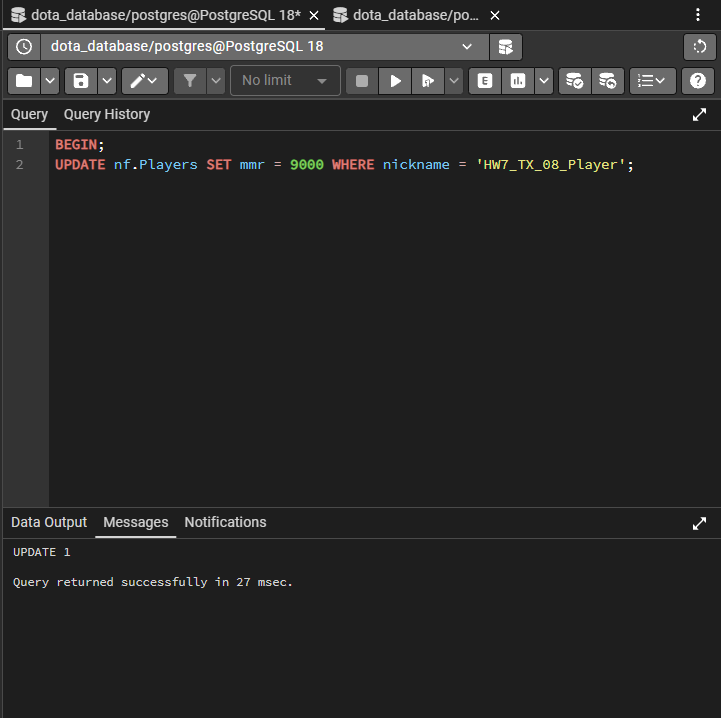

**T2 устанавливает READ UNCOMMITTED.**

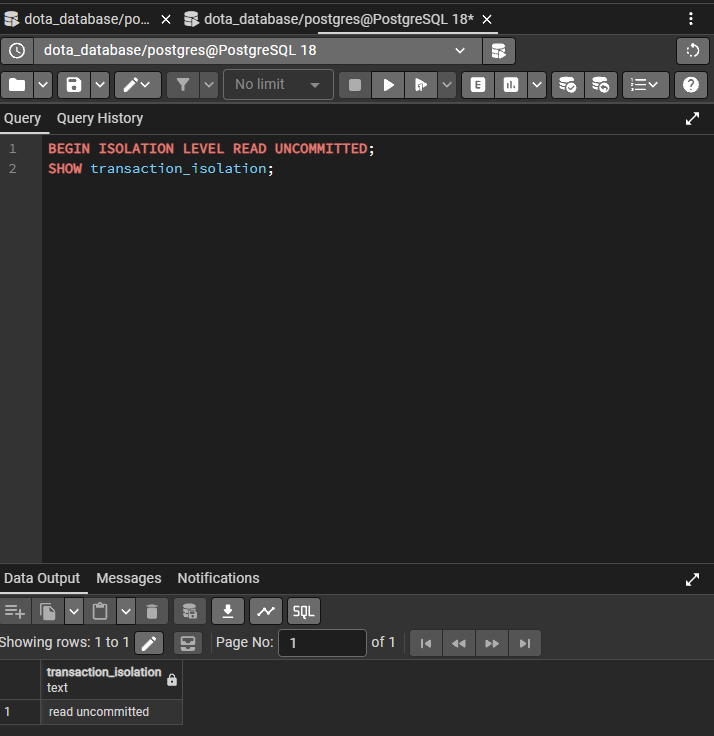

**T1 выполняет COMMIT.**

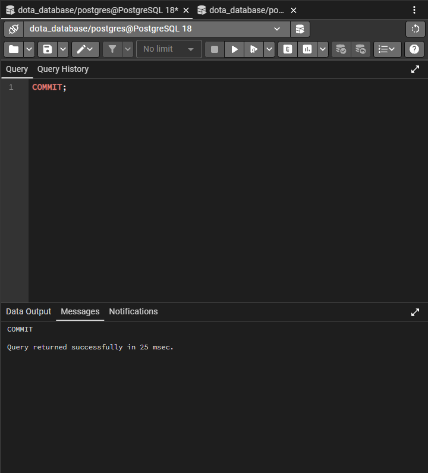

</details>

<details>
<summary>Пошаговые контрольные значения</summary>

Текстовый протокол PostgreSQL 17.10: [08_ru_dirty_b.txt](output/08_ru_dirty_b.txt).

| Шаг | Сессия | Результат |
|---|---|---|
| 1 | T1 | UPDATE 1 |
| 2 | T2 | transaction_isolation → [["read uncommitted"]] |
| 3 | T2 | mmr → [[8000]] |
| 4 | T1 | Команда выполнена. |
| 5 | T2 | mmr → [[9000]] |
| 6 | T2 | Команда выполнена. |

Запись `[[100]]` означает одну строку со значением 100.

</details>

[↑ К содержанию](#contents)

<a id="hw7-09"></a>

### 09. READ COMMITTED: грязное чтение, цена предмета

**Что я делаю и объясняю:** На READ COMMITTED я тоже не вижу грязную цену 900. После ROLLBACK T1 подтверждённая цена остаётся 100.

**Итог:** Грязная цена не видна.

**Основные фотографии:**

**T1 меняет цену на 900 без COMMIT.**

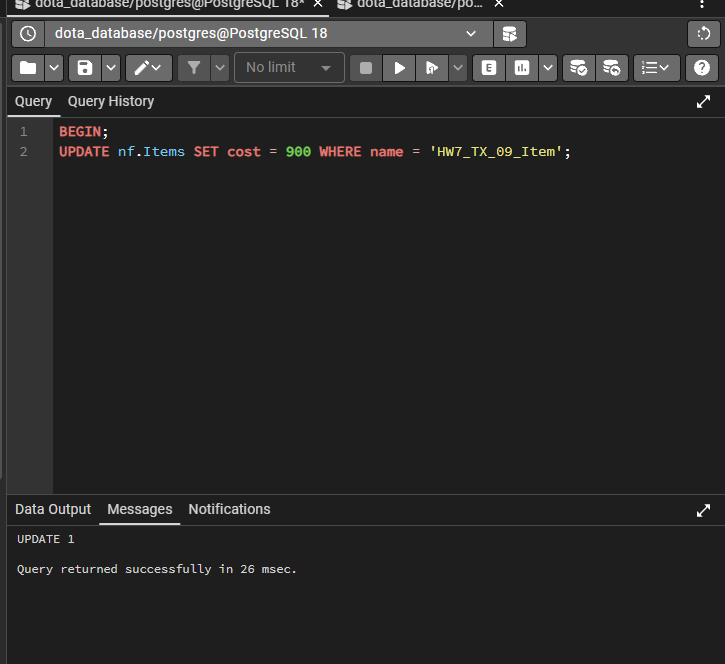

**T2 видит цену 100.**

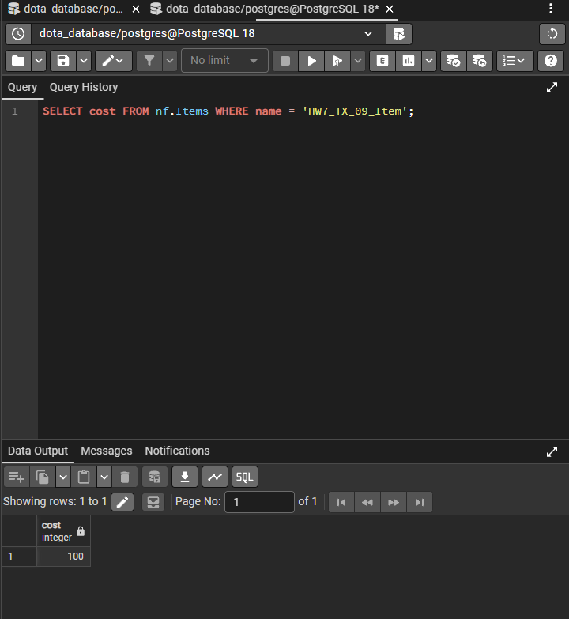

**Цена остаётся 100.**

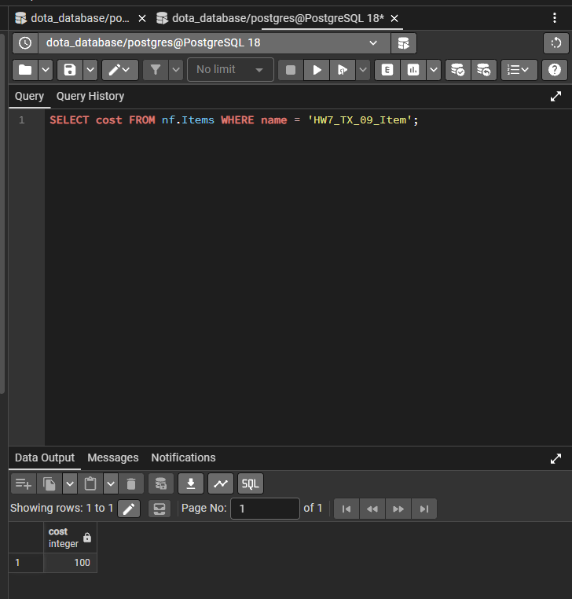

<details>
<summary>SQL и точный порядок выполнения</summary>

**Файлы:** [T1.sql](sql/09_rc_dirty_a/T1.sql), [T2.sql](sql/09_rc_dirty_a/T2.sql).

**Порядок:** 1 (T1) → 2 (T2) → 3 (T2) → 4 (T1) → 5 (T2) → 6 (T2).

**Шаг 1 — T1.** Оставить транзакцию открытой, не нажимать COMMIT.

```sql
BEGIN;
UPDATE nf.Items SET cost = 900 WHERE name = 'HW7_TX_09_Item';
```

**Шаг 2 — T2.** Начать независимую читающую транзакцию.

```sql
BEGIN ISOLATION LEVEL READ COMMITTED;
SHOW transaction_isolation;
```

**Шаг 3 — T2.** Читается старое подтверждённое значение, без ожидания UPDATE.

```sql
SELECT cost FROM nf.Items WHERE name = 'HW7_TX_09_Item';
```

**Шаг 4 — T1.** Завершить T1 через ROLLBACK.

```sql
ROLLBACK;
```

**Шаг 5 — T2.** Повторное чтение.

```sql
SELECT cost FROM nf.Items WHERE name = 'HW7_TX_09_Item';
```

**Шаг 6 — T2.** Завершить T2.

```sql
COMMIT;
```

</details>

<details>
<summary>Остальные фотографии — 2</summary>

**T2 устанавливает READ COMMITTED.**

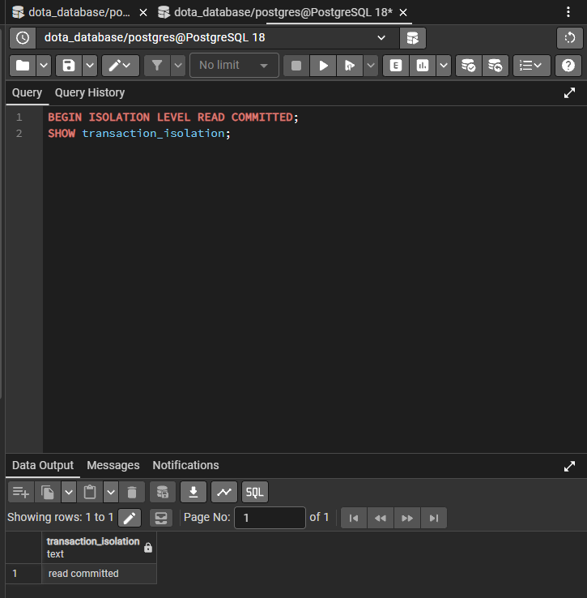

**T1 выполняет ROLLBACK.**

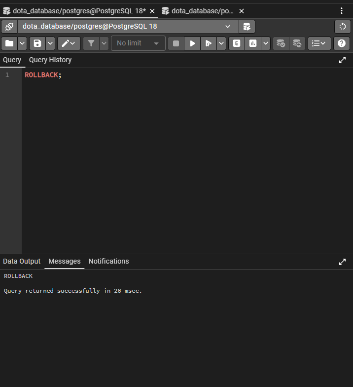

</details>

<details>
<summary>Пошаговые контрольные значения</summary>

Текстовый протокол PostgreSQL 17.10: [09_rc_dirty_a.txt](output/09_rc_dirty_a.txt).

| Шаг | Сессия | Результат |
|---|---|---|
| 1 | T1 | UPDATE 1 |
| 2 | T2 | transaction_isolation → [["read committed"]] |
| 3 | T2 | cost → [[100]] |
| 4 | T1 | Команда выполнена. |
| 5 | T2 | cost → [[100]] |
| 6 | T2 | Команда выполнена. |

Запись `[[100]]` означает одну строку со значением 100.

</details>

[↑ К содержанию](#contents)

<a id="hw7-10"></a>

### 10. READ COMMITTED: грязное чтение, MMR игрока

**Что я делаю и объясняю:** Я читаю подтверждённый MMR 8000, пока T1 не завершена. После её COMMIT следующий SELECT в T2 возвращает 9000.

**Итог:** Новое значение видно после COMMIT.

**Основные фотографии:**

**До фиксации T2 видит 8000.**

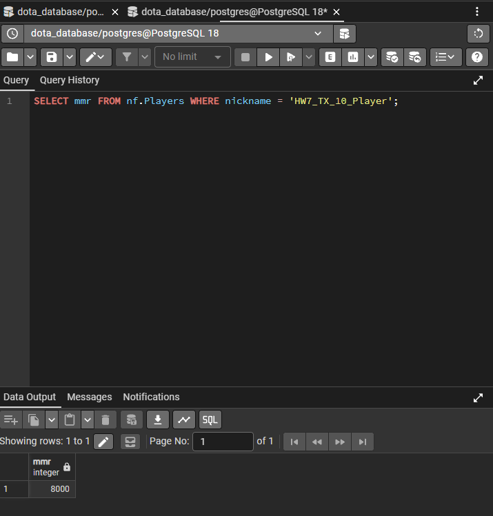

**После фиксации T2 видит 9000.**

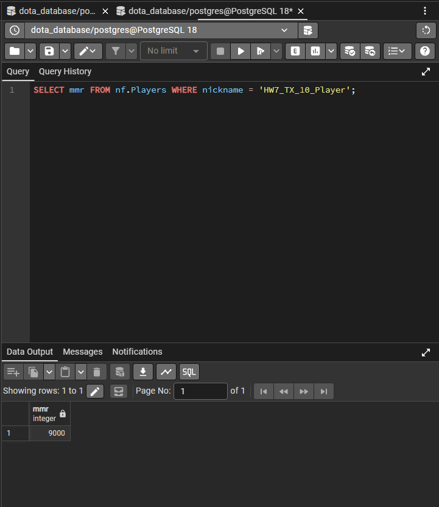

<details>
<summary>SQL и точный порядок выполнения</summary>

**Файлы:** [T1.sql](sql/10_rc_dirty_b/T1.sql), [T2.sql](sql/10_rc_dirty_b/T2.sql).

**Порядок:** 1 (T1) → 2 (T2) → 3 (T2) → 4 (T1) → 5 (T2) → 6 (T2).

**Шаг 1 — T1.** Оставить транзакцию открытой, не нажимать COMMIT.

```sql
BEGIN;
UPDATE nf.Players SET mmr = 9000 WHERE nickname = 'HW7_TX_10_Player';
```

**Шаг 2 — T2.** Начать независимую читающую транзакцию.

```sql
BEGIN ISOLATION LEVEL READ COMMITTED;
SHOW transaction_isolation;
```

**Шаг 3 — T2.** Читается старое подтверждённое значение, без ожидания UPDATE.

```sql
SELECT mmr FROM nf.Players WHERE nickname = 'HW7_TX_10_Player';
```

**Шаг 4 — T1.** Завершить T1 через COMMIT.

```sql
COMMIT;
```

**Шаг 5 — T2.** Повторное чтение.

```sql
SELECT mmr FROM nf.Players WHERE nickname = 'HW7_TX_10_Player';
```

**Шаг 6 — T2.** Завершить T2.

```sql
COMMIT;
```

</details>

<details>
<summary>Остальные фотографии — 2</summary>

**T1 меняет MMR на 9000 без COMMIT.**

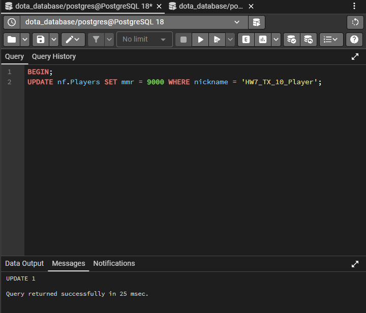

**T2 устанавливает READ COMMITTED.**

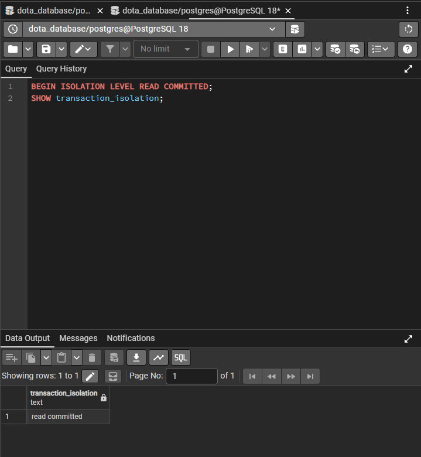

</details>

<details>
<summary>Пошаговые контрольные значения</summary>

Текстовый протокол PostgreSQL 17.10: [10_rc_dirty_b.txt](output/10_rc_dirty_b.txt).

| Шаг | Сессия | Результат |
|---|---|---|
| 1 | T1 | UPDATE 1 |
| 2 | T2 | transaction_isolation → [["read committed"]] |
| 3 | T2 | mmr → [[8000]] |
| 4 | T1 | Команда выполнена. |
| 5 | T2 | mmr → [[9000]] |
| 6 | T2 | Команда выполнена. |

Запись `[[100]]` означает одну строку со значением 100.

</details>

[↑ К содержанию](#contents)

<a id="hw7-11"></a>

### 11. READ COMMITTED: повторное чтение, цена предмета

**Что я делаю и объясняю:** В одной T1 я дважды читаю тот же предмет. Между чтениями T2 фиксирует цену 150. Второе чтение T1 возвращает уже 150 вместо 100.

**Итог:** 100 → 150 внутри T1.

**Основные фотографии:**

**T1: первое чтение цены 100.**

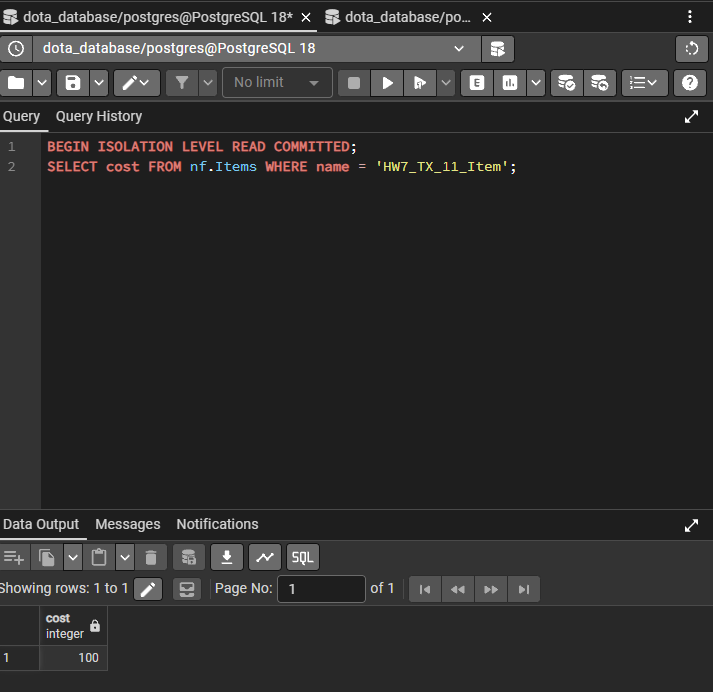

**T1: повторное чтение цены 150.**

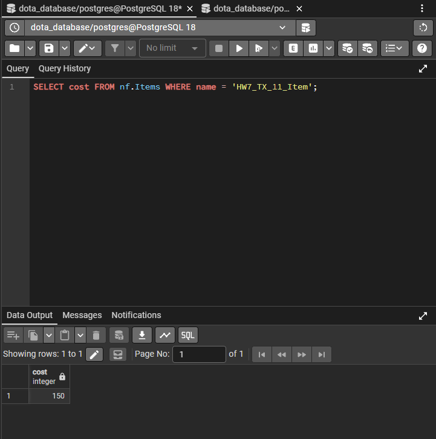

<details>
<summary>SQL и точный порядок выполнения</summary>

**Файлы:** [T1.sql](sql/11_rc_repeat_a/T1.sql), [T2.sql](sql/11_rc_repeat_a/T2.sql).

**Порядок:** 1 (T1) → 2 (T2) → 3 (T1) → 4 (T1).

**Шаг 1 — T1.** Первое чтение создаёт снимок.

```sql
BEGIN ISOLATION LEVEL READ COMMITTED;
SELECT cost FROM nf.Items WHERE name = 'HW7_TX_11_Item';
```

**Шаг 2 — T2.** Изменить значение и зафиксировать.

```sql
BEGIN;
UPDATE nf.Items SET cost = 150 WHERE name = 'HW7_TX_11_Item';
COMMIT;
```

**Шаг 3 — T1.** Повторить тот же SELECT.

```sql
SELECT cost FROM nf.Items WHERE name = 'HW7_TX_11_Item';
```

**Шаг 4 — T1.** После завершения транзакции.

```sql
COMMIT;
SELECT cost FROM nf.Items WHERE name = 'HW7_TX_11_Item';
```

</details>

<details>
<summary>Остальные фотографии — 2</summary>

**T2: UPDATE до 150 и COMMIT.**

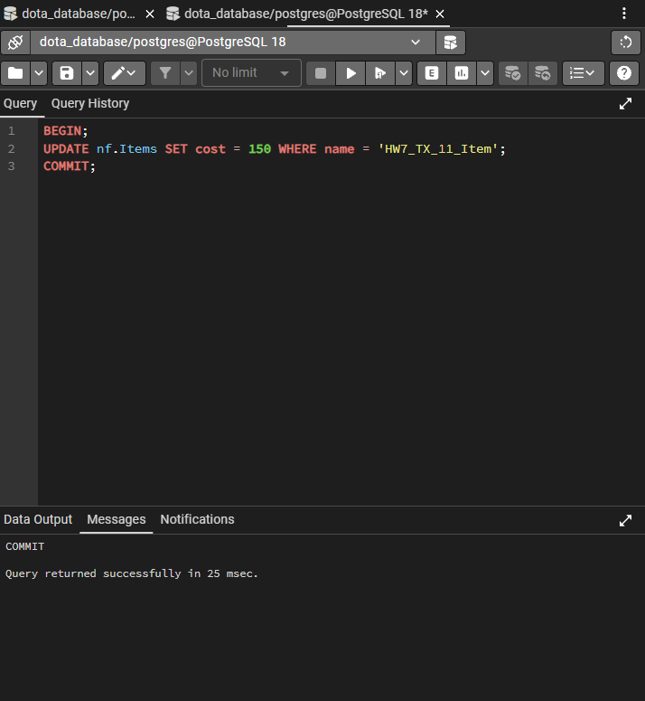

**После COMMIT T1 цена 150.**

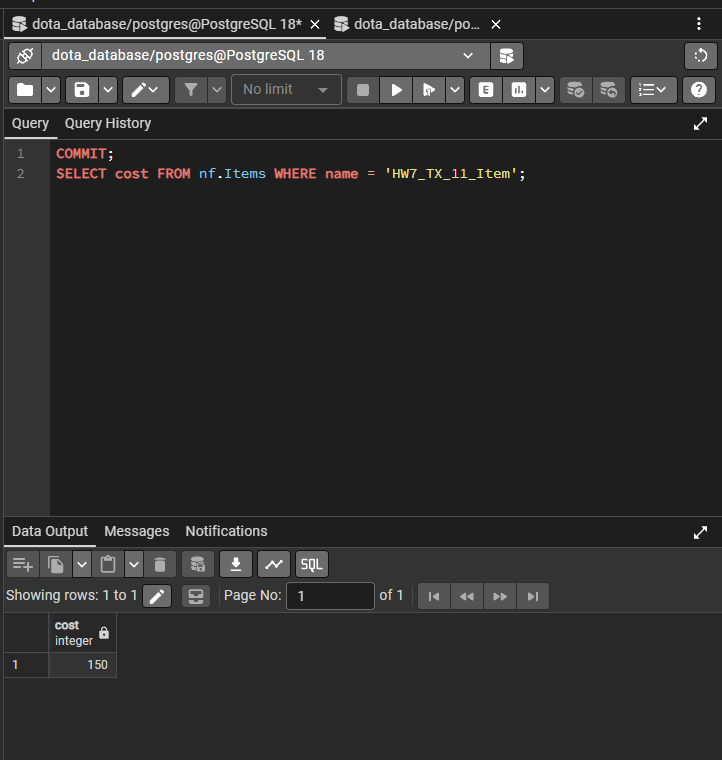

</details>

<details>
<summary>Пошаговые контрольные значения</summary>

Текстовый протокол PostgreSQL 17.10: [11_rc_repeat_a.txt](output/11_rc_repeat_a.txt).

| Шаг | Сессия | Результат |
|---|---|---|
| 1 | T1 | cost → [[100]] |
| 2 | T2 | UPDATE 1 |
| 3 | T1 | cost → [[150]] |
| 4 | T1 | cost → [[150]] |

Запись `[[100]]` означает одну строку со значением 100.

</details>

[↑ К содержанию](#contents)

<a id="hw7-12"></a>

### 12. READ COMMITTED: повторное чтение, MMR игрока

**Что я делаю и объясняю:** Я повторяю неповторяющееся чтение на игроке: два SELECT одной транзакции возвращают сначала MMR 8000, затем 8100.

**Итог:** 8000 → 8100 внутри T1.

**Основные фотографии:**

**T1: первое чтение MMR 8000.**

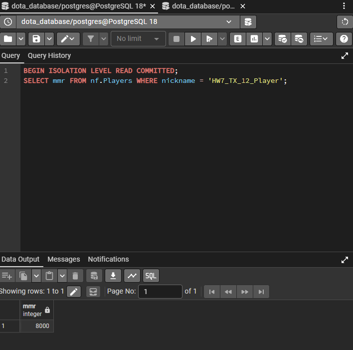

**T1: повторное чтение MMR 8100.**


<details>
<summary>SQL и точный порядок выполнения</summary>

**Файлы:** [T1.sql](sql/12_rc_repeat_b/T1.sql), [T2.sql](sql/12_rc_repeat_b/T2.sql).

**Порядок:** 1 (T1) → 2 (T2) → 3 (T1) → 4 (T1).

**Шаг 1 — T1.** Первое чтение создаёт снимок.

```sql
BEGIN ISOLATION LEVEL READ COMMITTED;
SELECT mmr FROM nf.Players WHERE nickname = 'HW7_TX_12_Player';
```

**Шаг 2 — T2.** Изменить значение и зафиксировать.

```sql
BEGIN;
UPDATE nf.Players SET mmr = 8100 WHERE nickname = 'HW7_TX_12_Player';
COMMIT;
```

**Шаг 3 — T1.** Повторить тот же SELECT.

```sql
SELECT mmr FROM nf.Players WHERE nickname = 'HW7_TX_12_Player';
```

**Шаг 4 — T1.** После завершения транзакции.

```sql
COMMIT;
SELECT mmr FROM nf.Players WHERE nickname = 'HW7_TX_12_Player';
```

</details>

<details>
<summary>Остальные фотографии — 2</summary>

**T2: UPDATE до 8100 и COMMIT.**


**После COMMIT T1 MMR 8100.**


</details>

<details>
<summary>Пошаговые контрольные значения</summary>

Текстовый протокол PostgreSQL 17.10: [12_rc_repeat_b.txt](output/12_rc_repeat_b.txt).

| Шаг | Сессия | Результат |
|---|---|---|
| 1 | T1 | mmr → [[8000]] |
| 2 | T2 | UPDATE 1 |
| 3 | T1 | mmr → [[8100]] |
| 4 | T1 | mmr → [[8100]] |

Запись `[[100]]` означает одну строку со значением 100.

</details>

[↑ К содержанию](#contents)

<a id="hw7-13"></a>

### 13. READ COMMITTED: новый игрок команды

**Что я делаю и объясняю:** Первый SELECT в T1 находит одного игрока команды. T2 добавляет ещё одного. Повторный SELECT T1 находит двух: это фантомная строка.

**Итог:** Один игрок → два.

**Основные фотографии:**

**T1: в команде один игрок.**


**T1 видит двух игроков: фантом появился.**


<details>
<summary>SQL и точный порядок выполнения</summary>

**Файлы:** [T1.sql](sql/13_rc_phantom_a/T1.sql), [T2.sql](sql/13_rc_phantom_a/T2.sql).

**Порядок:** 1 (T1) → 2 (T2) → 3 (T1) → 4 (T1).

**Шаг 1 — T1.** Первое чтение набора строк.

```sql
BEGIN ISOLATION LEVEL READ COMMITTED;
SELECT count(*) AS players_count FROM nf.Players
WHERE team_id = (SELECT team_id FROM nf.Teams WHERE name = 'HW7_TX_13_Team');
```

**Шаг 2 — T2.** Добавить строку, подходящую под условие, и зафиксировать.

```sql
BEGIN;
INSERT INTO nf.Players (nickname, mmr, team_id)
SELECT 'HW7_TX_13_New', 8500, team_id FROM nf.Teams WHERE name = 'HW7_TX_13_Team';
COMMIT;
```

**Шаг 3 — T1.** Повторить тот же запрос.

```sql
SELECT count(*) AS players_count FROM nf.Players
WHERE team_id = (SELECT team_id FROM nf.Teams WHERE name = 'HW7_TX_13_Team');
```

**Шаг 4 — T1.** После завершения T1 новая строка видна.

```sql
COMMIT;
SELECT count(*) AS players_count FROM nf.Players
WHERE team_id = (SELECT team_id FROM nf.Teams WHERE name = 'HW7_TX_13_Team');
```

</details>

<details>
<summary>Остальные фотографии — 2</summary>

**T2: INSERT нового игрока и COMMIT.**


**После COMMIT T1 игроков также два.**


</details>

<details>
<summary>Пошаговые контрольные значения</summary>

Текстовый протокол PostgreSQL 17.10: [13_rc_phantom_a.txt](output/13_rc_phantom_a.txt).

| Шаг | Сессия | Результат |
|---|---|---|
| 1 | T1 | players_count → [[1]] |
| 2 | T2 | INSERT 0 1 |
| 3 | T1 | players_count → [[2]] |
| 4 | T1 | players_count → [[2]] |

Запись `[[100]]` означает одну строку со значением 100.

</details>

[↑ К содержанию](#contents)

<a id="hw7-14"></a>

### 14. READ COMMITTED: новый предмет в выборке

**Что я делаю и объясняю:** Я повторяю опыт с набором предметов: после INSERT и COMMIT в T2 тот же запрос T1 возвращает два предмета вместо одного.

**Итог:** Один предмет → два.

**Основные фотографии:**

**T1: условию соответствует один предмет.**


**T1 видит два предмета: фантом появился.**


<details>
<summary>SQL и точный порядок выполнения</summary>

**Файлы:** [T1.sql](sql/14_rc_phantom_b/T1.sql), [T2.sql](sql/14_rc_phantom_b/T2.sql).

**Порядок:** 1 (T1) → 2 (T2) → 3 (T1) → 4 (T1).

**Шаг 1 — T1.** Первое чтение набора строк.

```sql
BEGIN ISOLATION LEVEL READ COMMITTED;
SELECT count(*) AS items_count FROM nf.Items WHERE description = 'HW7_TX_14_Group' AND cost >= 100;
```

**Шаг 2 — T2.** Добавить строку, подходящую под условие, и зафиксировать.

```sql
BEGIN;
INSERT INTO nf.Items (name, cost, description)
VALUES ('HW7_TX_14_New', 200, 'HW7_TX_14_Group');
COMMIT;
```

**Шаг 3 — T1.** Повторить тот же запрос.

```sql
SELECT count(*) AS items_count FROM nf.Items WHERE description = 'HW7_TX_14_Group' AND cost >= 100;
```

**Шаг 4 — T1.** После завершения T1 новая строка видна.

```sql
COMMIT;
SELECT count(*) AS items_count FROM nf.Items WHERE description = 'HW7_TX_14_Group' AND cost >= 100;
```

</details>

<details>
<summary>Остальные фотографии — 2</summary>

**T2: INSERT второго предмета и COMMIT.**


**Итоговая проверка: два предмета.**


</details>

<details>
<summary>Пошаговые контрольные значения</summary>

Текстовый протокол PostgreSQL 17.10: [14_rc_phantom_b.txt](output/14_rc_phantom_b.txt).

| Шаг | Сессия | Результат |
|---|---|---|
| 1 | T1 | items_count → [[1]] |
| 2 | T2 | INSERT 0 1 |
| 3 | T1 | items_count → [[2]] |
| 4 | T1 | items_count → [[2]] |

Запись `[[100]]` означает одну строку со значением 100.

</details>

[↑ К содержанию](#contents)

<a id="hw7-15"></a>

### 15. REPEATABLE READ: повторное чтение, цена предмета

**Что я делаю и объясняю:** Я читаю цену 100 на REPEATABLE READ. После изменения цены другой сессией в T1 по-прежнему вижу 100. Значение 150 появляется после завершения T1.

**Итог:** Внутри T1 — 100; после — 150.

**Основные фотографии:**

**T1 продолжает видеть 100 на прежнем снимке.**


**После COMMIT T1 видна цена 150.**


<details>
<summary>SQL и точный порядок выполнения</summary>

**Файлы:** [T1.sql](sql/15_rr_repeat_a/T1.sql), [T2.sql](sql/15_rr_repeat_a/T2.sql).

**Порядок:** 1 (T1) → 2 (T2) → 3 (T1) → 4 (T1).

**Шаг 1 — T1.** Первое чтение создаёт снимок.

```sql
BEGIN ISOLATION LEVEL REPEATABLE READ;
SELECT cost FROM nf.Items WHERE name = 'HW7_TX_15_Item';
```

**Шаг 2 — T2.** Изменить значение и зафиксировать.

```sql
BEGIN;
UPDATE nf.Items SET cost = 150 WHERE name = 'HW7_TX_15_Item';
COMMIT;
```

**Шаг 3 — T1.** Повторить тот же SELECT.

```sql
SELECT cost FROM nf.Items WHERE name = 'HW7_TX_15_Item';
```

**Шаг 4 — T1.** После завершения транзакции.

```sql
COMMIT;
SELECT cost FROM nf.Items WHERE name = 'HW7_TX_15_Item';
```

</details>

<details>
<summary>Остальные фотографии — 2</summary>

**T1: первое чтение цены 100.**


**T2: изменение цены до 150 и COMMIT.**


</details>

<details>
<summary>Пошаговые контрольные значения</summary>

Текстовый протокол PostgreSQL 17.10: [15_rr_repeat_a.txt](output/15_rr_repeat_a.txt).

| Шаг | Сессия | Результат |
|---|---|---|
| 1 | T1 | cost → [[100]] |
| 2 | T2 | UPDATE 1 |
| 3 | T1 | cost → [[100]] |
| 4 | T1 | cost → [[150]] |

Запись `[[100]]` означает одну строку со значением 100.

</details>

[↑ К содержанию](#contents)

<a id="hw7-16"></a>

### 16. REPEATABLE READ: повторное чтение, MMR игрока

**Что я делаю и объясняю:** Я проверяю стабильность снимка на MMR: внутри T1 остаётся 8000, после её COMMIT вижу 8100.

**Итог:** Внутри T1 — 8000; после — 8100.

**Основные фотографии:**

**T1 продолжает видеть 8000.**


**После COMMIT T1 виден MMR 8100.**


<details>
<summary>SQL и точный порядок выполнения</summary>

**Файлы:** [T1.sql](sql/16_rr_repeat_b/T1.sql), [T2.sql](sql/16_rr_repeat_b/T2.sql).

**Порядок:** 1 (T1) → 2 (T2) → 3 (T1) → 4 (T1).

**Шаг 1 — T1.** Первое чтение создаёт снимок.

```sql
BEGIN ISOLATION LEVEL REPEATABLE READ;
SELECT mmr FROM nf.Players WHERE nickname = 'HW7_TX_16_Player';
```

**Шаг 2 — T2.** Изменить значение и зафиксировать.

```sql
BEGIN;
UPDATE nf.Players SET mmr = 8100 WHERE nickname = 'HW7_TX_16_Player';
COMMIT;
```

**Шаг 3 — T1.** Повторить тот же SELECT.

```sql
SELECT mmr FROM nf.Players WHERE nickname = 'HW7_TX_16_Player';
```

**Шаг 4 — T1.** После завершения транзакции.

```sql
COMMIT;
SELECT mmr FROM nf.Players WHERE nickname = 'HW7_TX_16_Player';
```

</details>

<details>
<summary>Остальные фотографии — 2</summary>

**T1: первое чтение MMR 8000.**


**T2: изменение MMR до 8100 и COMMIT.**


</details>

<details>
<summary>Пошаговые контрольные значения</summary>

Текстовый протокол PostgreSQL 17.10: [16_rr_repeat_b.txt](output/16_rr_repeat_b.txt).

| Шаг | Сессия | Результат |
|---|---|---|
| 1 | T1 | mmr → [[8000]] |
| 2 | T2 | UPDATE 1 |
| 3 | T1 | mmr → [[8000]] |
| 4 | T1 | mmr → [[8100]] |

Запись `[[100]]` означает одну строку со значением 100.

</details>

[↑ К содержанию](#contents)

<a id="hw7-17"></a>

### 17. REPEATABLE READ: новый игрок команды

**Что я делаю и объясняю:** T2 добавляет игрока, но в T1 на REPEATABLE READ я по-прежнему вижу одного. После COMMIT T1 — двух. В PostgreSQL на этом уровне фантом не появляется.

**Итог:** Внутри T1 — один; после — два.

**Основные фотографии:**

**T1 по-прежнему видит одного игрока.**


**После COMMIT T1 видит двух игроков.**


<details>
<summary>SQL и точный порядок выполнения</summary>

**Файлы:** [T1.sql](sql/17_rr_phantom_a/T1.sql), [T2.sql](sql/17_rr_phantom_a/T2.sql).

**Порядок:** 1 (T1) → 2 (T2) → 3 (T1) → 4 (T1).

**Шаг 1 — T1.** Первое чтение набора строк.

```sql
BEGIN ISOLATION LEVEL REPEATABLE READ;
SELECT count(*) AS players_count FROM nf.Players
WHERE team_id = (SELECT team_id FROM nf.Teams WHERE name = 'HW7_TX_17_Team');
```

**Шаг 2 — T2.** Добавить строку, подходящую под условие, и зафиксировать.

```sql
BEGIN;
INSERT INTO nf.Players (nickname, mmr, team_id)
SELECT 'HW7_TX_17_New', 8500, team_id FROM nf.Teams WHERE name = 'HW7_TX_17_Team';
COMMIT;
```

**Шаг 3 — T1.** Повторить тот же запрос.

```sql
SELECT count(*) AS players_count FROM nf.Players
WHERE team_id = (SELECT team_id FROM nf.Teams WHERE name = 'HW7_TX_17_Team');
```

**Шаг 4 — T1.** После завершения T1 новая строка видна.

```sql
COMMIT;
SELECT count(*) AS players_count FROM nf.Players
WHERE team_id = (SELECT team_id FROM nf.Teams WHERE name = 'HW7_TX_17_Team');
```

</details>

<details>
<summary>Остальные фотографии — 2</summary>

**T1: в команде один игрок.**


**T2: INSERT игрока и COMMIT.**


</details>

<details>
<summary>Пошаговые контрольные значения</summary>

Текстовый протокол PostgreSQL 17.10: [17_rr_phantom_a.txt](output/17_rr_phantom_a.txt).

| Шаг | Сессия | Результат |
|---|---|---|
| 1 | T1 | players_count → [[1]] |
| 2 | T2 | INSERT 0 1 |
| 3 | T1 | players_count → [[1]] |
| 4 | T1 | players_count → [[2]] |

Запись `[[100]]` означает одну строку со значением 100.

</details>

[↑ К содержанию](#contents)

<a id="hw7-18"></a>

### 18. REPEATABLE READ: новый предмет в выборке

**Что я делаю и объясняю:** Я повторяю проверку на предметах. Внутри T1 количество остаётся 1, после её завершения становится 2.

**Итог:** Внутри T1 — один; после — два.

**Основные фотографии:**

**T1 на прежнем снимке видит один предмет.**


**После завершения T1 видит два предмета.**


<details>
<summary>SQL и точный порядок выполнения</summary>

**Файлы:** [T1.sql](sql/18_rr_phantom_b/T1.sql), [T2.sql](sql/18_rr_phantom_b/T2.sql).

**Порядок:** 1 (T1) → 2 (T2) → 3 (T1) → 4 (T1).

**Шаг 1 — T1.** Первое чтение набора строк.

```sql
BEGIN ISOLATION LEVEL REPEATABLE READ;
SELECT count(*) AS items_count FROM nf.Items WHERE description = 'HW7_TX_18_Group' AND cost >= 100;
```

**Шаг 2 — T2.** Добавить строку, подходящую под условие, и зафиксировать.

```sql
BEGIN;
INSERT INTO nf.Items (name, cost, description)
VALUES ('HW7_TX_18_New', 200, 'HW7_TX_18_Group');
COMMIT;
```

**Шаг 3 — T1.** Повторить тот же запрос.

```sql
SELECT count(*) AS items_count FROM nf.Items WHERE description = 'HW7_TX_18_Group' AND cost >= 100;
```

**Шаг 4 — T1.** После завершения T1 новая строка видна.

```sql
COMMIT;
SELECT count(*) AS items_count FROM nf.Items WHERE description = 'HW7_TX_18_Group' AND cost >= 100;
```

</details>

<details>
<summary>Остальные фотографии — 2</summary>

**T1: в выборке один предмет.**


**T2: INSERT предмета и COMMIT.**


</details>

<details>
<summary>Пошаговые контрольные значения</summary>

Текстовый протокол PostgreSQL 17.10: [18_rr_phantom_b.txt](output/18_rr_phantom_b.txt).

| Шаг | Сессия | Результат |
|---|---|---|
| 1 | T1 | items_count → [[1]] |
| 2 | T2 | INSERT 0 1 |
| 3 | T1 | items_count → [[1]] |
| 4 | T1 | items_count → [[2]] |

Запись `[[100]]` означает одну строку со значением 100.

</details>

[↑ К содержанию](#contents)

<a id="hw7-19"></a>

### 19. SERIALIZABLE: две одинаковые заявки на матч (1800 секунд)

**Что я делаю и объясняю:** В обеих транзакциях я проверяю отсутствие одинакового матча. После вставки T1 вторая вставка получает 40001. На новом снимке T2 уже видит существующую запись.

**Итог:** 40001, повтор видит один матч.

**Основные фотографии:**

**T2 получает ошибку сериализации 40001 при вставке.**


**Повтор T2: матч уже существует, количество 1.**


**Итоговая проверка: один матч.**


<details>
<summary>SQL и точный порядок выполнения</summary>

**Файлы:** [T1.sql](sql/19_serial_insert_a/T1.sql), [T2.sql](sql/19_serial_insert_a/T2.sql).

**Порядок:** 1 (T1) → 2 (T2) → 3 (T1) → 4 (T2) → 5 (T2) → 6 (T2) → 7 (T2) → 8 (T1).

**Шаг 1 — T1.** T1 проверяет отсутствие матча.

```sql
BEGIN ISOLATION LEVEL SERIALIZABLE;
SELECT count(*) AS matches_count FROM nf.Matches WHERE game_mode_id = (SELECT game_mode_id FROM nf.GameModes WHERE mode_name = 'HW7_TX_19_Mode')
  AND match_date = DATE '2026-11-19' AND duration_sec = 1800;
```

**Шаг 2 — T2.** T2 также видит отсутствие матча.

```sql
BEGIN ISOLATION LEVEL SERIALIZABLE;
SELECT count(*) AS matches_count FROM nf.Matches WHERE game_mode_id = (SELECT game_mode_id FROM nf.GameModes WHERE mode_name = 'HW7_TX_19_Mode')
  AND match_date = DATE '2026-11-19' AND duration_sec = 1800;
```

**Шаг 3 — T1.** T1 первой создаёт матч и фиксирует результат.

```sql
INSERT INTO nf.Matches (duration_sec, game_mode_id, match_date)
SELECT 1800, game_mode_id, DATE '2026-11-19' FROM nf.GameModes WHERE mode_name = 'HW7_TX_19_Mode';
COMMIT;
```

**Шаг 4 — T2.** Ожидаемая ошибка сериализации, не ошибка UNIQUE.

```sql
INSERT INTO nf.Matches (duration_sec, game_mode_id, match_date)
SELECT 1800, game_mode_id, DATE '2026-11-19' FROM nf.GameModes WHERE mode_name = 'HW7_TX_19_Mode';
```

**Шаг 5 — T2.** Завершить неудачную транзакцию отдельной командой.

```sql
ROLLBACK;
```

**Шаг 6 — T2.** Повтор всей транзакции: снимок и проверка создаются заново.

```sql
BEGIN ISOLATION LEVEL SERIALIZABLE;
SELECT count(*) AS matches_count FROM nf.Matches WHERE game_mode_id = (SELECT game_mode_id FROM nf.GameModes WHERE mode_name = 'HW7_TX_19_Mode')
  AND match_date = DATE '2026-11-19' AND duration_sec = 1800;
```

**Шаг 7 — T2.** На свежем снимке NOT EXISTS ложно: INSERT 0 0.

```sql
INSERT INTO nf.Matches (duration_sec, game_mode_id, match_date)
SELECT 1800, game_mode_id, DATE '2026-11-19' FROM nf.GameModes
WHERE mode_name = 'HW7_TX_19_Mode'
  AND NOT EXISTS (SELECT 1 FROM nf.Matches WHERE game_mode_id = (SELECT game_mode_id FROM nf.GameModes WHERE mode_name = 'HW7_TX_19_Mode')
  AND match_date = DATE '2026-11-19' AND duration_sec = 1800);
COMMIT;
```

**Шаг 8 — T1.** Окончательная проверка.

```sql
SELECT count(*) AS matches_count FROM nf.Matches WHERE game_mode_id = (SELECT game_mode_id FROM nf.GameModes WHERE mode_name = 'HW7_TX_19_Mode')
  AND match_date = DATE '2026-11-19' AND duration_sec = 1800;
```

</details>

<details>
<summary>Остальные фотографии — 4</summary>

**T1: подходящих матчей 0.**


**T2: подходящих матчей 0.**


**T1 вставляет матч и выполняет COMMIT.**


**T2 выполняет ROLLBACK.**


</details>

<details>
<summary>Пошаговые контрольные значения</summary>

Текстовый протокол PostgreSQL 17.10: [19_serial_insert_a.txt](output/19_serial_insert_a.txt).

| Шаг | Сессия | Результат |
|---|---|---|
| 1 | T1 | matches_count → [[0]] |
| 2 | T2 | matches_count → [[0]] |
| 3 | T1 | INSERT 0 1 |
| 4 | T2 | `40001`: could not serialize access due to read/write dependencies among transactions |
| 5 | T2 | Команда выполнена. |
| 6 | T2 | matches_count → [[1]] |
| 7 | T2 | INSERT 0 0 |
| 8 | T1 | matches_count → [[1]] |

Запись `[[100]]` означает одну строку со значением 100.

</details>

[↑ К содержанию](#contents)

<a id="hw7-20"></a>

### 20. SERIALIZABLE: две одинаковые заявки на матч (2400 секунд)

**Что я делаю и объясняю:** Я повторяю конфликт одинаковых заявок для другого матча. После ROLLBACK и повтора проверка NOT EXISTS не даёт вставить дубликат: остаётся один матч.

**Итог:** 40001, дубликат не создаётся.

**Основные фотографии:**

**T2 получает SQLSTATE 40001.**


**Повтор T2: найден один матч.**


**Итог: остался один матч.**


<details>
<summary>SQL и точный порядок выполнения</summary>

**Файлы:** [T1.sql](sql/20_serial_insert_b/T1.sql), [T2.sql](sql/20_serial_insert_b/T2.sql).

**Порядок:** 1 (T1) → 2 (T2) → 3 (T1) → 4 (T2) → 5 (T2) → 6 (T2) → 7 (T2) → 8 (T1).

**Шаг 1 — T1.** T1 проверяет отсутствие матча.

```sql
BEGIN ISOLATION LEVEL SERIALIZABLE;
SELECT count(*) AS matches_count FROM nf.Matches WHERE game_mode_id = (SELECT game_mode_id FROM nf.GameModes WHERE mode_name = 'HW7_TX_20_Mode')
  AND match_date = DATE '2026-11-19' AND duration_sec = 2400;
```

**Шаг 2 — T2.** T2 также видит отсутствие матча.

```sql
BEGIN ISOLATION LEVEL SERIALIZABLE;
SELECT count(*) AS matches_count FROM nf.Matches WHERE game_mode_id = (SELECT game_mode_id FROM nf.GameModes WHERE mode_name = 'HW7_TX_20_Mode')
  AND match_date = DATE '2026-11-19' AND duration_sec = 2400;
```

**Шаг 3 — T1.** T1 первой создаёт матч и фиксирует результат.

```sql
INSERT INTO nf.Matches (duration_sec, game_mode_id, match_date)
SELECT 2400, game_mode_id, DATE '2026-11-19' FROM nf.GameModes WHERE mode_name = 'HW7_TX_20_Mode';
COMMIT;
```

**Шаг 4 — T2.** Ожидаемая ошибка сериализации, не ошибка UNIQUE.

```sql
INSERT INTO nf.Matches (duration_sec, game_mode_id, match_date)
SELECT 2400, game_mode_id, DATE '2026-11-19' FROM nf.GameModes WHERE mode_name = 'HW7_TX_20_Mode';
```

**Шаг 5 — T2.** Завершить неудачную транзакцию отдельной командой.

```sql
ROLLBACK;
```

**Шаг 6 — T2.** Повтор всей транзакции: снимок и проверка создаются заново.

```sql
BEGIN ISOLATION LEVEL SERIALIZABLE;
SELECT count(*) AS matches_count FROM nf.Matches WHERE game_mode_id = (SELECT game_mode_id FROM nf.GameModes WHERE mode_name = 'HW7_TX_20_Mode')
  AND match_date = DATE '2026-11-19' AND duration_sec = 2400;
```

**Шаг 7 — T2.** На свежем снимке NOT EXISTS ложно: INSERT 0 0.

```sql
INSERT INTO nf.Matches (duration_sec, game_mode_id, match_date)
SELECT 2400, game_mode_id, DATE '2026-11-19' FROM nf.GameModes
WHERE mode_name = 'HW7_TX_20_Mode'
  AND NOT EXISTS (SELECT 1 FROM nf.Matches WHERE game_mode_id = (SELECT game_mode_id FROM nf.GameModes WHERE mode_name = 'HW7_TX_20_Mode')
  AND match_date = DATE '2026-11-19' AND duration_sec = 2400);
COMMIT;
```

**Шаг 8 — T1.** Окончательная проверка.

```sql
SELECT count(*) AS matches_count FROM nf.Matches WHERE game_mode_id = (SELECT game_mode_id FROM nf.GameModes WHERE mode_name = 'HW7_TX_20_Mode')
  AND match_date = DATE '2026-11-19' AND duration_sec = 2400;
```

</details>

<details>
<summary>Остальные фотографии — 5</summary>

**T1: подходящих матчей 0.**


**T2: подходящих матчей 0.**


**T1 вставляет матч и выполняет COMMIT.**


**T2 выполняет ROLLBACK.**


**Повторный INSERT с NOT EXISTS и COMMIT.**


</details>

<details>
<summary>Пошаговые контрольные значения</summary>

Текстовый протокол PostgreSQL 17.10: [20_serial_insert_b.txt](output/20_serial_insert_b.txt).

| Шаг | Сессия | Результат |
|---|---|---|
| 1 | T1 | matches_count → [[0]] |
| 2 | T2 | matches_count → [[0]] |
| 3 | T1 | INSERT 0 1 |
| 4 | T2 | `40001`: could not serialize access due to read/write dependencies among transactions |
| 5 | T2 | Команда выполнена. |
| 6 | T2 | matches_count → [[1]] |
| 7 | T2 | INSERT 0 0 |
| 8 | T1 | matches_count → [[1]] |

Запись `[[100]]` означает одну строку со значением 100.

</details>

[↑ К содержанию](#contents)

<a id="hw7-21"></a>

### 21. SERIALIZABLE: конкурентное обновление цены

**Что я делаю и объясняю:** Обе транзакции читают цену 100. T1 добавляет 10. T2 получает 40001 при обновлении старой версии. Я повторяю T2 целиком, и обе прибавки сохраняются: итог 130.

**Итог:** 40001 → повтор → цена 130.

**Основные фотографии:**

**T2: ошибка конкурентного UPDATE, SQLSTATE 40001.**


**Повтор T2: чтение новой цены 110.**


**Итоговая цена 130.**


<details>
<summary>SQL и точный порядок выполнения</summary>

**Файлы:** [T1.sql](sql/21_serial_update_a/T1.sql), [T2.sql](sql/21_serial_update_a/T2.sql).

**Порядок:** 1 (T1) → 2 (T2) → 3 (T1) → 4 (T2) → 5 (T2) → 6 (T2) → 7 (T2) → 8 (T1).

**Шаг 1 — T1.** Создать снимок T1.

```sql
BEGIN ISOLATION LEVEL SERIALIZABLE;
SELECT cost FROM nf.Items WHERE name = 'HW7_TX_21_Item';
```

**Шаг 2 — T2.** Создать снимок T2 до изменения строки.

```sql
BEGIN ISOLATION LEVEL SERIALIZABLE;
SELECT cost FROM nf.Items WHERE name = 'HW7_TX_21_Item';
```

**Шаг 3 — T1.** Первое обновление фиксируется.

```sql
UPDATE nf.Items SET cost = cost + 10 WHERE name = 'HW7_TX_21_Item';
COMMIT;
```

**Шаг 4 — T2.** Ожидается именно ошибка concurrent update.

```sql
UPDATE nf.Items SET cost = cost + 20 WHERE name = 'HW7_TX_21_Item';
```

**Шаг 5 — T2.** Закрыть неудачную транзакцию.

```sql
ROLLBACK;
```

**Шаг 6 — T2.** Повторить транзакцию с самого начала.

```sql
BEGIN ISOLATION LEVEL SERIALIZABLE;
SELECT cost FROM nf.Items WHERE name = 'HW7_TX_21_Item';
```

**Шаг 7 — T2.** Повторное обновление на свежем снимке.

```sql
UPDATE nf.Items SET cost = cost + 20 WHERE name = 'HW7_TX_21_Item';
COMMIT;
```

**Шаг 8 — T1.** Обе прибавки сохранены.

```sql
SELECT cost FROM nf.Items WHERE name = 'HW7_TX_21_Item';
```

</details>

<details>
<summary>Остальные фотографии — 5</summary>

**T1: первоначальная цена 100.**


**T2: первоначальная цена 100.**


**T1 увеличивает цену на 10 и выполняет COMMIT.**


**T2 выполняет ROLLBACK.**


**T2 увеличивает цену на 20 и выполняет COMMIT.**


</details>

<details>
<summary>Пошаговые контрольные значения</summary>

Текстовый протокол PostgreSQL 17.10: [21_serial_update_a.txt](output/21_serial_update_a.txt).

| Шаг | Сессия | Результат |
|---|---|---|
| 1 | T1 | cost → [[100]] |
| 2 | T2 | cost → [[100]] |
| 3 | T1 | UPDATE 1 |
| 4 | T2 | `40001`: could not serialize access due to concurrent update |
| 5 | T2 | Команда выполнена. |
| 6 | T2 | cost → [[110]] |
| 7 | T2 | UPDATE 1 |
| 8 | T1 | cost → [[130]] |

Запись `[[100]]` означает одну строку со значением 100.

</details>

[↑ К содержанию](#contents)

<a id="hw7-22"></a>

### 22. SERIALIZABLE: конкурентное обновление MMR

**Что я делаю и объясняю:** Я повторяю конкурентный UPDATE на MMR. После полного повтора T2 результат равен 8300: учтены и +100, и +200.

**Итог:** 40001 → повтор → MMR 8300.

**Основные фотографии:**

**T2: SQLSTATE 40001 при конкурентном UPDATE.**


**Повтор T2: MMR 8100.**


**Итоговый MMR 8300.**


<details>
<summary>SQL и точный порядок выполнения</summary>

**Файлы:** [T1.sql](sql/22_serial_update_b/T1.sql), [T2.sql](sql/22_serial_update_b/T2.sql).

**Порядок:** 1 (T1) → 2 (T2) → 3 (T1) → 4 (T2) → 5 (T2) → 6 (T2) → 7 (T2) → 8 (T1).

**Шаг 1 — T1.** Создать снимок T1.

```sql
BEGIN ISOLATION LEVEL SERIALIZABLE;
SELECT mmr FROM nf.Players WHERE nickname = 'HW7_TX_22_Player';
```

**Шаг 2 — T2.** Создать снимок T2 до изменения строки.

```sql
BEGIN ISOLATION LEVEL SERIALIZABLE;
SELECT mmr FROM nf.Players WHERE nickname = 'HW7_TX_22_Player';
```

**Шаг 3 — T1.** Первое обновление фиксируется.

```sql
UPDATE nf.Players SET mmr = mmr + 100 WHERE nickname = 'HW7_TX_22_Player';
COMMIT;
```

**Шаг 4 — T2.** Ожидается именно ошибка concurrent update.

```sql
UPDATE nf.Players SET mmr = mmr + 200 WHERE nickname = 'HW7_TX_22_Player';
```

**Шаг 5 — T2.** Закрыть неудачную транзакцию.

```sql
ROLLBACK;
```

**Шаг 6 — T2.** Повторить транзакцию с самого начала.

```sql
BEGIN ISOLATION LEVEL SERIALIZABLE;
SELECT mmr FROM nf.Players WHERE nickname = 'HW7_TX_22_Player';
```

**Шаг 7 — T2.** Повторное обновление на свежем снимке.

```sql
UPDATE nf.Players SET mmr = mmr + 200 WHERE nickname = 'HW7_TX_22_Player';
COMMIT;
```

**Шаг 8 — T1.** Обе прибавки сохранены.

```sql
SELECT mmr FROM nf.Players WHERE nickname = 'HW7_TX_22_Player';
```

</details>

<details>
<summary>Остальные фотографии — 5</summary>

**T1: первоначальный MMR 8000.**


**T2: первоначальный MMR 8000.**


**T1 добавляет 100 и выполняет COMMIT.**


**T2 выполняет ROLLBACK.**


**T2 добавляет 200 и выполняет COMMIT.**


</details>

<details>
<summary>Пошаговые контрольные значения</summary>

Текстовый протокол PostgreSQL 17.10: [22_serial_update_b.txt](output/22_serial_update_b.txt).

| Шаг | Сессия | Результат |
|---|---|---|
| 1 | T1 | mmr → [[8000]] |
| 2 | T2 | mmr → [[8000]] |
| 3 | T1 | UPDATE 1 |
| 4 | T2 | `40001`: could not serialize access due to concurrent update |
| 5 | T2 | Команда выполнена. |
| 6 | T2 | mmr → [[8100]] |
| 7 | T2 | UPDATE 1 |
| 8 | T1 | mmr → [[8300]] |

Запись `[[100]]` означает одну строку со значением 100.

</details>

[↑ К содержанию](#contents)

## 3. SAVEPOINT

<a id="hw7-23"></a>

### 23. SAVEPOINT: сохранить изменения до точки

**Что я делаю и объясняю:** Я создаю игрока Before до точки сохранения, After — после неё. ROLLBACK TO удаляет только After; Before остаётся и сохраняется после COMMIT.

**Итог:** Before остаётся, After отменён.

**Основные фотографии:**

**Перед откатом видны Before и After.**


**После ROLLBACK TO остался только Before.**


**После завершения транзакции Before сохранился.**


<details>
<summary>SQL и точный порядок выполнения</summary>

**Файлы:** [T1.sql](sql/23_savepoint_one/T1.sql).

**Порядок:** 1 (T1) → 2 (T1) → 3 (T1) → 4 (T1) → 5 (T1).

**Шаг 1 — T1.** Изменения до точки сохранения.

```sql
BEGIN;
UPDATE nf.Teams SET foundation_date = DATE '2010-01-01' WHERE name = 'HW7_TX_23_Team';
INSERT INTO nf.Players (nickname, mmr, team_id)
SELECT 'HW7_TX_23_Before', 8000, team_id FROM nf.Teams WHERE name = 'HW7_TX_23_Team';
SAVEPOINT before_extra;
```

**Шаг 2 — T1.** Изменения после точки.

```sql
UPDATE nf.Teams SET foundation_date = DATE '2020-01-01' WHERE name = 'HW7_TX_23_Team';
INSERT INTO nf.Players (nickname, mmr, team_id)
SELECT 'HW7_TX_23_After', 9000, team_id FROM nf.Teams WHERE name = 'HW7_TX_23_Team';
```

**Шаг 3 — T1.** Перед частичным откатом.

```sql
SELECT foundation_date FROM nf.Teams WHERE name = 'HW7_TX_23_Team';
SELECT nickname FROM nf.Players WHERE nickname IN ('HW7_TX_23_Before', 'HW7_TX_23_After') ORDER BY nickname;
```

**Шаг 4 — T1.** Изменения до SAVEPOINT остались.

```sql
ROLLBACK TO SAVEPOINT before_extra;
SELECT foundation_date FROM nf.Teams WHERE name = 'HW7_TX_23_Team';
SELECT nickname FROM nf.Players WHERE nickname IN ('HW7_TX_23_Before', 'HW7_TX_23_After') ORDER BY nickname;
```

**Шаг 5 — T1.** Оставшиеся изменения зафиксированы.

```sql
COMMIT;
SELECT foundation_date FROM nf.Teams WHERE name = 'HW7_TX_23_Team';
SELECT nickname FROM nf.Players WHERE nickname IN ('HW7_TX_23_Before', 'HW7_TX_23_After') ORDER BY nickname;
```

</details>

<details>
<summary>Остальные фотографии — 2</summary>

**Изменения и игрок Before созданы до SAVEPOINT.**


**Игрок After и второе изменение даты созданы после SAVEPOINT.**


</details>

<details>
<summary>Пошаговые контрольные значения</summary>

Текстовый протокол PostgreSQL 17.10: [23_savepoint_one.txt](output/23_savepoint_one.txt).

| Шаг | Сессия | Результат |
|---|---|---|
| 1 | T1 | UPDATE 1; INSERT 0 1 |
| 2 | T1 | UPDATE 1; INSERT 0 1 |
| 3 | T1 | foundation_date → [["2020-01-01"]]; nickname → [["HW7_TX_23_After"], ["HW7_TX_23_Before"]] |
| 4 | T1 | foundation_date → [["2010-01-01"]]; nickname → [["HW7_TX_23_Before"]] |
| 5 | T1 | foundation_date → [["2010-01-01"]]; nickname → [["HW7_TX_23_Before"]] |

Запись `[[100]]` означает одну строку со значением 100.

</details>

[↑ К содержанию](#contents)

<a id="hw7-24"></a>

### 24. SAVEPOINT: возврат ко второй и первой точкам

**Что я делаю и объясняю:** Я меняю цену 100 → 110 → 120 → 130. Возврат ко второй точке даёт 120, к первой — 110. Именно 110 сохраняется после COMMIT.

**Итог:** 130 → 120 → 110.

**Основные фотографии:**

**Созданы две точки, текущая цена 130.**


**ROLLBACK TO second_point возвращает 120.**


**ROLLBACK TO first_point возвращает 110.**


**После RELEASE и COMMIT цена 110.**


<details>
<summary>SQL и точный порядок выполнения</summary>

**Файлы:** [T1.sql](sql/24_savepoint_two/T1.sql).

**Порядок:** 1 (T1) → 2 (T1) → 3 (T1) → 4 (T1).

**Шаг 1 — T1.** Создать две точки.

```sql
BEGIN;
UPDATE nf.Items SET cost = 110 WHERE name = 'HW7_TX_24_Item';
SAVEPOINT first_point;
UPDATE nf.Items SET cost = 120 WHERE name = 'HW7_TX_24_Item';
SAVEPOINT second_point;
UPDATE nf.Items SET cost = 130 WHERE name = 'HW7_TX_24_Item';
SELECT cost FROM nf.Items WHERE name = 'HW7_TX_24_Item';
```

**Шаг 2 — T1.** Возврат ко второй.

```sql
ROLLBACK TO SAVEPOINT second_point;
SELECT cost FROM nf.Items WHERE name = 'HW7_TX_24_Item';
```

**Шаг 3 — T1.** Возврат к первой.

```sql
ROLLBACK TO SAVEPOINT first_point;
SELECT cost FROM nf.Items WHERE name = 'HW7_TX_24_Item';
```

**Шаг 4 — T1.** Сохранить результат.

```sql
RELEASE SAVEPOINT first_point;
COMMIT;
SELECT cost FROM nf.Items WHERE name = 'HW7_TX_24_Item';
```

</details>

<details>
<summary>Пошаговые контрольные значения</summary>

Текстовый протокол PostgreSQL 17.10: [24_savepoint_two.txt](output/24_savepoint_two.txt).

| Шаг | Сессия | Результат |
|---|---|---|
| 1 | T1 | UPDATE 1; UPDATE 1; UPDATE 1; cost → [[130]] |
| 2 | T1 | cost → [[120]] |
| 3 | T1 | cost → [[110]] |
| 4 | T1 | cost → [[110]] |

Запись `[[100]]` означает одну строку со значением 100.

</details>

[↑ К содержанию](#contents)

## 4. Мои выводы

1. Я проверил атомарность: COMMIT сохраняет связанные операции, ROLLBACK отменяет обе.
2. После ошибки без SAVEPOINT транзакция остаётся прерванной: обычные команды
   дают 25P02. Я завершаю её через ROLLBACK; исходные значения сохраняются.
3. На READ UNCOMMITTED и READ COMMITTED я не увидел грязных данных.
   В PostgreSQL эти уровни одинаковы по поведению чтения.
4. На READ COMMITTED я получил и неповторяющееся чтение, и фантомные строки:
   каждый новый SELECT может увидеть изменения, зафиксированные другой сессией.
5. На REPEATABLE READ я получил стабильный снимок: изменения строк и новые строки
   другой сессии стали видны только после завершения T1.
6. На SERIALIZABLE я получил ошибки 40001 при конфликтующих вставках и обновлениях.
   После ROLLBACK я повторил транзакции с самого начала на новом снимке.
7. Через ROLLBACK TO я отменил изменения после точки сохранения, сохранив более ранние.
   При возврате к первой точке более поздняя вторая точка перестаёт существовать.
8. SERIAL-последовательности не откатываются вместе с транзакцией. Пропуски ID
   не означают, что в таблицах сохранились отменённые строки.

### Сравнение уровней в моих опытах

| Уровень | Грязное чтение | Изменение результата повторного SELECT | Новые строки в той же выборке |
|---|---|---|---|
| READ UNCOMMITTED (PostgreSQL) | Не увидел | Возможно после чужого COMMIT | Возможно после чужого COMMIT |
| READ COMMITTED | Не увидел | Получил | Получил |
| REPEATABLE READ | Не допускается | Не получил | Не получил |
| SERIALIZABLE | Не допускается | Согласованность со снимком | Согласованность со снимком; конфликт может дать 40001 |

Это поведение PostgreSQL. Общая таблица SQL-уровней на слайде 28 допускает
фантомы на REPEATABLE READ, но PostgreSQL даёт более сильную гарантию.
Снимок REPEATABLE READ / SERIALIZABLE устанавливается при первом запросе,
которому нужен снимок, а не обязательно в момент одного BEGIN.

### Повторение и очистка

Для повторения я завершаю все транзакции и запускаю `01_prepare.sql`.
После опытов [99_cleanup.sql](99_cleanup.sql) удаляет только мои строки `HW7_TX_`.
Пока они есть в базе, общие агрегаты прошлых работ могут учитывать их.
После очистки исходные наборы строк восстанавливаются; последовательности ID не сбрасываются.
